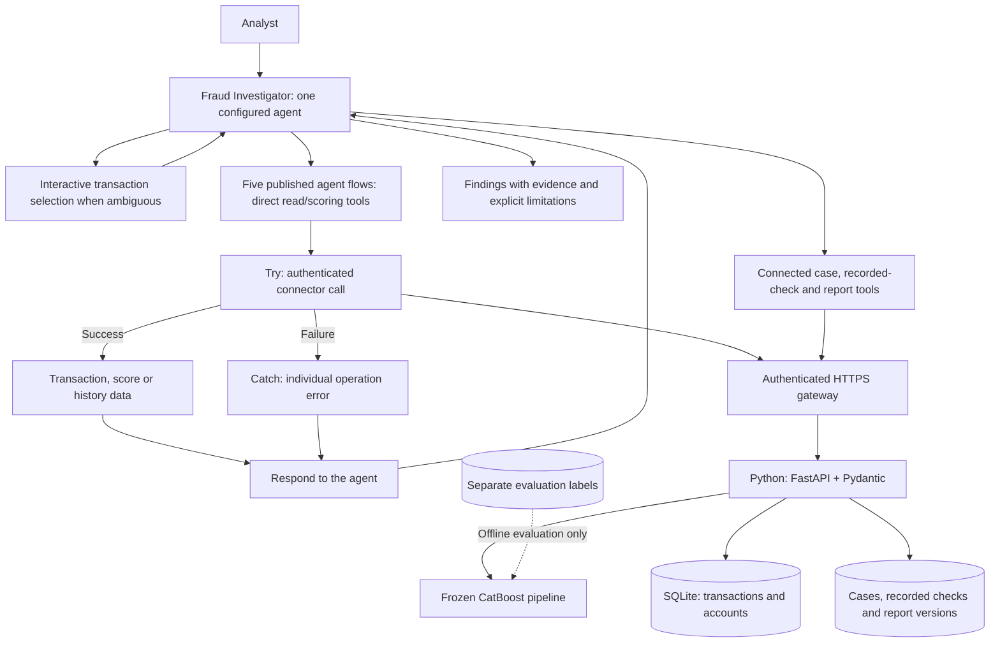

# Agentic Fraud Investigation

An AI engineering portfolio project combining **Microsoft Copilot Studio agents, machine learning and evidence-based investigation** on 6.3 million synthetic PaySim transactions.

## Demo

Transaction lookup, recipient history and frozen CatBoost scoring in Copilot Studio, followed by an explanation of the alert decision. Recorded with synthetic PaySim data; pauses are shortened and playback is accelerated.

## Investigation workflow

An analyst supplies a transaction ID or an account-history request. The currently configured **Fraud Investigator** agent handles the conversation, selects backend tools, interprets their results and can retrieve saved investigations. Interactive transaction selection resolves ambiguous references. A separate coordinator/investigator pair remains planned.

## Current integration architecture

**Agent:** chooses relevant operations, preserves available results and distinguishes facts, model alerts and hypotheses.

**Agent flows:** execute connector calls and catch individual failures before returning data to the agent. A combined lookup and a combined scoring request each retained the valid result alongside a transaction-not-found error in owner-supplied manual tests. Five flows are published; the direct-account history flow still needs its missing response payload resolved.

**Python backend:** validates inputs, enforces history bounds, runs the frozen model and stores case-linked evidence. Agents use defined operations rather than arbitrary SQL or direct database access. Direct lookup/scoring/history calls do not persist investigation checks; saved evidence uses the separate recorded-check routes.

### Agent tool interface

| Tool group | Responsibility | Backend operation |
| --- | --- | --- |
| Transaction lookup | Facts and source provenance | `GET /transactions/{id}` |
| Direct scoring | Frozen suspicion score, threshold and alert | `POST /score` |
| Anchored account histories | Both account roles strictly before the transaction step | `GET /transactions/{id}/sender-history`, `/recipient-history` |
| Direct account history | Both roles with an explicit cutoff | `GET /accounts/{account_id}/transactions` |
| Case discovery and management | Find saved investigations by transaction, create or read a case | `GET /cases?transaction_id=...`, `POST /cases`, `GET /cases/{id}` |
| Recorded checks | Execute and retain transaction, score or history evidence | `POST /cases/{id}/runs`, run-reading routes |
| Versioned reports | Save and retrieve factual JSON/Markdown snapshots | `POST /cases/{id}/reports`, report-reading routes |

Each recorded check has a stable execution ID. Report facts cite those IDs. Histories exclude the anchor step and expose truncation; evaluation labels are inaccessible to investigation tools.

### Integration acceptance and remaining work

Owner-supplied manual tests demonstrate case creation, four recorded checks, saved reports, recovery of a case/report in a fresh conversation, interactive selection and rejection of fabricated evidence. Backend guarantees and cloud acceptance remain distinct: chat text alone does not establish that no additional writes occurred.

Lookup and scoring flows passed combined success/failure tests. Anchored histories returned the expected bounded results in a combined test. Direct-account history returned no usable payload in that test despite publication and remains open. Flow-level error handling for case/report operations, PDF export, and separate-agent delegation are not implemented. Flow definitions are configured in the owner's environment and have not been exported as a deployable solution here.

[Flow setup, Run after rules and acceptance record](docs/COPILOT_FLOWS.md) · [Gateway setup](docs/COPILOT_REST.md) · [Saved investigation contracts](docs/COPILOT_CASES.md)

## Machine learning results

**13 models compared** over five temporal walk-forward validation windows, followed by feature engineering and CatBoost tuning. The selected features combine transaction type, amount, sender balance, cyclic hour, balance share and prior recipient activity.

Final temporal test: **298,584 transactions**, including **2,592 frauds**.

| Precision | Recall | F1 | Frauds detected | False alerts |
| --- | --- | --- | --- | --- |
| **98.69%** | **84.49%** | **0.9104** | **2,190** | **29** |

These results describe synthetic PaySim data. A suspicion score supports investigation rather than confirming fraud. [Evaluation and limitations](docs/ML_FINAL_REPORT.md).

## Stack

Python · Polars · CatBoost · FastAPI · Pydantic · SQLite · Microsoft Copilot Studio · Agent flows / Power Automate

[Data analysis](docs/EDA.md) · [API contracts](docs/API.md) · [Reproduce the project](docs/REPRODUCING.md)
