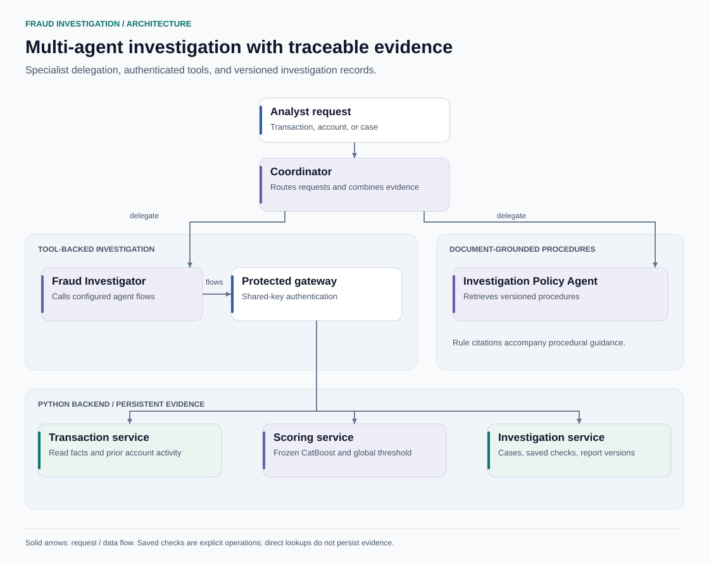

# Agentic Fraud Investigation

A multi-agent investigation system built with **Microsoft Copilot Studio**, combining specialist delegation, tool-backed transaction evidence, and document-grounded policy guidance.

A Coordinator routes analyst requests to a **Fraud Investigator** and an **Investigation Policy Agent**, then combines their responses. The Investigator calls authenticated Python APIs for transaction lookup, account history, ML scoring, and saved case operations. The Policy Agent retrieves versioned procedures with rule citations.

## Agent responsibilities

| Agent | Role | Evidence source |
| --- | --- | --- |
| Coordinator | Select specialists, transfer identifiers and scope, synthesize their responses | Specialist responses and conversation context |
| Fraud Investigator | Retrieve operational evidence and perform explicitly requested investigation operations | Authenticated flows, transaction services, model scores, saved checks |
| Investigation Policy Agent | Explain procedures and human-handoff criteria with citations | Versioned investigation, scoring, evidence, and handoff documents |

Separating execution from procedure lets the system answer a policy question without accessing transactions, or combine both specialists for a mixed investigation request.

## How the agents collaborate

For a request such as **“Score this transaction and explain which investigation steps apply”**, the Coordinator follows a documented evidence-to-procedure workflow:

1. Pass the transaction identifier and requested scope to the Fraud Investigator.
2. Retrieve the score through the authenticated scoring tool, including the threshold, alert flag, model version, and policy version.
3. Transfer that evidence, or its explicit failure state, to the Investigation Policy Agent for the applicable procedure and rule citations.
4. Synthesize the operational findings and cited guidance while preserving missing evidence and the analyst's requested scope.

This request does not authorize a saved case. Case creation, recorded checks, and report generation are separate, explicitly requested operations. The [routing reference](docs/coordinator/evaluation/routing-reference.csv) makes these delegation and tool-use boundaries inspectable.

## Demonstration

Transaction lookup, recipient history, frozen model scoring, and alert interpretation in Copilot Studio. The recording uses synthetic PaySim data, with shortened pauses and accelerated playback.


## System architecture



[Diagram source](docs/visuals/visual_spec.json)

The coordinator routes requests by scope. The investigator calls bounded tools; the policy agent retrieves procedural guidance. Direct lookup and scoring do not create a case automatically.

| Contract | Implementation |
| --- | --- |
| Historical evidence | Account activity at steps strictly earlier than the requested cutoff |
| Label isolation | Evaluation labels stored separately from the application database |
| Recorded checks | Stable execution IDs attached to saved cases |
| Report provenance | Versioned JSON/Markdown snapshots referencing recorded checks |
| Tool access | Validated HTTP operations rather than arbitrary SQL |
| Model identity | Frozen manifest and pipeline fingerprint |

[API contracts](docs/API.md) · [Gateway](docs/COPILOT_REST.md) · [Saved investigations](docs/COPILOT_CASES.md)

## Agent orchestration and evaluation

The coordinator configuration preserves identifiers, request scope, and returned evidence across handoffs. Missing inputs trigger clarification. Technical failures remain distinct from successful lookups with no matching records. Saved investigation writes require an explicit request and stable retry keys.

The repository includes **20 independent evaluation scenarios**: five policy questions, five operational requests, five mixed requests, and five clarification or capability-boundary requests. Routing references identify required, optional, and forbidden agents. Answer correctness, task completion, and trace-level routing are evaluated separately; the scenario count is not a measured pass rate.

[Coordinator instructions and evaluation suite](docs/coordinator/README.md) · [Policy knowledge](docs/policy_agent/README.md) · [Agent flows](docs/COPILOT_FLOWS.md)

## Fraud-scoring tool: recorded result

A frozen CatBoost model was evaluated on **298,584 synthetic PaySim transactions**, including **2,592 frauds**, from steps 505–743.

| Precision | Recall | F1 | Detected frauds | False alerts |
| ---: | ---: | ---: | ---: | ---: |
| 98.69% | 84.49% | 0.9104 | 2,190 | 29 |

The threshold, **0.312318**, was selected before final testing. These are results on synthetic transactions; the score supports investigation and does not establish that a real transaction is fraudulent.

[Evaluation record](docs/results/ml_final_test.json) · [Frozen configuration](docs/results/ml_final_manifest.json) · [Detailed evaluation](docs/ML_FINAL_REPORT.md)


## Experimental protocol

Thirteen candidate models were compared over five walk-forward windows before feature experiments and tuning. The retained representation uses transaction type, amount, sender starting balance, cyclic hour, balance share, and the recipient's strictly earlier reception count.

| Final stage | PaySim steps | Role |
| --- | --- | --- |
| Fit | 1–360 | Estimate model parameters |
| Threshold | 361–432 | Select the F1 operating point |
| Selection reserve | 433–504 | Compare development choices |
| Final test | 505–743 | Evaluate the frozen policy |

The final test contains 272 transactions in steps 721–743, all labeled fraudulent. The [period-level results](docs/results/ml_final_test.json) retain this simulator-specific composition.

## Reproduce

Requires Python 3.11–3.13 and uv.

```bash
uv sync --locked
uv run --locked python -m unittest discover -s tests -v
```

Follow [Reproducing](docs/REPRODUCING.md) to download and verify PaySim, import the application and evaluation databases, and reconstruct the frozen model. Raw data and the trained binary are local artifacts.

After those steps:

```bash
uv run --locked python scripts/serve_api.py \
  --database data/app/fraud.sqlite \
  --model data/ml_final_catboost/pipeline.joblib \
  --manifest docs/results/ml_final_manifest.json
```

The local service exposes lookup, histories, scoring, cases, recorded checks, and reports. Copilot Studio configuration is documented separately in the [coordinator guide](docs/coordinator/README.md) and [flow guide](docs/COPILOT_FLOWS.md).

## Technical documentation

[Data audit](docs/DATA_AUDIT.md) · [Exploratory analysis](docs/EDA.md) · [Model benchmark](docs/ML_BENCHMARK.md) · [Database](docs/DATABASE.md) · [Policy corpus](docs/policy_agent/README.md)
