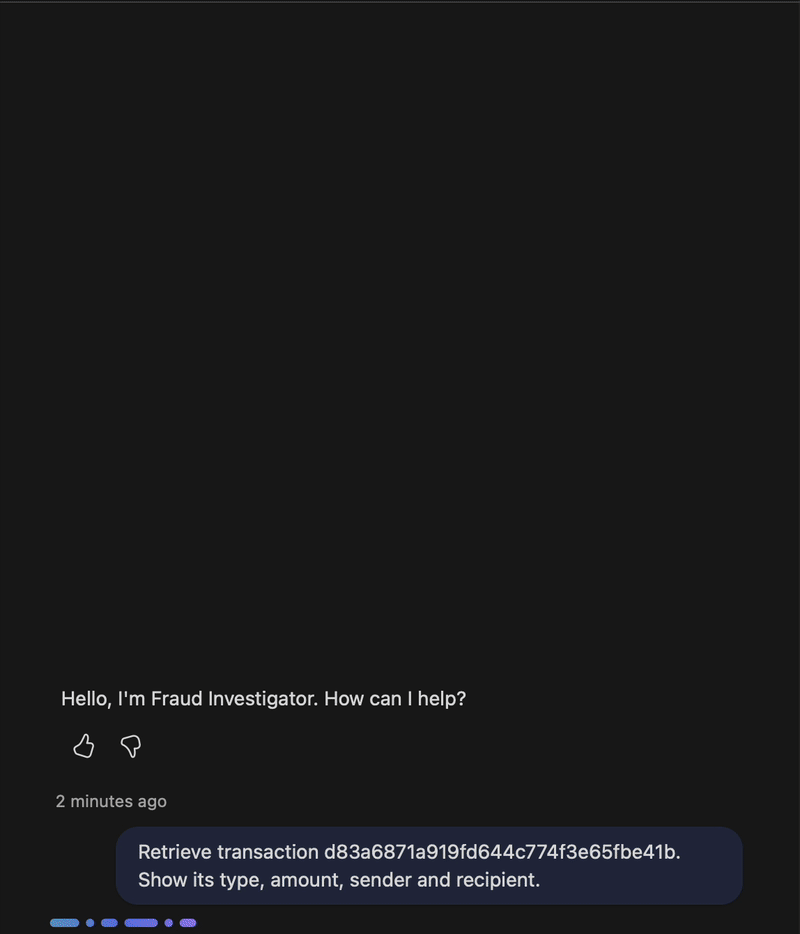
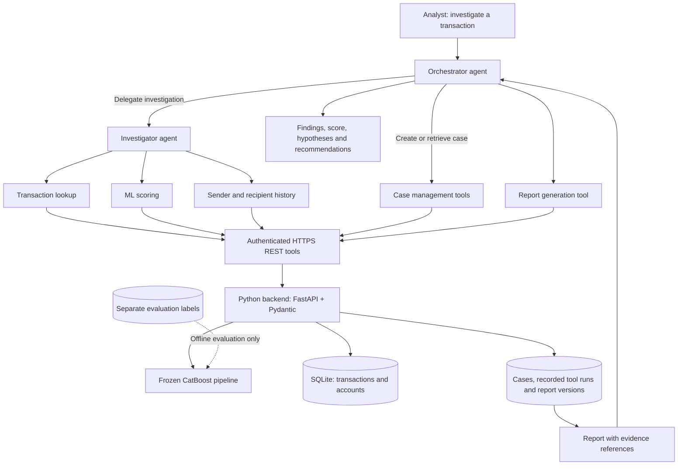

# Agentic Fraud Investigation

An AI engineering portfolio project combining **Microsoft Copilot Studio agents, machine learning and evidence-based investigation** on 6.3 million synthetic PaySim transactions.

## Demo

Transaction lookup, recipient history and frozen CatBoost scoring in Copilot Studio, followed by an explanation of the alert decision. Recorded with synthetic PaySim data; pauses are shortened and playback is accelerated.

## Investigation workflow

An analyst supplies a transaction ID. An **orchestrator** coordinates the investigation and an **investigator** examines the transaction using backend tools. The workflow retrieves the facts, calculates a suspicion score, checks account histories and produces a report with references to the evidence behind its findings.

## End-to-end architecture

**Orchestrator:** handles the conversation, coordinates the case, delegates analysis and presents the report.

**Investigator:** selects relevant checks, interprets their results and distinguishes observed facts from hypotheses.

**Python backend:** validates requests, enforces query limits, runs the frozen model and stores tool results. Agents use defined API operations rather than arbitrary SQL or direct database access.

### Agent tool interface

| Tool | Responsibility | Backend operation |
| --- | --- | --- |
| Transaction lookup | Retrieve facts and source provenance | `GET /transactions/{id}` |
| Case management | Create or retrieve the investigation | `POST /cases`, `GET /cases/{id}` |
| Recorded transaction check | Preserve retrieved facts as evidence | `POST /cases/{id}/runs`: `transaction` |
| Fraud scoring | Run CatBoost with the fixed decision threshold | Same endpoint: `score` |
| Sender history | Examine earlier activity of the sender | Same endpoint: `sender_history` |
| Recipient history | Examine earlier activity of the recipient | Same endpoint: `recipient_history` |
| Investigation notes | Save comments separately from backend evidence | `POST /cases/{id}/events` |
| Report generation | Save and retrieve versioned JSON/Markdown reports | `POST /cases/{id}/reports`, report-reading routes |

Each recorded check has a stable execution ID. Report facts cite those IDs. Histories exclude the current step and respect response limits; unavailable tools remain visible in the report. Evaluation labels are inaccessible to investigation tools.

The diagram defines the complete agent architecture. Authenticated lookup, frozen scoring and account-history tools are connected in Copilot Studio. The demo shows transaction lookup, recipient history and scoring; sender history has also been checked manually. Direct account history is available with a specified cutoff. Protected case/check/report tools and an English Swagger export are ready for manual connection. Case/report integration in Copilot Studio and agent delegation remain to be completed.

## Machine learning results

**13 models compared** over five temporal walk-forward validation windows, followed by feature engineering and CatBoost tuning. The selected features combine transaction type, amount, sender balance, cyclic hour, balance share and prior recipient activity.

Final temporal test: **298,584 transactions**, including **2,592 frauds**.

| Precision | Recall | F1 | Frauds detected | False alerts |
| --- | --- | --- | --- | --- |
| **98.69%** | **84.49%** | **0.9104** | **2,190** | **29** |

These results describe synthetic PaySim data. A suspicion score supports investigation rather than confirming fraud. [Evaluation and limitations](docs/ML_FINAL_REPORT.md).

## Stack

Python · Polars · CatBoost · FastAPI · Pydantic · SQLite · Microsoft Copilot Studio

[Data analysis](docs/EDA.md) · [API contracts](docs/API.md) · [Reproduce the project](docs/REPRODUCING.md)
