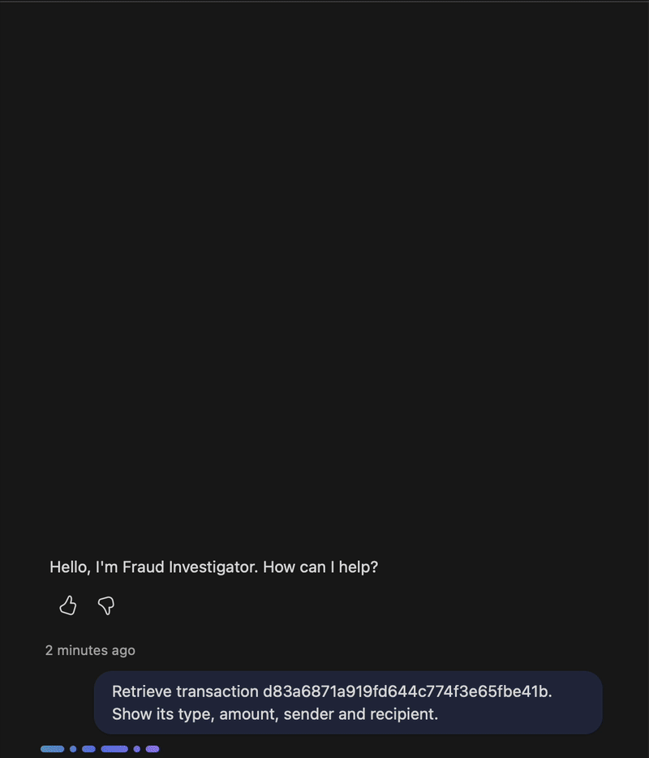
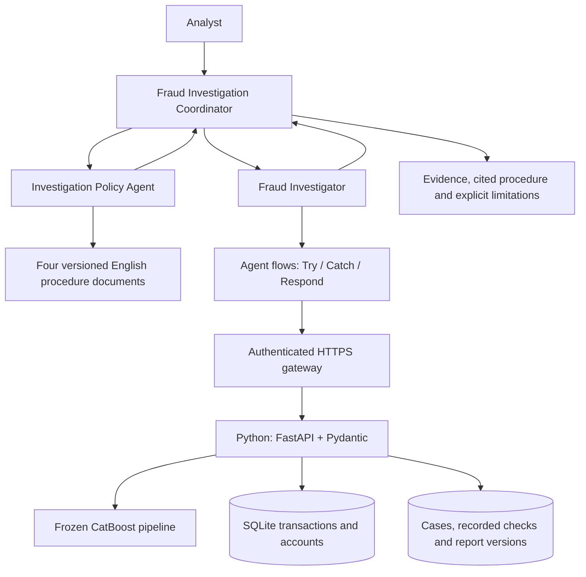

# Agentic Fraud Investigation

An AI engineering portfolio project combining **Microsoft Copilot Studio agents, machine learning and evidence-based investigation** on 6.3 million synthetic PaySim transactions.

## Demo

Transaction lookup, recipient history and frozen CatBoost scoring in Copilot Studio, followed by an explanation of the alert decision. Recorded with synthetic PaySim data; pauses are shortened and playback is accelerated.

## Investigation workflow

An analyst supplies a transaction ID, an account-history request or a procedural question. The **Fraud Investigation Coordinator** routes work to **Fraud Investigator** for tool-backed evidence and **Investigation Policy Agent** for cited prototype procedures, then synthesizes the results in English. Requests retain their original scope: a direct score does not automatically create a saved investigation.

## Current integration architecture

**Coordinator:** selects specialists, passes the requested scope and exact identifiers, and separates facts from procedural interpretation.

**Policy Agent:** retrieves four v1.0.0 documents covering investigation scope, scoring interpretation, incomplete evidence and human handoff. It explains procedures without operational tools.

**Investigator and flows:** call authenticated backend operations and return individual results or explicit errors. The backend validates inputs, enforces history bounds and stores requested case-linked evidence. Agents cannot run arbitrary SQL. Direct lookup/scoring/history calls do not persist recorded investigation checks.

[Coordinator configuration and 20-case evaluation suite](docs/coordinator/README.md) · [Policy knowledge corpus](docs/policy_agent/README.md)

### Agent tool interface

| Tool group | Responsibility | Backend operation |
| --- | --- | --- |
| Transaction lookup | Facts and source provenance | `GET /transactions/{id}` |
| Direct scoring | Frozen suspicion score, threshold and alert | `POST /score` |
| Anchored account histories | Both account roles strictly before the transaction step | `GET /transactions/{id}/sender-history`, `/recipient-history` |
| Direct account history | Both roles with an explicit cutoff | `GET /accounts/{account_id}/transactions` |
| Case discovery and management | Find saved investigations by transaction, create or read a case | `GET /cases?transaction_id=...`, `POST /cases`, `GET /cases/{id}` |
| Recorded checks | Execute and retain transaction, score or history evidence | `POST /cases/{id}/runs`, run-reading routes |
| Versioned reports | Save and retrieve factual JSON/Markdown snapshots | `POST /cases/{id}/reports`, report-reading routes |

Each recorded check has a stable execution ID. Report facts cite those IDs. Histories exclude the anchor step and expose truncation; evaluation labels are inaccessible to investigation tools.

### Demonstrated workflows

Owner-supplied manual results demonstrate direct account history, case creation, four recorded checks, versioned report retrieval and idempotent retries returning the same identifiers without additional records in the final listings. The nullable recorded-check response mismatch was resolved by omitting absent optional fields from gateway responses.

Interactive multiagent examples combine scoring evidence with procedural guidance. Policy responses distinguish a non-alert from proof of legitimacy and a successful empty history from a failed operation. Clarification examples preserve missing identifiers and cutoff requirements. These observations describe prototype behavior; chat responses alone do not prove execution traces or production reliability.

The repository includes configuration references and a 20-question coordinator evaluation suite. Live agent and flow definitions remain configured in the owner's environment rather than exported as a deployable solution.

[Coordinator setup and evaluation](docs/coordinator/README.md) · [Flow setup and historical acceptance record](docs/COPILOT_FLOWS.md) · [Gateway setup](docs/COPILOT_REST.md) · [Saved investigation contracts](docs/COPILOT_CASES.md)

## Machine learning results

**13 models compared** over five temporal walk-forward validation windows, followed by feature engineering and CatBoost tuning. The selected features combine transaction type, amount, sender balance, cyclic hour, balance share and prior recipient activity.

Final temporal test: **298,584 transactions**, including **2,592 frauds**.

| Precision | Recall | F1 | Frauds detected | False alerts |
| --- | --- | --- | --- | --- |
| **98.69%** | **84.49%** | **0.9104** | **2,190** | **29** |

These results describe synthetic PaySim data. A suspicion score supports investigation rather than confirming fraud. [Evaluation and limitations](docs/ML_FINAL_REPORT.md).

## Stack

Python · Polars · CatBoost · FastAPI · Pydantic · SQLite · Microsoft Copilot Studio · Agent flows / Power Automate

[Data analysis](docs/EDA.md) · [API contracts](docs/API.md) · [Reproduce the project](docs/REPRODUCING.md)
