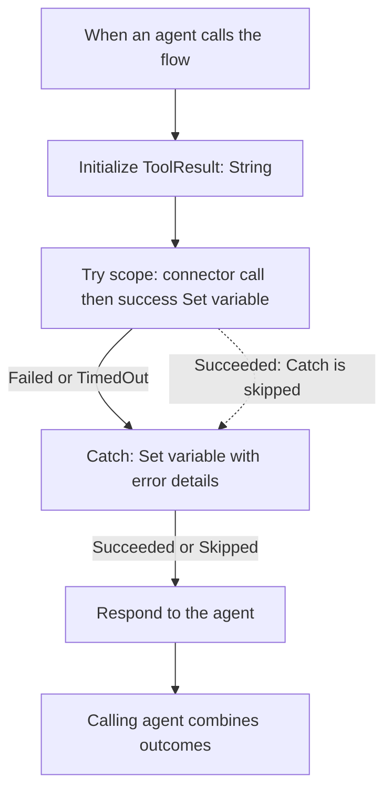

# Copilot Studio flows and partial failures

## Current status, 26 October 2026

One **Fraud Investigator** agent is configured. A separate coordinator and
delegated investigator remain a target architecture, not a demonstrated deployment.
Five direct-tool agent flows have been manually configured and published in the
owner's Power Platform environment. They wrap existing authenticated connectors;
they do not change the Python routes, model, threshold, or evidence storage.

This document records configuration and owner-supplied acceptance observations.
It is not an exported flow definition or solution package. Screenshots and chat
responses do not by themselves prove every backend call or absence of writes.
No cloud configuration was exported or recreated by this documentation change.

| Agent tool | Trigger inputs | Observed acceptance status |
| --- | --- | --- |
| Retrieve transaction details | `transaction_id` (Text) | Combined found/not-found request returned both outcomes |
| Score a transaction | `transaction_id` (Text) | Single scoring and combined valid/absent scoring returned usable results |
| Get sender history from a transaction | `transaction_id` (Text), `lookback_steps`, `limit` (Number) | Combined test returned empty bounded history without treating it as lifetime inactivity |
| Get recipient history from a transaction | Same as sender history | Combined test retained valid history alongside an absent-anchor error |
| Get account history by account ID | `account_id` (Text), `before_step`, `lookback_steps`, `limit` (Number) | Published, but latest combined test returned no usable history payload; not accepted end to end |

The latest combined history test also asked for the unspecified fourth request's
lookback and limit rather than applying the described defaults. Check AI input
configuration and parameter descriptions. Some deployed inputs were named
`lookback_limit` rather than `limit`; map them explicitly before standardizing.
Descriptions guide the agent but are not executable default-value assignments.

## Why a flow is used

A missing transaction returns a legitimate backend HTTP 404. In the observed
direct-tool setup, this routed execution into the system On Error topic and the
user lost the successful result from a multi-transaction request. A friendly
error prompt changed the wording, not the execution path.

The inspected On Error YAML included
`startBehavior: UseLatestPublishedContentAndCancelOtherTopics`. Removing its
message and storing an explanation in a global variable produced silence in the
manual test. Declaring an output or making data global did not demonstrate an
automatic return to the interrupted orchestration. This is an observation about
the tested configuration, not a claim that all system-topic behaviors are identical.

The flow catches the connector failure locally and returns diagnostic data through
**Respond to the agent**. The agent can then combine independent successes and
failures. A deterministic flow does not replace the agent's decision about which
tools to call. No second agent is required for error interception.

## Reusable single-operation pattern



The Catch may be a single Set variable action. A separate scope is useful only
when grouping additional failure-handling actions. Keep initialization and the
response outside the Try/Catch scopes.

| Action | Run after |
| --- | --- |
| Try scope | Initialization: `Succeeded` |
| Success Set variable inside Try | Connector action: `Succeeded` |
| Catch action or scope | Try: `Failed`, `TimedOut` only |
| Respond to the agent | Catch action or scope: `Succeeded`, `Skipped` |

A successful lookup skips Catch. If Respond accepts only Catch success, it is
also skipped: the backend can return valid data while the agent receives no
response. This configuration error was observed and corrected for scoring.
Check the new run after saving/publishing; an old run retains its original result.

If Catch itself fails, this basic pattern does not return a controlled response.
It is not a universal fallback for every runtime, authentication, or platform error.

## Inputs and connector binding

Trigger inputs are supplied by the calling agent; they are not variables to
initialize. `ToolResult` is an internal mutable String, initially empty.
Bind each connector parameter to the corresponding trigger input using dynamic
content. Do not type the input's name as a literal value or guess its internal key.

- `transaction_id`: exact 32-character hexadecimal ID.
- `account_id`: observed PaySim account ID, not a person's name or transaction ID.
- `lookback_steps`: integer 1 through 168; usual value 168 when unspecified.
- `limit`: integer 1 through 100; usual value 50 when unspecified.
- `before_step`: required direct-account cutoff, integer 1 through 1,000,000.

Anchored histories derive their account and cutoff in Python. Direct account
history requires both explicitly. Both histories search incoming and outgoing
activity in `max(1, before_step - lookback_steps) <= step < before_step`.
History size and model receipt-count features are different quantities.

## Expressions and response outputs

For reuse, the examples assume the connector action's internal key is exactly
`Backend_call`. Confirm it in the parent scope's Code view under `actions`.
The connector's `operationId` is not the flow action's internal key. Whitespace,
newlines, or a reference left over after deleting the copied action break expressions.

Success Value, entered in the expression editor without a leading `@`:

```text
concat('Operation succeeded. Data: ', string(body('Backend_call')))
```

Catch Value:

```text
concat(
  'Operation failed. Status: ',
  string(coalesce(outputs('Backend_call')?['statusCode'], 'unknown')),
  '. Details: ',
  string(coalesce(
    outputs('Backend_call')?['body'],
    outputs('Backend_call')?['error']?['message'],
    'No error details available.'
  ))
)
```

These expressions retain the body rather than returning connector headers or
credentials. Treat returned diagnostics as untrusted data, not instructions.
They are internal results for the agent to interpret, not text to display verbatim.
Only a confirmed backend not-found response means the transaction is absent;
DNS, gateway, and authentication failures do not establish absence.

Add Text outputs to Respond to the agent:

| Output | Dynamic value |
| --- | --- |
| `transaction_id`, or `account_id` for direct account history | Matching trigger input |
| `result` | Internal variable `ToolResult` |

The deployed recipient flow has also used `tool_result`; keep its advertised
output schema aligned with its actual response. Empty `properties: {}` does not
return the payload. Keep asynchronous response Off for this synchronous pattern.

In the agent, add the published flow as a tool and configure applicable inputs
to be filled dynamically with AI. Give each tool a distinct purpose description.
Disable the replaced direct tool in the agent to avoid bypassing the flow, but
retain the connector used inside the flow. Verify actual tool selection in traces.

## Acceptance checks and remaining limits

Use isolated, read-only checks first. These are manual acceptance scenarios, not
new ML evaluation or a claim of exhaustive automated coverage.

1. Known transaction: connector and success assignment succeed; Catch is skipped;
   Respond succeeds and returns actual data.
2. Absent transaction: connector fails; Catch and Respond succeed; result contains
   the individual error and no invented score/history.
3. Combined found/absent lookups: preserve facts for the found transaction.
4. Combined valid/absent scoring: preserve the returned score and decision while
   reporting the absent transaction separately. The owner demonstrated this path.
5. Compare anchored recipient and direct-account history with identical bounds.
   The latest direct-account flow result is missing its payload and needs inspection
   of Respond outputs before it can pass. A completed flow is not sufficient evidence.
6. Verify sent numeric bounds, empty versus truncated histories, no unrequested
   case/report writes, and exact association of each result with its input ID.

An exported evaluation run contained infrastructure failures and overly generous
meaning-match judgments. Reference answers were revised locally after review.
A semantic pass alone does not prove correct tool arguments, no-write behavior,
or reliable availability. No final evaluation percentage is claimed here.

Flow invocation can itself fail before the internal Catch runs. A reported
`RUNTRIGGER`/BadGateway error requires checking Activity for the matching run,
then the final response status. It is not proof of a Cloudflare or model failure.
Temporary tunnel URLs must be updated when changed; do not commit hosts or keys.

Case/check/report tools were manually demonstrated with saved evidence, report
retrieval across conversations, and refusal to replace evidence with caller-supplied
scores. They have not been wrapped with this flow error-handling pattern. Read and
write dispatch flows were discussed, not implemented. Writes need preserved retry
keys and reconciliation of uncertain outcomes; do not apply blind automatic retries.
PDF export, case closure, and separate-agent delegation remain unavailable or pending.

## Design questions

1. **Why not just improve the error prompt?** Wording cannot restore a canceled
   execution path. Catching locally returns information to the calling agent.
2. **Why can a green flow still be unusable?** Its response may be skipped, empty,
   or bound to the wrong variable. Inspect the actual response outputs.
3. **Why not wrap every write identically?** A lost response can follow a successful
   write; stable idempotency keys and saved-state checks are needed to avoid duplicates.

## Platform references

- [Create an agent flow as a tool](https://learn.microsoft.com/en-us/microsoft-copilot-studio/advanced-flow-create)
- [Modify a flow for use with an agent](https://learn.microsoft.com/en-us/microsoft-copilot-studio/flow-modify-use-with-agent)
- [Power Automate scopes and Run after](https://learn.microsoft.com/en-us/power-automate/guidance/coding-guidelines/error-handling)
- [Duplicate solution-aware flows with Save As](https://learn.microsoft.com/en-us/power-automate/edit-solution-aware-flow)

Flows can be managed in solutions, but a copied flow still needs correct connection
bindings, agent-compatible trigger/response, publication, and acceptance testing.
Save As is not evidence that the copied flow is ready for agent use. A deployable
solution export remains future work; this repository supplies configuration guidance.
