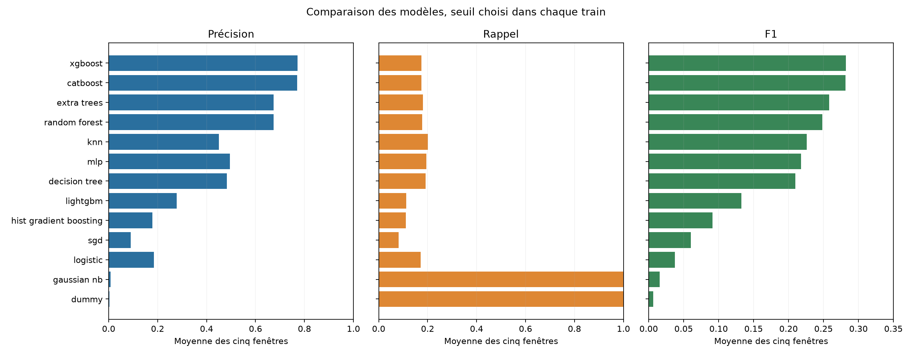
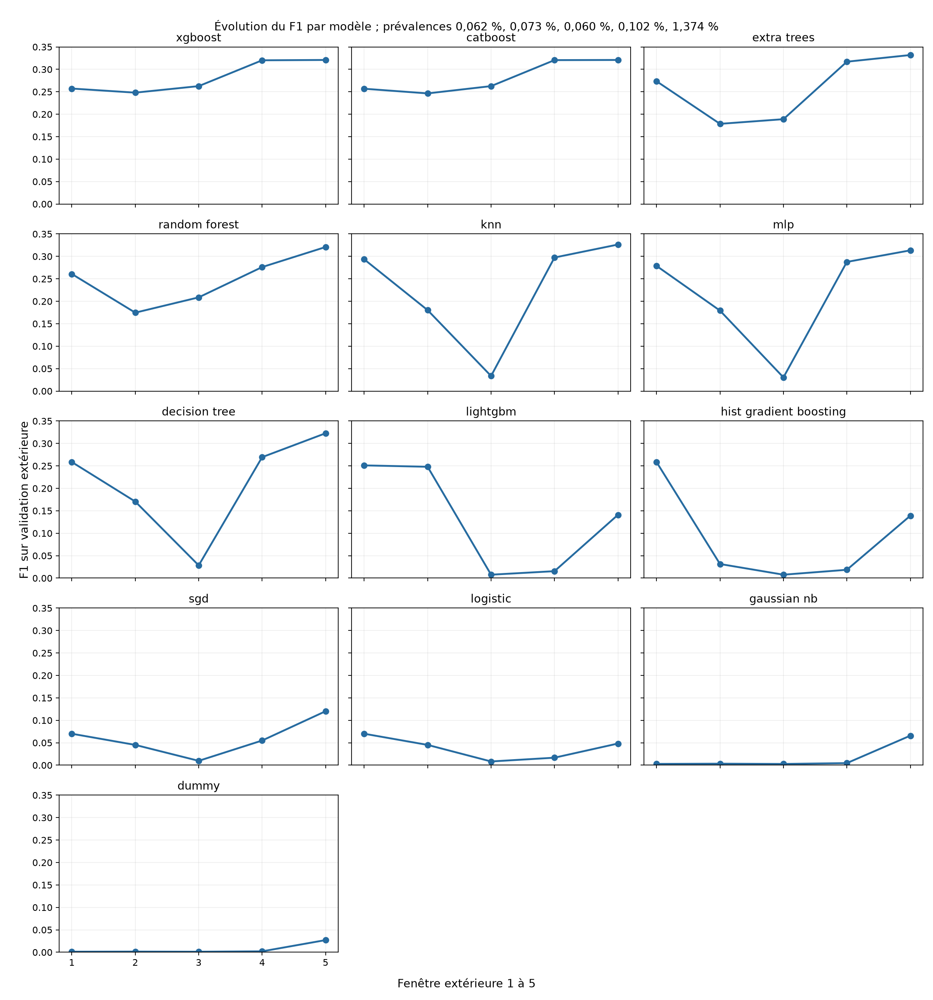

# Lot 4.2 : première comparaison des modèles PaySim

Les métriques proviennent exclusivement des validations extérieures 145 à 504. Le test 505 à 743 n'a pas été lu pour la comparaison. Chaque seuil maximise le F1 sur la réserve chronologique interne du train, avant le calcul des métriques extérieures. Le [protocole](ML_PROTOCOL.md) fixe les bornes et les règles de sélection.

## Moyennes sur les cinq fenêtres

Les moyennes ci-dessous sont arithmétiques et non pondérées. Les modèles incomplets n'y figurent pas.

| Modèle | Précision | Rappel | F1 | F1 minimum | Écart-type F1 | Temps médian d'ajustement | FP cumulés | FN cumulés |
| --- | ---: | ---: | ---: | ---: | ---: | ---: | ---: | ---: |
| xgboost | 0.7714 | 0.1752 | 0.2818 | 0.2481 | 0.0357 | 2.0 s | 288 | 3,289 |
| catboost | 0.7697 | 0.1750 | 0.2814 | 0.2464 | 0.0363 | 11.5 s | 287 | 3,290 |
| extra_trees | 0.6738 | 0.1807 | 0.2580 | 0.1786 | 0.0712 | 8.4 s | 1,107 | 3,263 |
| random_forest | 0.6745 | 0.1778 | 0.2483 | 0.1747 | 0.0574 | 45.7 s | 1,282 | 3,276 |
| knn | 0.4508 | 0.2012 | 0.2263 | 0.0336 | 0.1213 | 1.3 s | 9,354 | 3,187 |
| mlp | 0.4960 | 0.1948 | 0.2179 | 0.0304 | 0.1166 | 20.5 s | 10,587 | 3,214 |
| decision_tree | 0.4831 | 0.1917 | 0.2100 | 0.0284 | 0.1153 | 2.7 s | 11,236 | 3,227 |
| lightgbm | 0.2783 | 0.1133 | 0.1327 | 0.0077 | 0.1191 | 1.8 s | 24,430 | 3,540 |
| hist_gradient_boosting | 0.1784 | 0.1103 | 0.0910 | 0.0076 | 0.1074 | 6.4 s | 31,027 | 3,552 |
| sgd | 0.0899 | 0.0809 | 0.0600 | 0.0097 | 0.0403 | 1.4 s | 16,059 | 3,665 |
| logistic | 0.1853 | 0.1711 | 0.0377 | 0.0083 | 0.0251 | 0.3 s | 76,749 | 3,281 |
| gaussian_nb | 0.0082 | 0.9993 | 0.0159 | 0.0028 | 0.0279 | 0.2 s | 1,980,630 | 3 |
| dummy | 0.0033 | 1.0000 | 0.0066 | 0.0012 | 0.0115 | 0.0 s | 4,550,450 | 0 |

**Choix provisoire selon la règle préannoncée de phase 1 : `xgboost`.** Il ne clôt pas l'analyse des résultats ni les expériences d'approfondissement.

- F1 moyen à moins de 0,005 du meilleur : xgboost, catboost
- F1 minimum à moins de 0,005 du meilleur : xgboost, catboost
- Écart-type à moins de 0,005 du meilleur : xgboost, catboost
- Temps médian à moins de 20 % du plus court : xgboost
- Taille à moins de 20 % de la plus petite : xgboost

La figure des moyennes a un axe horizontal propre à chaque métrique. Le F1 est agrandi pour rendre lisibles ses écarts ; il ne faut pas comparer la longueur d'une barre entre panneaux sans lire l'échelle.

Les petits panneaux utilisent la même échelle de F1. Les numéros 1 à 5 suivent l'ordre chronologique ; leurs prévalences sont indiquées dans le titre.

## Détail par modèle et fenêtre

`P` = précision, `R` = rappel. `FP` = normales alertées ; `FN` = fraudes manquées. La précision est reportée à 0 par convention si aucune alerte n'est émise.

| Modèle | Fenêtre | Transactions | Fraudes | Prévalence | Seuil interne | P | R | F1 | Alertes | FP | FN | Ajustement | Choix du seuil | Prédiction | Total |
| --- | ---: | ---: | ---: | ---: | ---: | ---: | ---: | ---: | ---: | ---: | ---: | ---: | ---: | ---: | ---: |
| dummy | 1 | 1,288,139 | 805 | 0.062 % | 0.000863606 | 0.0006 | 1.0000 | 0.0012 | 1,288,139 | 1,287,334 | 0 | 0.0 s | 0.0 s | 0.0 s | 1.2 s |
| dummy | 2 | 1,160,580 | 842 | 0.073 % | 0.00108108 | 0.0007 | 1.0000 | 0.0014 | 1,160,580 | 1,159,738 | 0 | 0.0 s | 0.0 s | 0.0 s | 0.4 s |
| dummy | 3 | 1,227,741 | 738 | 0.060 % | 0.000871061 | 0.0006 | 1.0000 | 0.0012 | 1,227,741 | 1,227,003 | 0 | 0.0 s | 0.0 s | 0.0 s | 0.4 s |
| dummy | 4 | 822,359 | 840 | 0.102 % | 0.000828383 | 0.0010 | 1.0000 | 0.0020 | 822,359 | 821,519 | 0 | 0.1 s | 0.0 s | 0.0 s | 0.4 s |
| dummy | 5 | 55,620 | 764 | 1.374 % | 0.000774577 | 0.0137 | 1.0000 | 0.0271 | 55,620 | 54,856 | 0 | 0.1 s | 0.0 s | 0.0 s | 0.4 s |
| logistic | 1 | 1,288,139 | 805 | 0.062 % | 0.00921173 | 0.0766 | 0.0646 | 0.0701 | 679 | 627 | 753 | 0.1 s | 0.0 s | 0.0 s | 0.6 s |
| logistic | 2 | 1,160,580 | 842 | 0.073 % | 0.022817 | 0.0452 | 0.0451 | 0.0452 | 840 | 802 | 804 | 0.2 s | 0.1 s | 0.0 s | 0.7 s |
| logistic | 3 | 1,227,741 | 738 | 0.060 % | 0.0128212 | 0.0044 | 0.0650 | 0.0083 | 10,818 | 10,770 | 690 | 0.3 s | 0.1 s | 0.0 s | 0.8 s |
| logistic | 4 | 822,359 | 840 | 0.102 % | 0.00203224 | 0.0085 | 0.6560 | 0.0167 | 65,096 | 64,545 | 289 | 0.4 s | 0.1 s | 0.0 s | 1.0 s |
| logistic | 5 | 55,620 | 764 | 1.374 % | 0.0127448 | 0.7917 | 0.0249 | 0.0482 | 24 | 5 | 745 | 0.6 s | 0.1 s | 0.0 s | 1.1 s |
| sgd | 1 | 1,288,139 | 805 | 0.062 % | 0.00811522 | 0.0766 | 0.0646 | 0.0701 | 679 | 627 | 753 | 0.4 s | 0.0 s | 0.0 s | 0.8 s |
| sgd | 2 | 1,160,580 | 842 | 0.073 % | 0.0165366 | 0.0452 | 0.0451 | 0.0452 | 840 | 802 | 804 | 0.7 s | 0.1 s | 0.0 s | 1.2 s |
| sgd | 3 | 1,227,741 | 738 | 0.060 % | 0.0134825 | 0.0052 | 0.0786 | 0.0097 | 11,209 | 11,151 | 680 | 1.4 s | 0.1 s | 0.0 s | 1.9 s |
| sgd | 4 | 822,359 | 840 | 0.102 % | 0.00988213 | 0.0342 | 0.1405 | 0.0550 | 3,454 | 3,336 | 722 | 2.1 s | 0.1 s | 0.0 s | 2.6 s |
| sgd | 5 | 55,620 | 764 | 1.374 % | 0.00802856 | 0.2886 | 0.0759 | 0.1202 | 201 | 143 | 706 | 2.7 s | 0.1 s | 0.0 s | 3.2 s |
| gaussian_nb | 1 | 1,288,139 | 805 | 0.062 % | 1 | 0.0014 | 1.0000 | 0.0028 | 564,750 | 563,945 | 0 | 0.1 s | 0.0 s | 0.1 s | 0.5 s |
| gaussian_nb | 2 | 1,160,580 | 842 | 0.073 % | 1 | 0.0017 | 1.0000 | 0.0033 | 503,279 | 502,437 | 0 | 0.1 s | 0.1 s | 0.1 s | 0.7 s |
| gaussian_nb | 3 | 1,227,741 | 738 | 0.060 % | 1 | 0.0014 | 1.0000 | 0.0028 | 535,132 | 534,394 | 0 | 0.2 s | 0.1 s | 0.1 s | 0.7 s |
| gaussian_nb | 4 | 822,359 | 840 | 0.102 % | 1 | 0.0023 | 0.9964 | 0.0047 | 358,982 | 358,145 | 3 | 0.2 s | 0.1 s | 0.1 s | 0.8 s |
| gaussian_nb | 5 | 55,620 | 764 | 1.374 % | 1 | 0.0340 | 1.0000 | 0.0658 | 22,473 | 21,709 | 0 | 0.3 s | 0.1 s | 0.0 s | 0.8 s |
| decision_tree | 1 | 1,288,139 | 805 | 0.062 % | 0.6 | 0.3401 | 0.2087 | 0.2587 | 494 | 326 | 637 | 0.9 s | 0.0 s | 0.0 s | 1.3 s |
| decision_tree | 2 | 1,160,580 | 842 | 0.073 % | 0.4 | 0.1556 | 0.1888 | 0.1706 | 1,022 | 863 | 683 | 1.3 s | 0.0 s | 0.0 s | 1.7 s |
| decision_tree | 3 | 1,227,741 | 738 | 0.060 % | 0.163636 | 0.0152 | 0.2100 | 0.0284 | 10,188 | 10,033 | 583 | 2.7 s | 0.0 s | 0.0 s | 3.2 s |
| decision_tree | 4 | 822,359 | 840 | 0.102 % | 0.572368 | 0.9048 | 0.1583 | 0.2695 | 147 | 14 | 707 | 4.8 s | 0.0 s | 0.0 s | 5.3 s |
| decision_tree | 5 | 55,620 | 764 | 1.374 % | 0.103659 | 1.0000 | 0.1924 | 0.3227 | 147 | 0 | 617 | 5.4 s | 0.0 s | 0.0 s | 5.8 s |
| random_forest | 1 | 1,288,139 | 805 | 0.062 % | 0.340031 | 0.3130 | 0.2236 | 0.2609 | 575 | 395 | 625 | 13.5 s | 0.3 s | 0.6 s | 14.8 s |
| random_forest | 2 | 1,160,580 | 842 | 0.073 % | 0.575881 | 0.1583 | 0.1948 | 0.1747 | 1,036 | 872 | 678 | 21.6 s | 0.6 s | 0.5 s | 23.2 s |
| random_forest | 3 | 1,227,741 | 738 | 0.060 % | 0.682202 | 1.0000 | 0.1165 | 0.2087 | 86 | 0 | 652 | 45.7 s | 0.6 s | 0.6 s | 47.2 s |
| random_forest | 4 | 822,359 | 840 | 0.102 % | 0.412838 | 0.9013 | 0.1631 | 0.2762 | 152 | 15 | 703 | 66.3 s | 0.6 s | 0.4 s | 68.3 s |
| random_forest | 5 | 55,620 | 764 | 1.374 % | 0.0993012 | 1.0000 | 0.1911 | 0.3209 | 146 | 0 | 618 | 94.2 s | 0.4 s | 0.0 s | 95.4 s |
| extra_trees | 1 | 1,288,139 | 805 | 0.062 % | 0.0535492 | 0.3797 | 0.2137 | 0.2734 | 453 | 281 | 633 | 2.1 s | 0.2 s | 0.5 s | 3.9 s |
| extra_trees | 2 | 1,160,580 | 842 | 0.073 % | 0.0992221 | 0.1684 | 0.1900 | 0.1786 | 950 | 790 | 682 | 3.6 s | 0.6 s | 0.5 s | 5.1 s |
| extra_trees | 3 | 1,227,741 | 738 | 0.060 % | 0.295874 | 1.0000 | 0.1043 | 0.1890 | 77 | 0 | 661 | 8.4 s | 0.6 s | 0.6 s | 10.0 s |
| extra_trees | 4 | 822,359 | 840 | 0.102 % | 0.065332 | 0.8209 | 0.1964 | 0.3170 | 201 | 36 | 675 | 10.3 s | 0.6 s | 0.4 s | 11.7 s |
| extra_trees | 5 | 55,620 | 764 | 1.374 % | 0.0519685 | 1.0000 | 0.1990 | 0.3319 | 152 | 0 | 612 | 14.5 s | 0.5 s | 0.0 s | 15.4 s |
| hist_gradient_boosting | 1 | 1,288,139 | 805 | 0.062 % | 0.831706 | 0.5938 | 0.1652 | 0.2585 | 224 | 91 | 672 | 2.3 s | 0.5 s | 1.3 s | 4.4 s |
| hist_gradient_boosting | 2 | 1,160,580 | 842 | 0.073 % | 0.0294603 | 0.0177 | 0.1437 | 0.0315 | 6,851 | 6,730 | 721 | 3.0 s | 1.2 s | 1.0 s | 5.7 s |
| hist_gradient_boosting | 3 | 1,227,741 | 738 | 0.060 % | 0.0330034 | 0.0039 | 0.1274 | 0.0076 | 23,873 | 23,779 | 644 | 6.4 s | 1.3 s | 1.3 s | 9.5 s |
| hist_gradient_boosting | 4 | 822,359 | 840 | 0.102 % | 0.0478519 | 0.0698 | 0.0107 | 0.0186 | 129 | 120 | 831 | 9.4 s | 1.2 s | 0.8 s | 12.0 s |
| hist_gradient_boosting | 5 | 55,620 | 764 | 1.374 % | 0.0212532 | 0.2067 | 0.1047 | 0.1390 | 387 | 307 | 684 | 10.5 s | 0.7 s | 0.0 s | 11.7 s |
| lightgbm | 1 | 1,288,139 | 805 | 0.062 % | 0.525025 | 0.4892 | 0.1689 | 0.2512 | 278 | 142 | 669 | 0.7 s | 0.4 s | 1.0 s | 2.5 s |
| lightgbm | 2 | 1,160,580 | 842 | 0.073 % | 0.624521 | 0.6515 | 0.1532 | 0.2481 | 198 | 69 | 713 | 1.0 s | 1.1 s | 0.9 s | 3.3 s |
| lightgbm | 3 | 1,227,741 | 738 | 0.060 % | 0.0343857 | 0.0039 | 0.1274 | 0.0077 | 23,811 | 23,717 | 644 | 1.8 s | 0.9 s | 0.9 s | 3.9 s |
| lightgbm | 4 | 822,359 | 840 | 0.102 % | 0.0455455 | 0.0415 | 0.0095 | 0.0155 | 193 | 185 | 832 | 2.7 s | 0.9 s | 0.6 s | 4.6 s |
| lightgbm | 5 | 55,620 | 764 | 1.374 % | 0.021286 | 0.2055 | 0.1073 | 0.1410 | 399 | 317 | 682 | 3.4 s | 0.6 s | 0.0 s | 4.4 s |
| xgboost | 1 | 1,288,139 | 805 | 0.062 % | 0.233496 | 0.4658 | 0.1776 | 0.2572 | 307 | 164 | 662 | 0.7 s | 0.1 s | 0.2 s | 1.4 s |
| xgboost | 2 | 1,160,580 | 842 | 0.073 % | 0.424987 | 0.6515 | 0.1532 | 0.2481 | 198 | 69 | 713 | 1.0 s | 0.3 s | 0.2 s | 1.9 s |
| xgboost | 3 | 1,227,741 | 738 | 0.060 % | 0.310148 | 0.9739 | 0.1518 | 0.2626 | 115 | 3 | 626 | 2.0 s | 0.3 s | 0.2 s | 2.9 s |
| xgboost | 4 | 822,359 | 840 | 0.102 % | 0.132578 | 0.7658 | 0.2024 | 0.3202 | 222 | 52 | 670 | 3.0 s | 0.3 s | 0.1 s | 3.8 s |
| xgboost | 5 | 55,620 | 764 | 1.374 % | 0.148221 | 1.0000 | 0.1911 | 0.3209 | 146 | 0 | 618 | 4.2 s | 0.2 s | 0.0 s | 4.8 s |
| catboost | 1 | 1,288,139 | 805 | 0.062 % | 0.276539 | 0.4718 | 0.1764 | 0.2568 | 301 | 159 | 663 | 4.2 s | 0.1 s | 0.1 s | 5.0 s |
| catboost | 2 | 1,160,580 | 842 | 0.073 % | 0.463857 | 0.6497 | 0.1520 | 0.2464 | 197 | 69 | 714 | 6.2 s | 0.2 s | 0.1 s | 6.8 s |
| catboost | 3 | 1,227,741 | 738 | 0.060 % | 0.333829 | 0.9739 | 0.1518 | 0.2626 | 115 | 3 | 626 | 11.5 s | 0.2 s | 0.1 s | 12.1 s |
| catboost | 4 | 822,359 | 840 | 0.102 % | 0.138796 | 0.7533 | 0.2036 | 0.3205 | 227 | 56 | 669 | 17.2 s | 0.2 s | 0.1 s | 17.8 s |
| catboost | 5 | 55,620 | 764 | 1.374 % | 0.170697 | 1.0000 | 0.1911 | 0.3209 | 146 | 0 | 618 | 25.8 s | 0.2 s | 0.0 s | 26.6 s |
| mlp | 1 | 1,288,139 | 805 | 0.062 % | 0.142173 | 0.3968 | 0.2149 | 0.2788 | 436 | 263 | 632 | 9.6 s | 0.1 s | 0.1 s | 11.0 s |
| mlp | 2 | 1,160,580 | 842 | 0.073 % | 0.25246 | 0.1725 | 0.1865 | 0.1792 | 910 | 753 | 685 | 12.5 s | 0.2 s | 0.0 s | 13.3 s |
| mlp | 3 | 1,227,741 | 738 | 0.060 % | 0.126408 | 0.0164 | 0.2154 | 0.0304 | 9,713 | 9,554 | 579 | 20.5 s | 0.1 s | 0.0 s | 21.2 s |
| mlp | 4 | 822,359 | 840 | 0.102 % | 0.206761 | 0.8944 | 0.1714 | 0.2877 | 161 | 17 | 696 | 24.8 s | 0.1 s | 0.0 s | 26.4 s |
| mlp | 5 | 55,620 | 764 | 1.374 % | 0.0781565 | 1.0000 | 0.1859 | 0.3135 | 142 | 0 | 622 | 31.7 s | 0.1 s | 0.0 s | 32.2 s |
| knn | 1 | 1,288,139 | 805 | 0.062 % | 0.28 | 0.4626 | 0.2149 | 0.2935 | 374 | 201 | 632 | 0.4 s | 8.3 s | 22.8 s | 31.9 s |
| knn | 2 | 1,160,580 | 842 | 0.073 % | 0.44 | 0.1715 | 0.1900 | 0.1803 | 933 | 773 | 682 | 0.6 s | 35.4 s | 31.9 s | 69.2 s |
| knn | 3 | 1,227,741 | 738 | 0.060 % | 0.2 | 0.0183 | 0.2087 | 0.0336 | 8,424 | 8,270 | 584 | 1.3 s | 44.3 s | 46.9 s | 93.6 s |
| knn | 4 | 822,359 | 840 | 0.102 % | 0.4 | 0.6014 | 0.1976 | 0.2975 | 276 | 110 | 674 | 1.7 s | 45.0 s | 34.9 s | 82.8 s |
| knn | 5 | 55,620 | 764 | 1.374 % | 0.24 | 1.0000 | 0.1950 | 0.3264 | 149 | 0 | 615 | 2.7 s | 47.3 s | 3.0 s | 54.4 s |

## Référence PaySim `isFlaggedFraud`

Cette règle fournie par le simulateur n'est jamais une entrée des modèles ni un candidat à sélectionner. Elle est évaluée directement sur les mêmes validations extérieures, sans seuil ajusté.

| Fenêtre | Précision | Rappel | F1 | Alertes | FP | FN |
| ---: | ---: | ---: | ---: | ---: | ---: | ---: |
| 1 | 1.0000 | 0.0012 | 0.0025 | 1 | 0 | 804 |
| 2 | 1.0000 | 0.0024 | 0.0047 | 2 | 0 | 840 |
| 3 | 0.0000 | 0.0000 | 0.0000 | 0 | 0 | 738 |
| 4 | 1.0000 | 0.0036 | 0.0071 | 3 | 0 | 837 |
| 5 | 0.0000 | 0.0000 | 0.0000 | 0 | 0 | 764 |

## Faisabilité et limites

Les temps ont été mesurés sur macOS Apple Silicon avec Python 3.11 et au plus quatre fils par modèle. La mémoire ci-dessous est le pic RSS échantillonné chaque seconde par l'orchestrateur : elle peut manquer un pic bref. La limite était 12 Gio par processus et 30 minutes pour l'exécution complète d'une fenêtre. Le temps d'ajustement du tableau exclut la lecture du CSV et la construction des variables ; le temps de choix du seuil comprend la prédiction sur la réserve et la recherche du F1 maximal ; le temps de prédiction extérieure exclut sa construction de variables. Le temps total comprend la lecture, les transformations et la sérialisation en mémoire. Les étapes ont été lancées séquentiellement. Les données et les journaux détaillés restent locaux.

| Modèle | Fenêtres achevées | Temps total d'ajustement | Pic RSS observé | Taille sérialisée, fenêtre 5 | État |
| --- | ---: | ---: | ---: | ---: | --- |
| dummy | 5/5 | 0.2 s | 0.72 Gio | 0.00 Mio | complet |
| logistic | 5/5 | 1.7 s | 1.06 Gio | 0.00 Mio | complet |
| sgd | 5/5 | 7.2 s | 1.00 Gio | 0.00 Mio | complet |
| gaussian_nb | 5/5 | 0.8 s | 0.83 Gio | 0.00 Mio | complet |
| decision_tree | 5/5 | 15.1 s | 1.11 Gio | 0.01 Mio | complet |
| random_forest | 5/5 | 241.2 s | 1.91 Gio | 3.25 Mio | complet |
| extra_trees | 5/5 | 38.9 s | 1.95 Gio | 2.09 Mio | complet |
| hist_gradient_boosting | 5/5 | 31.7 s | 1.53 Gio | 0.35 Mio | complet |
| lightgbm | 5/5 | 9.6 s | 1.17 Gio | 0.35 Mio | complet |
| xgboost | 5/5 | 10.9 s | 1.24 Gio | 0.18 Mio | complet |
| catboost | 5/5 | 65.0 s | 2.50 Gio | 0.10 Mio | complet |
| mlp | 5/5 | 99.1 s | 1.20 Gio | 0.01 Mio | complet |
| knn | 5/5 | 6.7 s | 1.64 Gio | 467.23 Mio | complet |
| svc_rbf | 0/5 | 0.0 s | 0.00 Gio | absent | essai complet interrompu au contrôle de coût |

Le SVM à noyau a été essayé sur la première fenêtre complète. Après au moins **200 s** sans résultat, l'essai a été interrompu pour préserver le budget du prototype. Ce constat ne prouve pas qu'il dépasserait 30 minutes ni qu'il serait moins précis. Aucun F1 sur sous-ensemble ne lui est attribué.

Les essais API sur 10 000 et 20 000 lignes, ainsi que la mesure KNN sur la première portion d'apprentissage complète, sont conservés dans [le fichier structuré](results/ml_benchmark.json). Les petits échantillons ne sont pas des validations comparables.

Ces mesures comparent des **pipelines** : `type` est représenté par cinq indicatrices fixes, sauf CatBoost qui reçoit sa catégorie native ; les modèles linéaires, GaussianNB et MLP utilisent `log1p(amount)` standardisé sur l'apprentissage de la fenêtre, comme KNN ; les arbres reçoivent le montant brut. Le premier passage n'utilise aucune pondération ni rééchantillonnage. Le code, les versions et chaque résultat numérique se trouvent dans [le fichier structuré](results/ml_benchmark.json). Aucun score n'est qualifié de probabilité calibrée. Les cinq fenêtres partagent des entraînements et ne sont pas cinq expériences indépendantes. La dernière validation est plus courte et plus riche en fraudes ; les moyennes seules ne décrivent pas cette variation. L'EDA avait déjà exposé les labels du futur test, même si aucun score de test n'a servi ici.

## Lecture provisoire

`xgboost` obtient un F1 moyen de **0.2818**, avec une précision moyenne de **0.7714** et un rappel moyen de **0.1752**. Ses cinq validations totalisent **288 faux positifs** et **3,289 fraudes manquées**. Ces effectifs sont additionnés sur les validations, tandis que les métriques affichées sont des moyennes par fenêtre, pas les ratios calculés sur les effectifs additionnés.

Les fortes variations de certains candidats entre fenêtres sont observées, mais leurs causes ne sont pas encore démontrées. La prévalence, la taille des validations, les seuils internes et les représentations diffèrent ; les diagnostics par type et montant ainsi que des comparaisons contrôlées restent à discuter avant la phase 2. Aucun candidat n'a été évalué sur le test 505 à 743.
