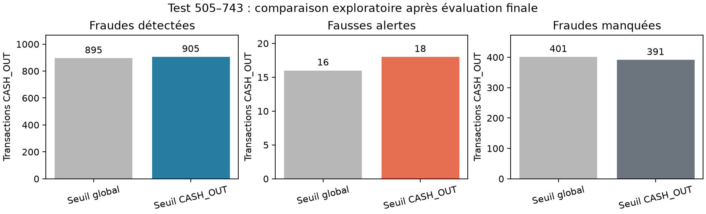

# Seuil spécifique aux CASH_OUT : analyse exploratoire après le test final

La [méthode](ML_CASHOUT_THRESHOLD_PROTOCOL.md) a été publiée avant ces calculs. Le pipeline CatBoost gelé, ses variables, paramètres et prétraitements n'ont pas été réajustés. La politique finale publiée garde son seuil unique **0,3123179923852385** et ses [résultats](ML_FINAL_REPORT.md). L'idée de ce seuil par type vient de l'examen de ce test déjà évalué : les chiffres ci-dessous sont donc une analyse exploratoire, pas une nouvelle mesure indépendante.

## Choix sur la réserve 361–432

Sur **289 951 CASH_OUT**, dont **420 fraudes**, le seuil global donne 287 TP, 17 FP, 133 FN et 289 514 TN, soit un F1 de **0,792818**. En maximisant le F1 CASH_OUT parmi les scores distincts inférieurs ou égaux au seuil global, le seuil retenu est **0,28803511270286475**. Sur cette même réserve, il donne 289 TP, 20 FP, 131 FN et 289 511 TN, soit un F1 de **0,792867**. Ce gain de F1 est très petit. Les scores identiques sont groupés et le seuil le plus élevé départage les F1 égaux. Le [résultat agrégé de la réserve](results/ml_cashout_threshold_reserve.json) a été publié avant la comparaison sur le test.

## Comparaison sur les scores sauvegardés du test 505–743

Pour les types autres que CASH_OUT, le seuil reste **0,3123179923852385**. Le tableau indique les métriques de chaque population, et non une moyenne entre les types.

| Population et politique | Seuil CASH_OUT | Précision | Rappel | F1 | Alertes | TP | FP | FN | TN |
| --- | ---: | ---: | ---: | ---: | ---: | ---: | ---: | ---: | ---: |
| CASH_OUT, politique finale | 0,3123179923852385 | 0,982437 | 0,690586 | 0,811056 | 911 | 895 | 16 | 401 | 94 707 |
| CASH_OUT, variante | 0,28803511270286475 | 0,980498 | 0,698302 | 0,815683 | 923 | 905 | 18 | 391 | 94 705 |
| Test complet, politique finale | 0,3123179923852385 | 0,986931 | 0,844907 | 0,910414 | 2 219 | 2 190 | 29 | 402 | 295 963 |
| Test complet, variante | 0,28803511270286475 | 0,986105 | 0,848765 | 0,912295 | 2 231 | 2 200 | 31 | 392 | 295 961 |

Le seuil affiché dans la dernière ligne ne s'applique qu'aux CASH_OUT ; les autres types conservent le seuil global. La variante ajoute **12 alertes**, dont **10 fraudes détectées** et **2 fausses alertes**. Elle réduit les fraudes manquées de **402 à 392** sur le test complet. Le rappel CASH_OUT gagne **0,007716** en valeur absolue, tandis que sa précision baisse de **0,001939**. Le F1 global gagne **0,001882** dans cette comparaison descriptive.

Les trois panneaux montrent les effectifs `CASH_OUT` du même test : fraudes détectées, fausses alertes et fraudes manquées. Chaque axe vertical démarre à zéro ; les panneaux ont des échelles distinctes parce que les effectifs diffèrent fortement. Les hauteurs des barres entre panneaux ne sont donc pas directement comparables.

## Contrôles et limites

Le CSV et le pipeline rechargé portent les empreintes du [manifeste](results/ml_final_manifest.json). Les scores individuels locaux ont été alignés dans l'ordre des lignes sur les steps et labels du CSV ; la décision `score >= seuil global` reproduit exactement la matrice finale globale et celle des CASH_OUT déjà publiées. La trace locale indique une évaluation du test achevée avec le même pipeline. L'empreinte des scores locaux est conservée dans les [agrégats exploratoires](results/ml_cashout_threshold_test.json). Aucune décision d'un autre type ne change. Les quatre cases des deux matrices de confusion retrouvent les effectifs et les fraudes.

La baisse du seuil ne retire aucune alerte existante : elle peut ajouter des fraudes détectées et des faux positifs, comme observé ici. Le F1 sur la réserve s'améliore à peine, et le test a déjà inspiré la question. La dernière période de ce test ne comporte que des fraudes. Ces résultats ne justifient pas l'adoption de la variante comme politique finale. Il faudrait la figer puis l'évaluer sur une **nouvelle période**. Les scores ne sont pas présentés comme des probabilités calibrées et PaySim ne démontre pas une généralisation à des transactions réelles.

Réexécution, depuis la racine du dépôt avec le modèle et les scores locaux déjà gelés : `.venv/bin/python scripts/run_ml_cashout_threshold.py reserve`, puis `.venv/bin/python scripts/run_ml_cashout_threshold.py test`, puis `.venv/bin/python scripts/report_ml_cashout_threshold.py`. Les deux premières commandes refusent de remplacer des résultats existants ; une réexécution indépendante requiert un espace de travail propre et la conservation de la trace originale. Seuls les agrégats et la figure sont publiés.

Ces commandes et les 47 tests du dépôt ont été vérifiés avec Python 3.11 local sur macOS Apple Silicon. Le tracé utilise le moteur non interactif de Matplotlib. La commande `uv run --locked`, Linux et Windows n'ont pas été vérifiés pour cette expérience.
