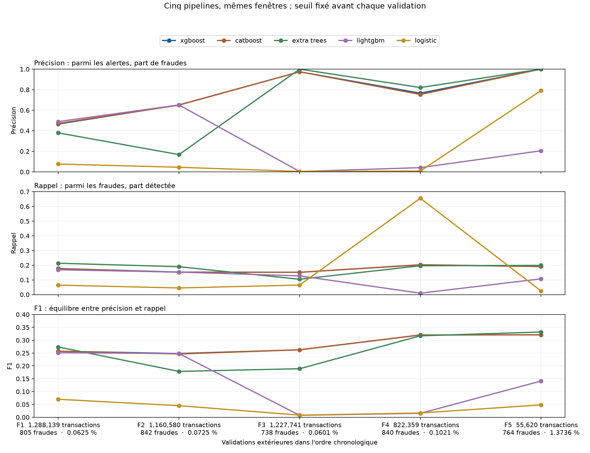

# Lot 4.3 : diagnostics guidés du benchmark

**Étape 1 : vérification et lecture des cinq validations extérieures.** Cette étape ne réentraîne aucun modèle, ne change aucun seuil et ne consulte aucun score du test 505 à 743. Les étapes par type et montant, puis les distributions des scores et des seuils, attendent les observations de l'utilisateur.

## Vérification du lot 4.2

Le [script d'audit](../scripts/diagnose_ml_results.py) relit les [65 résultats publiés](results/ml_benchmark.json). Il retrouve les cinq portions d'apprentissage, les cinq réserves internes et les cinq validations extérieures avec leurs bornes et effectifs prévus dans le [protocole](ML_PROTOCOL.md). Le [code d'entraînement](../src/fraud_investigation/ml_benchmark.py) ajuste la standardisation de `log1p(amount)` sur la seule portion d'apprentissage ; les cinq catégories de `type` sont un vocabulaire fixe du schéma. Il ajuste le modèle sur cette même portion, cherche le F1 maximal sur la réserve interne, puis applique le seuil obtenu sans le modifier à la validation extérieure. Les scores individuels n'avaient pas été conservés au lot 4.2 : cet audit vérifie le chemin de code et les agrégats publiés, mais ne recalcule pas indépendamment chaque seuil à partir des scores originaux.

Pour chaque ligne, `TP + FN = fraudes`, `TN + FP = normales`, `TP + FP = alertes` et `TP + FP + FN + TN = transactions`. Précision, rappel et F1 ont été recalculés à partir de ces quatre cases ; les moyennes arithmétiques ont été recalculées à partir des cinq lignes de chaque modèle. Les **65 validations de modèles ont toutes émis au moins une alerte**, donc leurs précisions et leurs moyennes sont définies. La règle de départage préannoncée place XGBoost et CatBoost dans le voisinage de 0,005 F1, puis les départage par le temps médian d'ajustement après les contrôles de minimum et de dispersion. La règle n'a pas été modifiée.

La précision de `isFlaggedFraud` était affichée à tort comme `0` aux fenêtres **3 et 5**, où cette règle n'émet aucune alerte. Elle est maintenant **non définie (`n.d.`)** dans le code, le [rapport corrigé](ML_BENCHMARK.md) et le fichier structuré. Aucun score ni classement des modèles ne change. Si un futur modèle n'émet aucune alerte dans une fenêtre, sa précision sur cinq fenêtres sera également `n.d.` ; rappel et F1 restent à zéro lorsque des fraudes sont présentes. Aucune valeur de remplacement silencieuse n'entre dans une moyenne. Le SVM à noyau a été interrompu après **au moins 200 secondes**, avant le plafond de 30 minutes : aucun dépassement de ce plafond n'a été démontré et aucun score SVM comparable n'est publié.

## Première lecture des résultats

Dans chaque cellule du tableau, l'ordre est **précision / rappel / F1**. Les validations suivent le temps ; leurs seuils respectifs avaient été choisis dans les réserves internes antérieures. Les taux de fraude et les effectifs sont sous la figure.

| Modèle | F1, steps 145–216 | F2, steps 217–288 | F3, steps 289–360 | F4, steps 361–432 | F5, steps 433–504 |
| --- | --- | --- | --- | --- | --- |
| XGBoost | 0,466 / 0,178 / 0,257 | 0,652 / 0,153 / 0,248 | 0,974 / 0,152 / 0,263 | 0,766 / 0,202 / 0,320 | 1,000 / 0,191 / 0,321 |
| CatBoost | 0,472 / 0,176 / 0,257 | 0,650 / 0,152 / 0,246 | 0,974 / 0,152 / 0,263 | 0,753 / 0,204 / 0,321 | 1,000 / 0,191 / 0,321 |
| Extra Trees | 0,380 / 0,214 / 0,273 | 0,168 / 0,190 / 0,179 | 1,000 / 0,104 / 0,189 | 0,821 / 0,196 / 0,317 | 1,000 / 0,199 / 0,332 |
| LightGBM | 0,489 / 0,169 / 0,251 | 0,652 / 0,153 / 0,248 | 0,004 / 0,127 / 0,008 | 0,041 / 0,010 / 0,015 | 0,206 / 0,107 / 0,141 |
| Régression logistique | 0,077 / 0,065 / 0,070 | 0,045 / 0,045 / 0,045 | 0,004 / 0,065 / 0,008 | 0,008 / 0,656 / 0,017 | 0,792 / 0,025 / 0,048 |

La figure donne, sous chaque fenêtre, le nombre de transactions, le nombre de fraudes et leur pourcentage parmi les transactions de cette fenêtre. Chaque panneau a son propre axe vertical ; les cinq modèles d'un même panneau utilisent la même échelle. Les lignes relient des évaluations sur des périodes successives, pas les prédictions d'une même transaction.

**Observation mesurée.** XGBoost et CatBoost ont des F1 moyens respectifs de **0,2818** et **0,2814**, soit environ **0,0003** d'écart avant arrondi. XGBoost a détecté **700 des 3 989 fraudes** cumulées dans les cinq validations ; **3 289** ont été manquées, avec **288 fausses alertes**. Son rappel moyen par fenêtre est **0,1752**. LightGBM passe de F1 proche de 0,25 aux fenêtres 1 et 2 à **0,0077** puis **0,0155** aux fenêtres 3 et 4. La régression logistique passe d'un rappel de **0,0650** en fenêtre 3 à **0,6560** en fenêtre 4, mais la précision de cette dernière n'est que **0,0085**. Ces écarts demandent une analyse de la composition des transactions, des scores et des seuils ; la seule variation de prévalence ne suffit pas à les expliquer.

Une **moyenne de métriques** donne le même poids aux cinq fenêtres. Une **métrique sur les effectifs cumulés** donne davantage de poids aux fenêtres plus volumineuses. Pour XGBoost, la précision moyenne est **0,7714**, tandis que la précision recalculée sur `700 TP / (700 TP + 288 FP)` est **0,7085**. Son F1 moyen est **0,2818** et son F1 sur les cases cumulées est **0,2813**. Ces deux lectures répondent à des questions différentes ; le classement suit la moyenne prévue au protocole.

**Hypothèses ouvertes.** La dégradation de LightGBM, les variations de la régression logistique et le rappel limité de XGBoost pourraient tenir à la composition des types, aux montants, au transfert du seuil ou à plusieurs de ces facteurs. Ce premier graphique ne permet pas de les départager. Les diagnostics par type et tranches de montant, puis par scores et seuils, seront préparés seulement après discussion de cette lecture.
