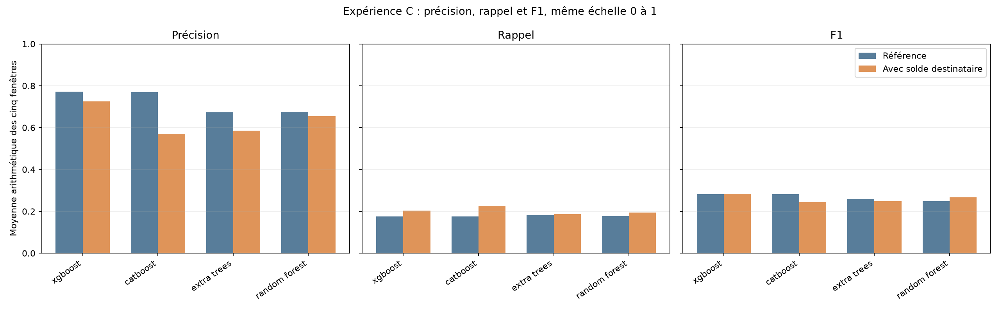
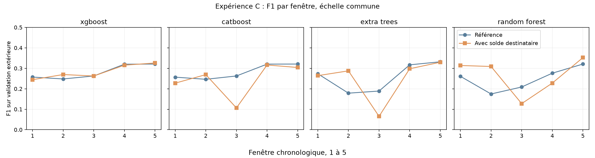
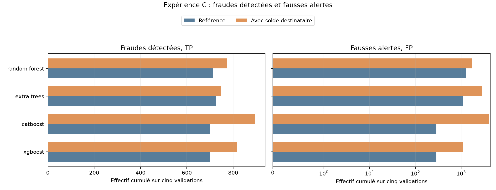

# Lot 4.3, expérience C : solde initial du destinataire

La référence utilise `type + amount`. C ajoute **uniquement `oldbalanceDest`**. Aucune heure simulée, autre solde ou variable dérivée n'est transmise aux modèles. Les vingt scores de référence correspondants proviennent du [benchmark vérifié](ML_BENCHMARK.md), sans réentraînement. Les configurations initiales et les cinq portions temporelles sont conservées. Les quatre modèles d'arbres reçoivent le solde brut en `float32` ; le zéro est conservé sans imputation ni variable supplémentaire. KNN n'est pas exécuté dans C. Chaque seuil est réestimé par F1 maximal sur la réserve interne, jamais sur la validation extérieure. Les scores égaux sont regroupés et, si plusieurs seuils donnent le même F1 maximal, le plus haut est retenu. Une précision sans alerte est non définie et reste `n.d.`. Le test 505 à 743 n'est pas consulté.

## Sens du solde enregistré

L'[audit](DATA_AUDIT.md) rapporte que les soldes de certains destinataires commerçants ne sont pas disponibles. Sur les steps 1 à 504, les 2 047 519 destinataires à identifiant préfixé `M` ont tous `oldbalanceDest = 0`. On compte aussi 522 724 zéros parmi les 4 016 517 autres destinataires. Aucun solde n'est absent ou négatif au contrôle. Un zéro peut donc désigner des situations différentes ; le CSV ne donne pas le marqueur nécessaire pour les séparer. `nameDest` a servi à l'audit, jamais à l'entraînement.

## Moyennes arithmétiques et changements

Ces moyennes donnent le même poids à chacune des cinq fenêtres. Elles ne sont pas des ratios calculés sur les cases de confusion cumulées. `Δ` = avec solde moins référence ; les effectifs FP et FN sont, eux, additionnés sur les fenêtres.

| Modèle | P réf. | P solde | ΔP | R réf. | R solde | ΔR | F1 réf. | F1 solde | ΔF1 | Alertes réf. → C | FP réf. → C | FN réf. → C |
| --- | ---: | ---: | ---: | ---: | ---: | ---: | ---: | ---: | ---: | ---: | ---: | ---: |
| xgboost | 0.7714 | 0.7250 | -0.0464 | 0.1752 | 0.2043 | 0.0291 | 0.2818 | 0.2836 | 0.0018 | 988 → 1,917 | 288 → 1,100 | 3,289 → 3,172 |
| catboost | 0.7697 | 0.5711 | -0.1987 | 0.1750 | 0.2253 | 0.0504 | 0.2814 | 0.2447 | -0.0367 | 986 → 5,018 | 287 → 4,124 | 3,290 → 3,095 |
| extra_trees | 0.6738 | 0.5851 | -0.0887 | 0.1807 | 0.1867 | 0.0060 | 0.2580 | 0.2489 | -0.0090 | 1,833 → 3,612 | 1,107 → 2,865 | 3,263 → 3,242 |
| random_forest | 0.6745 | 0.6537 | -0.0209 | 0.1778 | 0.1949 | 0.0171 | 0.2483 | 0.2661 | 0.0178 | 1,995 → 2,503 | 1,282 → 1,729 | 3,276 → 3,215 |

## Quatre ajouts séparés, F1 moyen

Chaque colonne repart de `type + amount`. A ajoute l'heure cyclique, B le solde émetteur et C le solde destinataire ; aucune colonne ne représente leur combinaison. Les cinq fenêtres de chaque moyenne sont les mêmes.

| Modèle | Référence | A | B | C |
| --- | ---: | ---: | ---: | ---: |
| xgboost | 0.2818 | 0.4065 | 0.6137 | 0.2836 |
| catboost | 0.2814 | 0.4042 | 0.5774 | 0.2447 |
| extra_trees | 0.2580 | 0.3147 | 0.3454 | 0.2489 |
| random_forest | 0.2483 | 0.2652 | 0.4812 | 0.2661 |

Les trois panneaux partagent une échelle verticale de 0 à 1 ; chaque barre est la moyenne d'une métrique sur cinq fenêtres. Les axes horizontaux indiquent les modèles.

Les quatre panneaux partagent la même échelle verticale de F1. L'axe horizontal suit les validations successives. Les lignes relient des périodes différentes, pas les mêmes transactions.

Chaque barre additionne les effectifs de cinq validations disjointes. L'axe TP est linéaire ; l'axe FP est logarithmique symétrique, avec une zone linéaire autour de zéro, pour garder visibles les petits et grands nombres sans masquer un éventuel zéro. Comparer les valeurs à l'intérieur de chaque panneau, car leurs axes mesurent des effectifs différents.

## Détail par modèle et fenêtre

P = précision ; R = rappel. Seuil et cases correspondent uniquement à l'expérience C ; les colonnes Δ comparent C à la référence sur la même validation. Une précision sans alerte serait non définie (`n.d.`).

| Modèle | Fenêtre | Transactions | Fraudes | Seuil C | P C | R C | F1 C | ΔP | ΔR | ΔF1 | TP | FP | FN | TN | Alertes | ΔFP | ΔFN | Ajustement | Seuil | Prédiction | Total | Pic RSS |
| --- | ---: | ---: | ---: | ---: | ---: | ---: | ---: | ---: | ---: | ---: | ---: | ---: | ---: | ---: | ---: | ---: | ---: | ---: | ---: | ---: | ---: | ---: | ---: | ---: |
| xgboost | 1 | 1,288,139 | 805 | 0.126333 | 0.2016 | 0.3106 | 0.2445 | -0.2642 | 0.1329 | -0.0127 | 250 | 990 | 555 | 1,286,344 | 1,240 | +826 | -107 | 0.8 s | 0.2 s | 0.2 s | 2.9 s | 0.86 Gio |
| xgboost | 2 | 1,160,580 | 842 | 0.312809 | 0.6912 | 0.1675 | 0.2696 | 0.0397 | 0.0143 | 0.0215 | 141 | 63 | 701 | 1,159,675 | 204 | -6 | -12 | 1.2 s | 0.3 s | 0.2 s | 2.0 s | 0.98 Gio |
| xgboost | 3 | 1,227,741 | 738 | 0.392579 | 0.9187 | 0.1531 | 0.2625 | -0.0552 | 0.0014 | -0.0001 | 113 | 10 | 625 | 1,226,993 | 123 | +7 | -1 | 2.3 s | 0.2 s | 0.2 s | 3.2 s | 1.16 Gio |
| xgboost | 4 | 822,359 | 840 | 0.180028 | 0.8200 | 0.1952 | 0.3154 | 0.0542 | -0.0071 | -0.0048 | 164 | 36 | 676 | 821,483 | 200 | -16 | +6 | 3.3 s | 0.3 s | 0.1 s | 4.2 s | 1.31 Gio |
| xgboost | 5 | 55,620 | 764 | 0.134709 | 0.9933 | 0.1950 | 0.3260 | -0.0067 | 0.0039 | 0.0052 | 149 | 1 | 615 | 54,855 | 150 | +1 | -3 | 5.0 s | 0.2 s | 0.0 s | 5.6 s | 1.45 Gio |
| catboost | 1 | 1,288,139 | 805 | 0.126974 | 0.1787 | 0.3130 | 0.2275 | -0.2930 | 0.1366 | -0.0292 | 252 | 1,158 | 553 | 1,286,176 | 1,410 | +999 | -110 | 5.2 s | 0.1 s | 0.1 s | 5.8 s | 1.02 Gio |
| catboost | 2 | 1,160,580 | 842 | 0.356911 | 0.7784 | 0.1627 | 0.2692 | 0.1287 | 0.0107 | 0.0228 | 137 | 39 | 705 | 1,159,699 | 176 | -30 | -9 | 7.1 s | 0.2 s | 0.1 s | 7.9 s | 1.13 Gio |
| catboost | 3 | 1,227,741 | 738 | 0.155409 | 0.0658 | 0.2764 | 0.1064 | -0.9081 | 0.1247 | -0.1562 | 204 | 2,894 | 534 | 1,224,109 | 3,098 | +2,891 | -92 | 11.9 s | 0.2 s | 0.1 s | 12.5 s | 1.42 Gio |
| catboost | 4 | 822,359 | 840 | 0.160816 | 0.8325 | 0.1952 | 0.3163 | 0.0792 | -0.0083 | -0.0042 | 164 | 33 | 676 | 821,486 | 197 | -23 | +7 | 17.6 s | 0.2 s | 0.1 s | 18.3 s | 1.58 Gio |
| catboost | 5 | 55,620 | 764 | 0.135821 | 1.0000 | 0.1793 | 0.3041 | 0.0000 | -0.0118 | -0.0168 | 137 | 0 | 627 | 54,856 | 137 | +0 | +9 | 25.0 s | 0.1 s | 0.0 s | 25.9 s | 1.66 Gio |
| extra_trees | 1 | 1,288,139 | 805 | 0.0277925 | 0.3019 | 0.2348 | 0.2642 | -0.0778 | 0.0211 | -0.0093 | 189 | 437 | 616 | 1,286,897 | 626 | +156 | -17 | 2.3 s | 0.2 s | 0.5 s | 4.0 s | 1.44 Gio |
| extra_trees | 2 | 1,160,580 | 842 | 0.117645 | 0.6892 | 0.1817 | 0.2876 | 0.5208 | -0.0083 | 0.1090 | 153 | 69 | 689 | 1,159,669 | 222 | -721 | +7 | 4.0 s | 0.6 s | 0.5 s | 5.4 s | 1.15 Gio |
| extra_trees | 3 | 1,227,741 | 738 | 0.229407 | 0.0425 | 0.1409 | 0.0653 | -0.9575 | 0.0366 | -0.1236 | 104 | 2,341 | 634 | 1,224,662 | 2,445 | +2,341 | -27 | 8.2 s | 0.5 s | 0.5 s | 9.7 s | 1.47 Gio |
| extra_trees | 4 | 822,359 | 840 | 0.0453054 | 0.8982 | 0.1786 | 0.2979 | 0.0773 | -0.0179 | -0.0191 | 150 | 17 | 690 | 821,502 | 167 | -19 | +15 | 8.4 s | 0.4 s | 0.3 s | 9.5 s | 1.65 Gio |
| extra_trees | 5 | 55,620 | 764 | 0.0232601 | 0.9934 | 0.1976 | 0.3297 | -0.0066 | -0.0013 | -0.0022 | 151 | 1 | 613 | 54,855 | 152 | +1 | +1 | 12.7 s | 0.4 s | 0.0 s | 13.6 s | 1.47 Gio |
| random_forest | 1 | 1,288,139 | 805 | 0.228856 | 0.4947 | 0.2298 | 0.3138 | 0.1816 | 0.0062 | 0.0530 | 185 | 189 | 620 | 1,287,145 | 374 | -206 | -5 | 14.1 s | 0.4 s | 0.8 s | 16.1 s | 1.34 Gio |
| random_forest | 2 | 1,160,580 | 842 | 0.470424 | 0.6987 | 0.1983 | 0.3090 | 0.5404 | 0.0036 | 0.1343 | 167 | 72 | 675 | 1,159,666 | 239 | -800 | -3 | 23.4 s | 0.9 s | 0.7 s | 26.1 s | 1.13 Gio |
| random_forest | 3 | 1,227,741 | 738 | 0.451622 | 0.0929 | 0.2033 | 0.1275 | -0.9071 | 0.0867 | -0.0812 | 150 | 1,465 | 588 | 1,225,538 | 1,615 | +1,465 | -64 | 46.2 s | 0.6 s | 0.6 s | 48.8 s | 1.31 Gio |
| random_forest | 4 | 822,359 | 840 | 0.661823 | 1.0000 | 0.1286 | 0.2278 | 0.0987 | -0.0345 | -0.0484 | 108 | 0 | 732 | 821,519 | 108 | -15 | +29 | 70.4 s | 0.7 s | 0.5 s | 72.7 s | 1.30 Gio |
| random_forest | 5 | 55,620 | 764 | 0.190514 | 0.9820 | 0.2147 | 0.3523 | -0.0180 | 0.0236 | 0.0314 | 164 | 3 | 600 | 54,853 | 167 | +3 | -18 | 95.4 s | 0.4 s | 0.0 s | 97.1 s | 1.56 Gio |

## Régularité et coût local

L'écart-type descriptif porte sur cinq F1 dépendants. Le pic RSS est échantillonné chaque seconde par l'orchestrateur et peut manquer un pic bref. Les temps additionnent les cinq exécutions ; le temps total inclut notamment cinq lectures du CSV.

| Modèle | F1 min réf. → C | Écart-type F1 réf. → C | Ajustement réf. → C | Temps total réf. → C | Pic RSS réf. → C |
| --- | ---: | ---: | ---: | ---: | ---: |
| xgboost | 0.2481 → 0.2445 | 0.0357 → 0.0353 | 10.9 → 12.6 s | 14.7 → 17.9 s | 1.24 → 1.45 Gio |
| catboost | 0.2464 → 0.1064 | 0.0363 → 0.0847 | 65.0 → 66.8 s | 68.3 → 70.4 s | 2.50 → 1.66 Gio |
| extra_trees | 0.1786 → 0.0653 | 0.0712 → 0.1053 | 38.9 → 35.5 s | 46.1 → 42.3 s | 1.95 → 1.65 Gio |
| random_forest | 0.1747 → 0.1275 | 0.0574 → 0.0898 | 241.2 → 249.5 s | 248.8 → 260.8 s | 1.91 → 1.56 Gio |

## Observations mesurées

Le tableau suivant compte les fenêtres où le F1 de C dépasse celui de la référence. Il complète la moyenne, qui peut masquer une forte dégradation sur une période. Les FP et FN sont des sommes d'effectifs, pas des moyennes de taux.

| Modèle | Fenêtres F1 amélioré / 5 | ΔF1 moyen | ΔFP cumulés | ΔFN cumulés |
| --- | ---: | ---: | ---: | ---: |
| xgboost | 2/5 | 0.0018 | +812 | -117 |
| catboost | 1/5 | -0.0367 | +3,837 | -195 |
| extra_trees | 1/5 | -0.0090 | +1,758 | -21 |
| random_forest | 3/5 | 0.0178 | +447 | -61 |

XGBoost varie de +0,0018 en F1 moyen, Random Forest de +0,0178, CatBoost de -0,0367 et Extra Trees de -0,0090. Ce sont des observations sur les pipelines et leurs seuils recalculés. Dans la fenêtre 3, C donne 2 894 FP à CatBoost, 2 341 à Extra Trees et 1 465 à Random Forest, avec des F1 de 0,1064, 0,0653 et 0,1275. Ces creux ne sont pas masqués par les moyennes. Le solde destinataire peut modifier les scores ou leur seuil, mais ces seuls agrégats ne permettent pas d'attribuer une cause précise au comportement de la fenêtre 3.

## Lecture et limites

Une hausse ou baisse est mesurée pour le **pipeline enrichi avec son seuil recalculé**. L'EDA avait relevé une forte signature du simulateur entre le montant et le solde initial de l'émetteur pour certains transferts et retraits frauduleux. Elle ne démontre aucun mécanisme analogue pour le solde destinataire. La présence de nombreux zéros codant possiblement une information indisponible complique l'interprétation de C. Même un gain élevé sur PaySim ne démontre pas une meilleure généralisation à des transactions réelles. Un solde supposé disponible avant l'opération doit encore être effectivement disponible dans l'application visée. Les modèles n'ont pas exactement la même représentation du montant et de `type` ; les comparaisons les plus contrôlées sont donc celles d'un même modèle avant et après ajout. Les taux de fraude des validations sont respectivement 0,0625 %, 0,0725 %, 0,0601 %, 0,1021 % et 1,3736 %. La dernière période a seulement 55 620 lignes. Les cinq résultats partagent des apprentissages et ne sont pas indépendants. Les labels du futur test avaient été vus pendant l'EDA, mais aucun score du test n'a servi ici. Le [fichier structuré](results/ml_feature_balance_dest.json) garde configurations, versions, bornes, colonnes et résultats agrégés ; les journaux locaux restent hors de Git.
