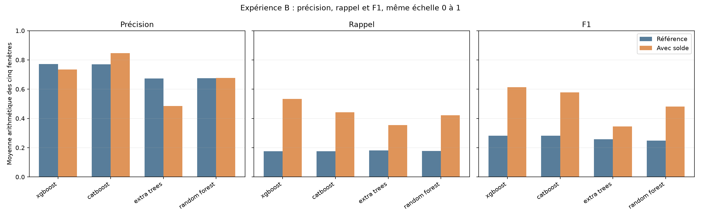
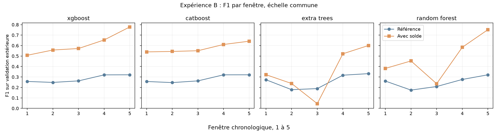
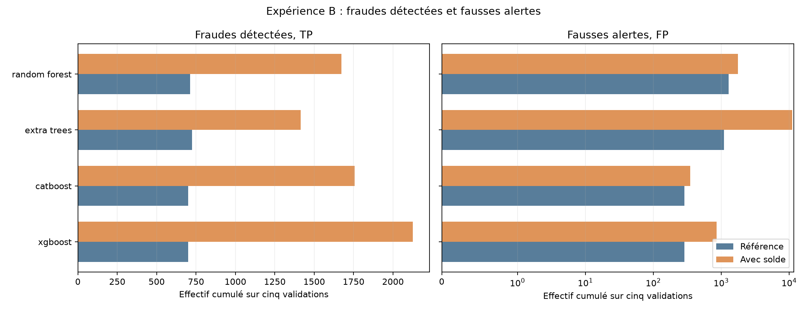

# Lot 4.3, expérience B : solde initial de l'émetteur

La référence utilise `type + amount`. B ajoute **uniquement `oldbalanceOrg`**. Aucune heure simulée, autre solde ou variable dérivée n'est transmise aux modèles. Les vingt scores de référence correspondants proviennent du [benchmark vérifié](ML_BENCHMARK.md), sans réentraînement. Les configurations initiales et les cinq portions temporelles sont conservées. KNN reçoit `log1p(oldbalanceOrg)` standardisé sur l'apprentissage seul ; les arbres reçoivent le solde brut. Chaque seuil est réestimé par F1 maximal sur la réserve interne, jamais sur la validation extérieure. Le test 505 à 743 n'est pas consulté. KNN a été retiré en cours de B sur décision de l'utilisateur ; ses trois fenêtres achevées restent décrites séparément ci-dessous, sans moyenne comparable.

## Moyennes arithmétiques et changements

Ces moyennes donnent le même poids à chacune des cinq fenêtres. Elles ne sont pas des ratios calculés sur les cases de confusion cumulées. `Δ` = avec solde moins référence ; les effectifs FP et FN sont, eux, additionnés sur les fenêtres.

| Modèle | P réf. | P solde | ΔP | R réf. | R solde | ΔR | F1 réf. | F1 solde | ΔF1 | Alertes réf. → B | FP réf. → B | FN réf. → B |
| --- | ---: | ---: | ---: | ---: | ---: | ---: | ---: | ---: | ---: | ---: | ---: | ---: |
| xgboost | 0.7714 | 0.7349 | -0.0365 | 0.1752 | 0.5336 | 0.3584 | 0.2818 | 0.6137 | 0.3319 | 988 → 2,985 | 288 → 859 | 3,289 → 1,863 |
| catboost | 0.7697 | 0.8469 | 0.0772 | 0.1750 | 0.4414 | 0.2664 | 0.2814 | 0.5774 | 0.2960 | 986 → 2,108 | 287 → 351 | 3,290 → 2,232 |
| extra_trees | 0.6738 | 0.4843 | -0.1895 | 0.1807 | 0.3550 | 0.1744 | 0.2580 | 0.3454 | 0.0875 | 1,833 → 12,544 | 1,107 → 11,130 | 3,263 → 2,575 |
| random_forest | 0.6745 | 0.6773 | 0.0027 | 0.1778 | 0.4208 | 0.2430 | 0.2483 | 0.4812 | 0.2330 | 1,995 → 3,439 | 1,282 → 1,765 | 3,276 → 2,315 |

**Lecture mesurée.** XGBoost passe de F1 moyen 0.2818 à 0.6137 ; CatBoost de 0.2814 à 0.5774. Leurs cinq fenêtres progressent chacune en F1, avec des compromis différents entre précision et rappel. Extra Trees émet 9,347 fausses alertes dans la seule fenêtre 3 et son F1 y baisse malgré un meilleur F1 moyen. Ces résultats sont ceux de PaySim et ne valident pas encore le solde comme entrée d'un modèle destiné à des transactions réelles.

Les trois panneaux partagent une échelle verticale de 0 à 1 ; chaque barre est la moyenne d'une métrique sur cinq fenêtres. Les axes horizontaux indiquent les modèles.

Les quatre panneaux partagent la même échelle verticale de F1. L'axe horizontal suit les validations successives. Les lignes relient des périodes différentes, pas les mêmes transactions.

Chaque barre additionne les effectifs de cinq validations disjointes. L'axe TP est linéaire ; l'axe FP est logarithmique symétrique, avec une zone linéaire autour de zéro, pour garder visibles les petits et grands nombres sans masquer un éventuel zéro. Comparer les valeurs à l'intérieur de chaque panneau, car leurs axes mesurent des effectifs différents.

## Détail par modèle et fenêtre

P = précision ; R = rappel. Seuil et cases correspondent uniquement à l'expérience B ; les colonnes Δ comparent B à la référence sur la même validation. Une précision sans alerte serait non définie (`n.d.`).

| Modèle | Fenêtre | Transactions | Fraudes | Seuil B | P B | R B | F1 B | ΔP | ΔR | ΔF1 | TP | FP | FN | TN | Alertes | ΔFP | ΔFN | Ajustement | Seuil | Prédiction | Total | Pic RSS |
| --- | ---: | ---: | ---: | ---: | ---: | ---: | ---: | ---: | ---: | ---: | ---: | ---: | ---: | ---: | ---: | ---: | ---: | ---: | ---: | ---: | ---: | ---: | ---: | ---: |
| xgboost | 1 | 1,288,139 | 805 | 0.145673 | 0.5006 | 0.5143 | 0.5074 | 0.0348 | 0.3366 | 0.2502 | 414 | 413 | 391 | 1,286,921 | 827 | +249 | -271 | 0.8 s | 0.1 s | 0.2 s | 2.7 s | 0.83 Gio |
| xgboost | 2 | 1,160,580 | 842 | 0.261537 | 0.7455 | 0.4454 | 0.5576 | 0.0940 | 0.2922 | 0.3095 | 375 | 128 | 467 | 1,159,610 | 503 | +59 | -246 | 1.3 s | 0.3 s | 0.2 s | 2.1 s | 0.95 Gio |
| xgboost | 3 | 1,227,741 | 738 | 0.223977 | 0.7265 | 0.4715 | 0.5719 | -0.2474 | 0.3198 | 0.3093 | 348 | 131 | 390 | 1,226,872 | 479 | +128 | -236 | 2.4 s | 0.2 s | 0.2 s | 3.3 s | 1.17 Gio |
| xgboost | 4 | 822,359 | 840 | 0.180917 | 0.7512 | 0.5786 | 0.6537 | -0.0146 | 0.3762 | 0.3335 | 486 | 161 | 354 | 821,358 | 647 | +109 | -316 | 3.5 s | 0.3 s | 0.1 s | 4.3 s | 1.30 Gio |
| xgboost | 5 | 55,620 | 764 | 0.135359 | 0.9509 | 0.6584 | 0.7780 | -0.0491 | 0.4673 | 0.4572 | 503 | 26 | 261 | 54,830 | 529 | +26 | -357 | 4.8 s | 0.2 s | 0.0 s | 5.4 s | 1.42 Gio |
| catboost | 1 | 1,288,139 | 805 | 0.121382 | 0.7214 | 0.4311 | 0.5397 | 0.2497 | 0.2547 | 0.2829 | 347 | 134 | 458 | 1,287,200 | 481 | -25 | -205 | 4.2 s | 0.1 s | 0.1 s | 4.7 s | 1.18 Gio |
| catboost | 2 | 1,160,580 | 842 | 0.272021 | 0.9083 | 0.3884 | 0.5441 | 0.2586 | 0.2363 | 0.2977 | 327 | 33 | 515 | 1,159,705 | 360 | -36 | -199 | 6.2 s | 0.2 s | 0.1 s | 6.9 s | 1.34 Gio |
| catboost | 3 | 1,227,741 | 738 | 0.134996 | 0.6971 | 0.4553 | 0.5508 | -0.2768 | 0.3035 | 0.2882 | 336 | 146 | 402 | 1,226,857 | 482 | +143 | -224 | 13.0 s | 0.2 s | 0.1 s | 13.7 s | 1.74 Gio |
| catboost | 4 | 822,359 | 840 | 0.2567 | 0.9187 | 0.4571 | 0.6105 | 0.1654 | 0.2536 | 0.2900 | 384 | 34 | 456 | 821,485 | 418 | -22 | -213 | 17.7 s | 0.3 s | 0.1 s | 19.1 s | 1.68 Gio |
| catboost | 5 | 55,620 | 764 | 0.227211 | 0.9891 | 0.4751 | 0.6419 | -0.0109 | 0.2840 | 0.3210 | 363 | 4 | 401 | 54,852 | 367 | +4 | -217 | 26.0 s | 0.2 s | 0.0 s | 27.7 s | 2.02 Gio |
| extra_trees | 1 | 1,288,139 | 805 | 0.0131848 | 0.2870 | 0.3665 | 0.3219 | -0.0927 | 0.1528 | 0.0484 | 295 | 733 | 510 | 1,286,601 | 1,028 | +452 | -123 | 2.3 s | 0.2 s | 0.4 s | 3.4 s | 1.49 Gio |
| extra_trees | 2 | 1,160,580 | 842 | 0.0379244 | 0.1973 | 0.2981 | 0.2375 | 0.0289 | 0.1081 | 0.0589 | 251 | 1,021 | 591 | 1,158,717 | 1,272 | +231 | -91 | 3.4 s | 0.5 s | 0.4 s | 4.8 s | 1.12 Gio |
| extra_trees | 3 | 1,227,741 | 738 | 0.0396751 | 0.0243 | 0.3157 | 0.0452 | -0.9757 | 0.2114 | -0.1438 | 233 | 9,347 | 505 | 1,217,656 | 9,580 | +9,347 | -156 | 7.1 s | 0.5 s | 0.4 s | 8.4 s | 1.38 Gio |
| extra_trees | 4 | 822,359 | 840 | 0.0373832 | 0.9189 | 0.3643 | 0.5217 | 0.0980 | 0.1679 | 0.2047 | 306 | 27 | 534 | 821,492 | 333 | -9 | -141 | 9.8 s | 0.5 s | 0.3 s | 11.1 s | 1.58 Gio |
| extra_trees | 5 | 55,620 | 764 | 0.0232279 | 0.9940 | 0.4306 | 0.6009 | -0.0060 | 0.2317 | 0.2690 | 329 | 2 | 435 | 54,854 | 331 | +2 | -177 | 12.9 s | 0.3 s | 0.0 s | 13.8 s | 1.93 Gio |
| random_forest | 1 | 1,288,139 | 805 | 0.102907 | 0.3209 | 0.4708 | 0.3817 | 0.0079 | 0.2472 | 0.1208 | 379 | 802 | 426 | 1,286,532 | 1,181 | +407 | -199 | 13.2 s | 0.3 s | 0.7 s | 14.6 s | 1.62 Gio |
| random_forest | 2 | 1,160,580 | 842 | 0.355004 | 0.9333 | 0.2993 | 0.4532 | 0.7750 | 0.1045 | 0.2786 | 252 | 18 | 590 | 1,159,720 | 270 | -854 | -88 | 19.9 s | 0.8 s | 0.6 s | 22.3 s | 1.20 Gio |
| random_forest | 3 | 1,227,741 | 738 | 0.395719 | 0.1942 | 0.2995 | 0.2356 | -0.8058 | 0.1829 | 0.0269 | 221 | 917 | 517 | 1,226,086 | 1,138 | +917 | -135 | 38.7 s | 0.6 s | 0.6 s | 41.1 s | 1.57 Gio |
| random_forest | 4 | 822,359 | 840 | 0.344385 | 0.9803 | 0.4155 | 0.5836 | 0.0790 | 0.2524 | 0.3074 | 349 | 7 | 491 | 821,512 | 356 | -8 | -212 | 56.7 s | 0.7 s | 0.4 s | 58.3 s | 2.01 Gio |
| random_forest | 5 | 55,620 | 764 | 0.108171 | 0.9575 | 0.6191 | 0.7520 | -0.0425 | 0.4280 | 0.4311 | 473 | 21 | 291 | 54,835 | 494 | +21 | -327 | 76.9 s | 0.5 s | 0.0 s | 78.5 s | 2.02 Gio |

## KNN : trois fenêtres B historiques, comparaison incomplète

Le calcul KNN en cours a été interrompu à la demande de l'utilisateur. Les fenêtres 1 à 3 achevées restent vérifiables ; les fenêtres 4 et 5 ne sont pas évaluées. Aucune moyenne KNN sur cinq fenêtres, ni rang comparable, n'est calculée pour B. Ses résultats complets de [référence](ML_BENCHMARK.md) et de [l'expérience A](ML_FEATURE_HOUR.md) restent publiés. L'abandon concerne le coût de prédiction, le stockage et la simplicité, sans prétendre que KNN serait toujours moins performant. La taille est celle d'une sérialisation `joblib` mesurée en mémoire ; aucun modèle individuel n'est publié.

| Fenêtre | P B | R B | F1 B | F1 référence | Seuil B | TP | FP | FN | TN | Alertes | Prédiction | Temps total | Taille sérialisée | Pic RSS |
| ---: | ---: | ---: | ---: | ---: | ---: | ---: | ---: | ---: | ---: | ---: | ---: | ---: |
| 1 | 0.3526 | 0.7031 | 0.4697 | 0.2935 | 0.2 | 566 | 1,039 | 239 | 1,286,295 | 1,605 | 23.3 s | 34.1 s | 107.3 Mio | 1.31 Gio |
| 2 | 0.8184 | 0.4121 | 0.5482 | 0.1803 | 0.48 | 347 | 77 | 495 | 1,159,661 | 424 | 32.7 s | 70.7 s | 153.0 Mio | 1.59 Gio |
| 3 | 0.6442 | 0.5840 | 0.6127 | 0.0336 | 0.4 | 431 | 238 | 307 | 1,226,765 | 669 | 51.1 s | 104.8 s | 284.8 Mio | 2.39 Gio |

## Régularité et coût local

L'écart-type descriptif porte sur cinq F1 dépendants. Le pic RSS est échantillonné chaque seconde par l'orchestrateur et peut manquer un pic bref. Les temps additionnent les cinq exécutions ; le temps total inclut notamment cinq lectures du CSV.

| Modèle | F1 min réf. → B | Écart-type F1 réf. → B | Ajustement réf. → B | Temps total réf. → B | Pic RSS réf. → B |
| --- | ---: | ---: | ---: | ---: | ---: |
| xgboost | 0.2481 → 0.5074 | 0.0357 → 0.1058 | 10.9 → 12.7 s | 14.7 → 17.8 s | 1.24 → 1.42 Gio |
| catboost | 0.2464 → 0.5397 | 0.0363 → 0.0461 | 65.0 → 67.1 s | 68.3 → 72.0 s | 2.50 → 2.02 Gio |
| extra_trees | 0.1786 → 0.0452 | 0.0712 → 0.2229 | 38.9 → 35.5 s | 46.1 → 41.5 s | 1.95 → 1.93 Gio |
| random_forest | 0.1747 → 0.2356 | 0.0574 → 0.1967 | 241.2 → 205.4 s | 248.8 → 214.8 s | 1.91 → 2.02 Gio |

## Observations mesurées

Le tableau suivant compte les fenêtres où le F1 de B dépasse celui de la référence. Il complète la moyenne, qui peut masquer une forte dégradation sur une période. Les FP et FN sont des sommes d'effectifs, pas des moyennes de taux.

| Modèle | Fenêtres F1 amélioré / 5 | ΔF1 moyen | ΔFP cumulés | ΔFN cumulés |
| --- | ---: | ---: | ---: | ---: |
| xgboost | 5/5 | 0.3319 | +571 | -1,426 |
| catboost | 5/5 | 0.2960 | +64 | -1,058 |
| extra_trees | 4/5 | 0.0875 | +10,023 | -688 |
| random_forest | 5/5 | 0.2330 | +483 | -961 |

## Lecture et limites

Une hausse ou baisse est mesurée pour le **pipeline enrichi avec son seuil recalculé**. Le solde initial présente une forte signature du simulateur dans l'EDA : pour les fraudes positives CASH_OUT et TRANSFER, il coïncide fréquemment avec le montant, contrairement aux normales de ces types à la précision vérifiée. Même un gain élevé sur PaySim ne démontre pas une meilleure généralisation à des transactions réelles. Un solde supposé disponible avant l'opération doit encore être effectivement disponible dans l'application visée. Les modèles n'ont pas exactement la même représentation du montant et de `type` ; les comparaisons les plus contrôlées sont donc celles d'un même modèle avant et après ajout. Les taux de fraude des validations sont respectivement 0,0625 %, 0,0725 %, 0,0601 %, 0,1021 % et 1,3736 %. La dernière période a seulement 55 620 lignes. Les cinq résultats partagent des apprentissages et ne sont pas indépendants. Les labels du futur test avaient été vus pendant l'EDA, mais aucun score du test n'a servi ici. Le [fichier structuré](results/ml_feature_balance_org.json) garde configurations, versions, bornes, colonnes et résultats agrégés ; les journaux locaux restent hors de Git.
