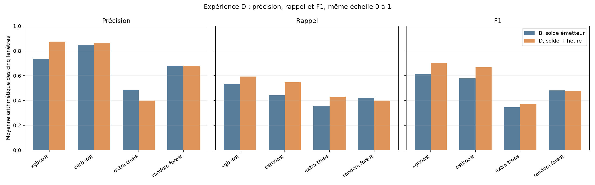
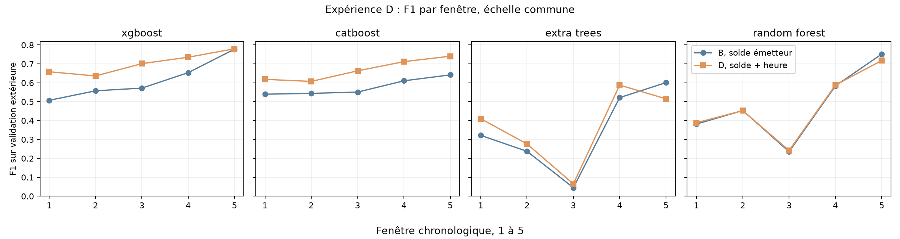
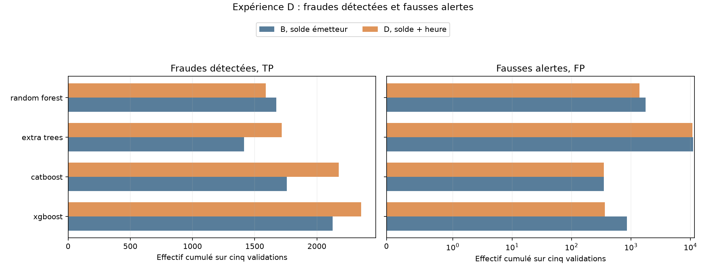

# Lot 4.3, expérience D : solde émetteur et heure cyclique

La comparaison principale est [B](ML_FEATURE_BALANCE_ORG.md), qui utilise `type + amount + oldbalanceOrg`. D y ajoute seulement l'heure simulée de [A](ML_FEATURE_HOUR.md), calculée par `h = (step - 1) % 24`, `sin(2πh/24)` et `cos(2πh/24)`. Les quatre modèles et leurs paramètres initiaux sont conservés. Le solde et le montant restent bruts en `float32` pour ces arbres. Le `step` brut sert au découpage et au calcul de l'heure, jamais comme prédicteur. `oldbalanceDest`, soldes après transaction, ratios, identifiants et labels n'entrent pas dans les modèles. KNN reste exclu. Les vingt résultats B vérifiés sont réutilisés sans réentraînement.

Chaque modèle apprend sur la première portion chronologique, choisit son seuil par F1 maximal dans la réserve interne puis est évalué sur la validation extérieure. Les scores identiques sont groupés ; en cas de même F1 maximal, le seuil le plus haut est retenu. Une précision sans alerte reste non définie (`n.d.`). Le test 505 à 743 n'est pas consulté.

## Moyennes arithmétiques : B contre D

Chaque moyenne donne le même poids aux cinq fenêtres. Elle ne correspond pas au ratio tiré des cases de confusion cumulées. `Δ` signifie D moins B. Les effectifs TP, FP, FN et alertes sont, eux, additionnés sur les cinq validations disjointes.

| Modèle | P B | P D | ΔP | R B | R D | ΔR | F1 B | F1 D | ΔF1 | TP B → D | FP B → D | FN B → D | Alertes B → D |
| --- | ---: | ---: | ---: | ---: | ---: | ---: | ---: | ---: | ---: | ---: | ---: | ---: | ---: |
| xgboost | 0.7349 | 0.8698 | 0.1349 | 0.5336 | 0.5924 | 0.0588 | 0.6137 | 0.7022 | 0.0885 | 2,126 → 2,356 | 859 → 364 | 1,863 → 1,633 | 2,985 → 2,720 |
| catboost | 0.8469 | 0.8626 | 0.0157 | 0.4414 | 0.5463 | 0.1049 | 0.5774 | 0.6683 | 0.0909 | 1,757 → 2,176 | 351 → 350 | 2,232 → 1,813 | 2,108 → 2,526 |
| extra_trees | 0.4843 | 0.3999 | -0.0844 | 0.3550 | 0.4317 | 0.0766 | 0.3454 | 0.3710 | 0.0255 | 1,414 → 1,716 | 11,130 → 10,879 | 2,575 → 2,273 | 12,544 → 12,595 |
| random_forest | 0.6773 | 0.6801 | 0.0029 | 0.4208 | 0.3988 | -0.0220 | 0.4812 | 0.4778 | -0.0034 | 1,674 → 1,588 | 1,765 → 1,387 | 2,315 → 2,401 | 3,439 → 2,975 |

## F1 moyen des cinq variantes

La référence utilise `type + amount`. A ajoute seulement l'heure, B seulement le solde émetteur, C seulement le solde destinataire. D combine B avec l'heure de A, sans C. Les paramètres et fenêtres sont identiques ; les seuils sont réestimés séparément.

| Modèle | Référence | A | B | C | D |
| --- | ---: | ---: | ---: | ---: | ---: |
| xgboost | 0.2818 | 0.4065 | 0.6137 | 0.2836 | 0.7022 |
| catboost | 0.2814 | 0.4042 | 0.5774 | 0.2447 | 0.6683 |
| extra_trees | 0.2580 | 0.3147 | 0.3454 | 0.2489 | 0.3710 |
| random_forest | 0.2483 | 0.2652 | 0.4812 | 0.2661 | 0.4778 |

Les trois panneaux partagent l'axe vertical de 0 à 1 ; chaque barre est une moyenne sur cinq validations. L'axe horizontal nomme les modèles.

Chaque panneau suit les cinq validations dans l'ordre temporel, sur une échelle verticale commune. Les lignes relient des périodes différentes.

Les barres additionnent les effectifs des cinq validations. L'axe TP est linéaire ; l'axe FP est logarithmique symétrique, avec une zone linéaire près de zéro pour représenter aussi les faibles effectifs. Les deux panneaux n'ont pas la même unité de lecture sur l'axe horizontal.

## Résultats par modèle et fenêtre

P = précision, R = rappel. Le seuil, les cases et les temps concernent D. Les colonnes Δ comparent D à B sur la même validation. `n.d.` désigne une précision non définie.

| Modèle | Fenêtre | Transactions | Fraudes | Seuil D | P D | R D | F1 D | ΔP | ΔR | ΔF1 | TP | FP | FN | TN | Alertes | ΔTP | ΔFP | ΔFN | Ajustement | Seuil | Prédiction | Total | Pic RSS |
| --- | ---: | ---: | ---: | ---: | ---: | ---: | ---: | ---: | ---: | ---: | ---: | ---: | ---: | ---: | ---: | ---: | ---: | ---: | ---: | ---: | ---: | ---: | ---: | ---: | ---: |
| xgboost | 1 | 1,288,139 | 805 | 0.229472 | 0.7862 | 0.5665 | 0.6585 | 0.2856 | 0.0522 | 0.1511 | 456 | 124 | 349 | 1,287,210 | 580 | +42 | -289 | -42 | 0.9 s | 0.1 s | 0.2 s | 3.0 s | 0.88 Gio |
| xgboost | 2 | 1,160,580 | 842 | 0.383006 | 0.9172 | 0.4869 | 0.6362 | 0.1717 | 0.0416 | 0.0785 | 410 | 37 | 432 | 1,159,701 | 447 | +35 | -91 | -35 | 1.3 s | 0.3 s | 0.2 s | 2.2 s | 1.02 Gio |
| xgboost | 3 | 1,227,741 | 738 | 0.214594 | 0.8063 | 0.6206 | 0.7014 | 0.0798 | 0.1491 | 0.1295 | 458 | 110 | 280 | 1,226,893 | 568 | +110 | -21 | -110 | 2.5 s | 0.2 s | 0.2 s | 3.5 s | 1.26 Gio |
| xgboost | 4 | 822,359 | 840 | 0.250355 | 0.8831 | 0.6298 | 0.7352 | 0.1320 | 0.0512 | 0.0816 | 529 | 70 | 311 | 821,449 | 599 | +43 | -91 | -43 | 4.0 s | 0.3 s | 0.1 s | 5.1 s | 1.43 Gio |
| xgboost | 5 | 55,620 | 764 | 0.264413 | 0.9563 | 0.6584 | 0.7798 | 0.0054 | 0.0000 | 0.0018 | 503 | 23 | 261 | 54,833 | 526 | +0 | -3 | +0 | 5.5 s | 0.2 s | 0.0 s | 6.4 s | 1.53 Gio |
| catboost | 1 | 1,288,139 | 805 | 0.121832 | 0.7665 | 0.5180 | 0.6182 | 0.0451 | 0.0870 | 0.0786 | 417 | 127 | 388 | 1,287,207 | 544 | +70 | -7 | -70 | 4.7 s | 0.1 s | 0.1 s | 5.3 s | 1.24 Gio |
| catboost | 2 | 1,160,580 | 842 | 0.211867 | 0.8453 | 0.4739 | 0.6073 | -0.0630 | 0.0855 | 0.0632 | 399 | 73 | 443 | 1,159,665 | 472 | +72 | +40 | -72 | 6.5 s | 0.2 s | 0.1 s | 7.2 s | 1.47 Gio |
| catboost | 3 | 1,227,741 | 738 | 0.224278 | 0.8615 | 0.5393 | 0.6633 | 0.1644 | 0.0840 | 0.1125 | 398 | 64 | 340 | 1,226,939 | 462 | +62 | -82 | -62 | 12.3 s | 0.2 s | 0.1 s | 13.1 s | 1.97 Gio |
| catboost | 4 | 822,359 | 840 | 0.164724 | 0.8909 | 0.5929 | 0.7119 | -0.0278 | 0.1357 | 0.1014 | 498 | 61 | 342 | 821,458 | 559 | +114 | +27 | -114 | 17.4 s | 0.2 s | 0.1 s | 18.1 s | 2.47 Gio |
| catboost | 5 | 55,620 | 764 | 0.208643 | 0.9489 | 0.6073 | 0.7406 | -0.0402 | 0.1322 | 0.0987 | 464 | 25 | 300 | 54,831 | 489 | +101 | +21 | -101 | 25.3 s | 0.2 s | 0.0 s | 25.9 s | 2.06 Gio |
| extra_trees | 1 | 1,288,139 | 805 | 0.0348073 | 0.3934 | 0.4286 | 0.4102 | 0.1064 | 0.0621 | 0.0883 | 345 | 532 | 460 | 1,286,802 | 877 | +50 | -201 | -50 | 3.4 s | 0.2 s | 0.5 s | 5.4 s | 1.45 Gio |
| extra_trees | 2 | 1,160,580 | 842 | 0.0766232 | 0.2404 | 0.3254 | 0.2765 | 0.0430 | 0.0273 | 0.0390 | 274 | 866 | 568 | 1,158,872 | 1,140 | +23 | -155 | -23 | 5.5 s | 0.6 s | 0.6 s | 7.2 s | 1.17 Gio |
| extra_trees | 3 | 1,227,741 | 738 | 0.0660893 | 0.0351 | 0.4472 | 0.0651 | 0.0108 | 0.1314 | 0.0200 | 330 | 9,064 | 408 | 1,217,939 | 9,394 | +97 | -283 | -97 | 12.1 s | 0.5 s | 0.5 s | 13.6 s | 1.43 Gio |
| extra_trees | 4 | 822,359 | 840 | 0.0638373 | 0.7837 | 0.4702 | 0.5878 | -0.1352 | 0.1060 | 0.0661 | 395 | 109 | 445 | 821,410 | 504 | +89 | +82 | -89 | 15.1 s | 0.5 s | 0.3 s | 16.5 s | 1.65 Gio |
| extra_trees | 5 | 55,620 | 764 | 0.047293 | 0.5471 | 0.4869 | 0.5152 | -0.4469 | 0.0563 | -0.0857 | 372 | 308 | 392 | 54,548 | 680 | +43 | +306 | -43 | 20.3 s | 0.4 s | 0.0 s | 21.3 s | 2.17 Gio |
| random_forest | 1 | 1,288,139 | 805 | 0.146674 | 0.3790 | 0.3988 | 0.3886 | 0.0581 | -0.0720 | 0.0069 | 321 | 526 | 484 | 1,286,808 | 847 | -58 | -276 | +58 | 13.3 s | 0.3 s | 0.6 s | 14.6 s | 1.69 Gio |
| random_forest | 2 | 1,160,580 | 842 | 0.344774 | 0.9299 | 0.2993 | 0.4528 | -0.0034 | 0.0000 | -0.0004 | 252 | 19 | 590 | 1,159,719 | 271 | +0 | +1 | +0 | 21.1 s | 0.7 s | 0.6 s | 22.9 s | 1.25 Gio |
| random_forest | 3 | 1,227,741 | 738 | 0.404968 | 0.2102 | 0.2846 | 0.2418 | 0.0160 | -0.0149 | 0.0062 | 210 | 789 | 528 | 1,226,214 | 999 | -11 | -128 | +11 | 44.1 s | 0.6 s | 0.6 s | 45.9 s | 1.55 Gio |
| random_forest | 4 | 822,359 | 840 | 0.272879 | 0.9596 | 0.4238 | 0.5879 | -0.0208 | 0.0083 | 0.0043 | 356 | 15 | 484 | 821,504 | 371 | +7 | +8 | -7 | 64.0 s | 0.7 s | 0.4 s | 65.6 s | 2.04 Gio |
| random_forest | 5 | 55,620 | 764 | 0.152872 | 0.9220 | 0.5877 | 0.7178 | -0.0355 | -0.0314 | -0.0342 | 449 | 38 | 315 | 54,818 | 487 | -24 | +17 | +24 | 89.8 s | 0.5 s | 0.0 s | 91.8 s | 2.23 Gio |

## Régularité et coût

L'écart-type descriptif porte sur cinq F1 dépendants. Le pic RSS est échantillonné chaque seconde et peut manquer un pic très bref. Les temps sont additionnés sur cinq exécutions, lectures répétées du CSV comprises.

| Modèle | F1 min B → D | Écart-type F1 B → D | F1 amélioré | Ajustement B → D | Temps total B → D | Pic RSS B → D |
| --- | ---: | ---: | ---: | ---: | ---: | ---: |
| xgboost | 0.5074 → 0.6362 | 0.1058 → 0.0579 | 5/5 | 12.7 → 14.3 s | 17.8 → 20.2 s | 1.42 → 1.53 Gio |
| catboost | 0.5397 → 0.6073 | 0.0461 → 0.0578 | 5/5 | 67.1 → 66.2 s | 72.0 → 69.6 s | 2.02 → 2.47 Gio |
| extra_trees | 0.0452 → 0.0651 | 0.2229 → 0.2073 | 4/5 | 35.5 → 56.4 s | 41.5 → 64.1 s | 1.93 → 2.17 Gio |
| random_forest | 0.2356 → 0.2418 | 0.1967 → 0.1830 | 3/5 | 205.4 → 232.2 s | 214.8 → 240.9 s | 2.02 → 2.23 Gio |

## Observations et hypothèse de complémentarité

XGBoost gagne +0.0885 de F1 moyen et CatBoost +0.0909 face à B. Pour chacun, D progresse dans les cinq fenêtres ; cela soutient l'idée que l'heure simulée apporte une information supplémentaire à ces deux pipelines dans PaySim. Random Forest varie de -0.0034 en F1 moyen, ce qui ne soutient pas le même constat pour ce modèle. Extra Trees progresse de +0.0255 en moyenne, mais sa troisième fenêtre conserve 9,064 fausses alertes et un F1 de 0.0651. Le gain moyen ne règle donc pas son instabilité. Les temps et pics mémoire ci-dessus sont des mesures locales ; ils ne suffisent pas à attribuer chaque écart de coût aux deux coordonnées ajoutées.

## Lecture et limites

L'écart D moins B porte sur le pipeline enrichi **et son seuil réestimé**. Il ne sépare pas l'effet des entrées de celui du seuil. L'EDA signale une forte signature du simulateur entre montant et solde initial de l'émetteur pour certaines fraudes ; un gain dans PaySim ne prouve pas une généralisation réelle. L'heure est une position simulée, sans correspondance confirmée avec une heure civile. Les cinq apprentissages se recouvrent et les validations ont déjà servi à plusieurs comparaisons ; leur moyenne n'est pas une preuve statistique indépendante. Le dernier ensemble extérieur ne contient que 55 620 lignes avec 1,3736 % de fraudes, contre 0,0601 % à 0,1021 % dans les quatre précédents. L'EDA avait exposé les labels du futur test ; aucun score des steps 505 à 743 n'est employé ici. Aucun modèle final n'est retenu. Le [fichier structuré](results/ml_feature_balance_org_hour.json) garde les versions, graines, paramètres, bornes, colonnes et agrégats. Les journaux intermédiaires restent hors de Git.
