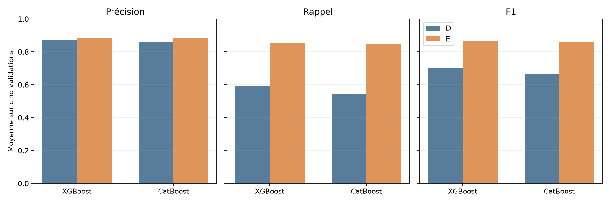
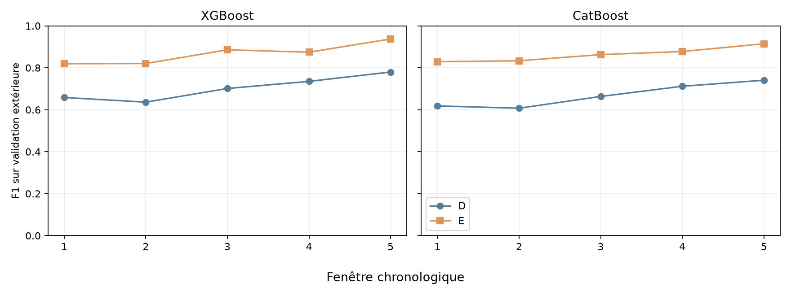
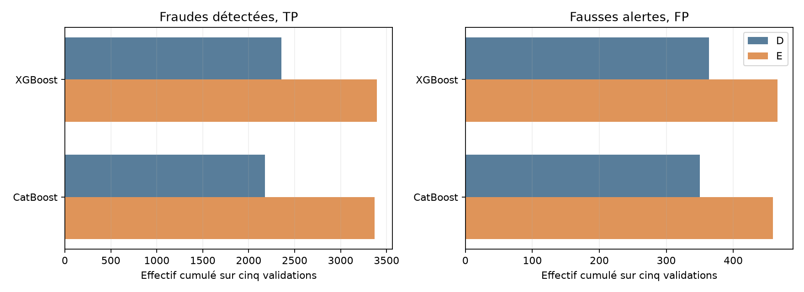

# Lot 4.4, expérience E : part du solde initial utilisée

D utilise `type + amount + oldbalanceOrg + hour_sin + hour_cos`. E ajoute seulement `part_solde = amount / oldbalanceOrg` lorsque le solde est strictement positif. Un solde nul donne `NaN`, traité nativement par XGBoost et CatBoost, sans imputation. Les ratios supérieurs à 1 ne sont pas plafonnés. Les modèles, paramètres, graines, fenêtres et seuils internes restent ceux de D. Le test 505 à 743 n'est pas consulté.

Chaque moyenne ci-dessous est arithmétique sur cinq fenêtres. Les effectifs sont cumulés sur cinq validations disjointes ; ils ne donnent pas la moyenne des métriques.

## Moyennes et effectifs cumulés

| Modèle | P D | P E | ΔP | R D | R E | ΔR | F1 D | F1 E | ΔF1 | TP D → E | FP D → E | FN D → E | Alertes D → E |
| --- | ---: | ---: | ---: | ---: | ---: | ---: | ---: | ---: | ---: | ---: | ---: | ---: | ---: | ---: |
| xgboost | 0.8698 | 0.8848 | 0.0149 | 0.5924 | 0.8520 | 0.2596 | 0.7022 | 0.8674 | 0.1652 | 2,356 → 3,395 | 364 → 466 | 1,633 → 594 | 2,720 → 3,861 |
| catboost | 0.8626 | 0.8842 | 0.0216 | 0.5463 | 0.8450 | 0.2987 | 0.6683 | 0.8634 | 0.1952 | 2,176 → 3,370 | 350 → 459 | 1,813 → 619 | 2,526 → 3,829 |

Axes : modèles en horizontal, moyenne des métriques de 0 à 1 en vertical.

Axes : fenêtres 1 à 5 en horizontal, F1 de 0 à 1 en vertical, même échelle pour les deux modèles.

Axes : effectifs cumulés, échelle linéaire, séparés entre fraudes détectées et fausses alertes.

## Résultats par fenêtre

La précision sans alerte serait notée `n.d.`. Le seuil est choisi par F1 maximal dans la réserve interne, avec regroupement des scores identiques et choix du seuil le plus élevé en cas d'égalité.

| Modèle | Fenêtre | Transactions | Fraudes | Seuil E | P E | R E | F1 E | ΔP | ΔR | ΔF1 | TP | FP | FN | TN | Alertes | Ajustement | Seuil | Prédiction | Total | Pic RSS | Ratio manquant en validation | Ratio > 1 en validation |
| --- | ---: | ---: | ---: | ---: | ---: | ---: | ---: | ---: | ---: | ---: | ---: | ---: | ---: | ---: | ---: | ---: | ---: | ---: | ---: | ---: | ---: | ---: |
| xgboost | 1 | 1,288,139 | 805 | 0.340637 | 0.7930 | 0.8472 | 0.8192 | 0.0068 | 0.2807 | 0.1607 | 682 | 178 | 123 | 1,287,156 | 860 | 1.5 s | 0.1 s | 0.2 s | 2.4 s | 1.15 Gio | 425,860 | 395,077 |
| xgboost | 2 | 1,160,580 | 842 | 0.404142 | 0.8325 | 0.8088 | 0.8205 | -0.0847 | 0.3219 | 0.1843 | 681 | 137 | 161 | 1,159,601 | 818 | 2.3 s | 0.3 s | 0.2 s | 3.4 s | 1.16 Gio | 385,132 | 353,734 |
| xgboost | 3 | 1,227,741 | 738 | 0.534904 | 0.9112 | 0.8618 | 0.8858 | 0.1048 | 0.2412 | 0.1844 | 636 | 62 | 102 | 1,226,941 | 698 | 4.1 s | 0.3 s | 0.2 s | 5.2 s | 1.53 Gio | 417,946 | 393,340 |
| xgboost | 4 | 822,359 | 840 | 0.470818 | 0.8972 | 0.8524 | 0.8742 | 0.0141 | 0.2226 | 0.1390 | 716 | 82 | 124 | 821,437 | 798 | 5.6 s | 0.3 s | 0.1 s | 6.7 s | 1.65 Gio | 276,649 | 259,950 |
| xgboost | 5 | 55,620 | 764 | 0.381896 | 0.9898 | 0.8901 | 0.9373 | 0.0335 | 0.2317 | 0.1574 | 680 | 7 | 84 | 54,849 | 687 | 8.1 s | 0.2 s | 0.0 s | 9.0 s | 1.75 Gio | 15,813 | 17,519 |
| catboost | 1 | 1,288,139 | 805 | 0.286406 | 0.8040 | 0.8559 | 0.8291 | 0.0374 | 0.3379 | 0.2109 | 689 | 168 | 116 | 1,287,166 | 857 | 4.3 s | 0.1 s | 0.1 s | 4.9 s | 1.22 Gio | 425,860 | 395,077 |
| catboost | 2 | 1,160,580 | 842 | 0.401748 | 0.8541 | 0.8135 | 0.8333 | 0.0088 | 0.3397 | 0.2260 | 685 | 117 | 157 | 1,159,621 | 802 | 6.5 s | 0.2 s | 0.1 s | 7.2 s | 1.54 Gio | 385,132 | 353,734 |
| catboost | 3 | 1,227,741 | 738 | 0.469655 | 0.8975 | 0.8306 | 0.8628 | 0.0360 | 0.2913 | 0.1994 | 613 | 70 | 125 | 1,226,933 | 683 | 12.5 s | 0.2 s | 0.1 s | 13.3 s | 1.96 Gio | 417,946 | 393,340 |
| catboost | 4 | 822,359 | 840 | 0.325028 | 0.8989 | 0.8571 | 0.8775 | 0.0080 | 0.2643 | 0.1656 | 720 | 81 | 120 | 821,438 | 801 | 18.1 s | 0.2 s | 0.1 s | 19.2 s | 2.45 Gio | 276,649 | 259,950 |
| catboost | 5 | 55,620 | 764 | 0.22129 | 0.9665 | 0.8678 | 0.9145 | 0.0176 | 0.2605 | 0.1739 | 663 | 23 | 101 | 54,833 | 686 | 24.1 s | 0.1 s | 0.0 s | 24.8 s | 2.76 Gio | 15,813 | 17,519 |

## Régularité, coût et interprétation

| Modèle | F1 minimum D → E | Écart-type descriptif D → E | Ajustement D → E | Temps total D → E | Pic RSS D → E |
| --- | ---: | ---: | ---: | ---: | ---: |
| xgboost | 0.6362 → 0.8192 | 0.0579 → 0.0495 | 14.3 → 21.5 s | 20.2 → 26.8 s | 1.53 → 1.75 Gio |
| catboost | 0.6073 → 0.8291 | 0.0578 → 0.0350 | 66.2 → 65.5 s | 69.6 → 69.4 s | 2.47 → 2.76 Gio |

Le ratio rend explicite une relation entre deux entrées déjà présentes. Une différence mesurée décrit le pipeline E et son seuil réestimé, pas un effet causal isolé de la variable. La relation montant et solde initial porte une signature forte du simulateur PaySim ; un gain éventuel ne garantit pas une généralisation à des opérations réelles. L'heure est simulée. Les apprentissages se recouvrent, les validations ont déjà guidé plusieurs analyses et les labels du futur test ont été exposés pendant l'EDA. Aucun modèle final n'est annoncé. Les résultats structurés gardent les paramètres, versions, bornes, colonnes et compteurs de ratios manquants ou supérieurs à 1.
