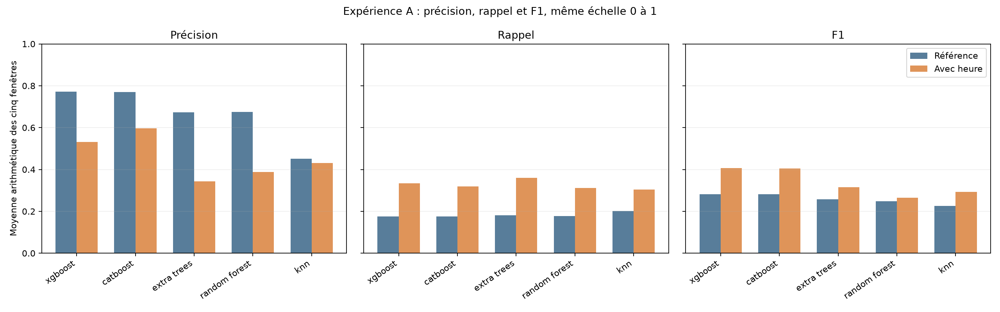
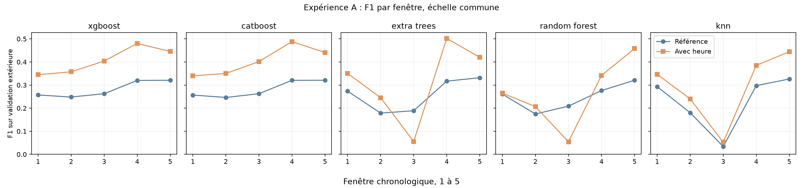

# Lot 4.3, expérience A : heure simulée

La référence utilise `type + amount`. Cette expérience ajoute **une information cyclique** `h=(step-1)%24`, codée en sinus et cosinus ; ce n'est pas une heure civile confirmée. Les 25 scores de référence proviennent du [benchmark vérifié](ML_BENCHMARK.md), sans réentraînement. Les configurations initiales et les cinq portions temporelles sont conservées. Chaque seuil est réestimé par F1 maximal sur la réserve interne, jamais sur la validation extérieure. Le test 505 à 743 n'est pas consulté.

## Moyennes arithmétiques et changements

Ces moyennes donnent le même poids à chacune des cinq fenêtres. Elles ne sont pas des ratios calculés sur les cases de confusion cumulées. `Δ` = avec heure moins référence ; les effectifs FP et FN sont, eux, additionnés sur les fenêtres.

| Modèle | P réf. | P heure | ΔP | R réf. | R heure | ΔR | F1 réf. | F1 heure | ΔF1 | Alertes réf. → heure | FP réf. → heure | FN réf. → heure |
| --- | ---: | ---: | ---: | ---: | ---: | ---: | ---: | ---: | ---: | ---: | ---: | ---: |
| xgboost | 0.7714 | 0.5314 | -0.2400 | 0.1752 | 0.3348 | 0.1595 | 0.2818 | 0.4065 | 0.1247 | 988 → 2,555 | 288 → 1,219 | 3,289 → 2,653 |
| catboost | 0.7697 | 0.5960 | -0.1738 | 0.1750 | 0.3186 | 0.1436 | 0.2814 | 0.4042 | 0.1228 | 986 → 2,266 | 287 → 993 | 3,290 → 2,716 |
| extra_trees | 0.6738 | 0.3431 | -0.3307 | 0.1807 | 0.3604 | 0.1797 | 0.2580 | 0.3147 | 0.0567 | 1,833 → 12,172 | 1,107 → 10,736 | 3,263 → 2,553 |
| random_forest | 0.6745 | 0.3875 | -0.2870 | 0.1778 | 0.3109 | 0.1331 | 0.2483 | 0.2652 | 0.0169 | 1,995 → 12,921 | 1,282 → 11,692 | 3,276 → 2,760 |
| knn | 0.4508 | 0.4303 | -0.0204 | 0.2012 | 0.3042 | 0.1029 | 0.2263 | 0.2938 | 0.0676 | 10,156 → 11,149 | 9,354 → 9,943 | 3,187 → 2,783 |

Les trois panneaux partagent une échelle verticale de 0 à 1 ; chaque barre est la moyenne d'une métrique sur cinq fenêtres. Les axes horizontaux indiquent les modèles.

Les cinq panneaux partagent la même échelle verticale de F1. L'axe horizontal suit les validations successives. Les lignes relient des périodes différentes, pas les mêmes transactions.

## Détail par modèle et fenêtre

P = précision ; R = rappel. Seuil et cases correspondent uniquement à l'expérience A ; les colonnes Δ comparent A à la référence sur la même validation. Une précision sans alerte serait non définie (`n.d.`).

| Modèle | Fenêtre | Transactions | Fraudes | Seuil A | P A | R A | F1 A | ΔP | ΔR | ΔF1 | TP | FP | FN | TN | Alertes | ΔFP | ΔFN |
| --- | ---: | ---: | ---: | ---: | ---: | ---: | ---: | ---: | ---: | ---: | ---: | ---: | ---: | ---: | ---: | ---: | ---: | ---: |
| xgboost | 1 | 1,288,139 | 805 | 0.11743 | 0.4379 | 0.2845 | 0.3449 | -0.0279 | 0.1068 | 0.0877 | 229 | 294 | 576 | 1,287,040 | 523 | +130 | -86 |
| xgboost | 2 | 1,160,580 | 842 | 0.132742 | 0.4968 | 0.2791 | 0.3574 | -0.1547 | 0.1259 | 0.1093 | 235 | 238 | 607 | 1,159,500 | 473 | +169 | -106 |
| xgboost | 3 | 1,227,741 | 738 | 0.150881 | 0.6526 | 0.2927 | 0.4041 | -0.3213 | 0.1409 | 0.1415 | 216 | 115 | 522 | 1,226,888 | 331 | +112 | -104 |
| xgboost | 4 | 822,359 | 840 | 0.079066 | 0.5736 | 0.4131 | 0.4803 | -0.1922 | 0.2107 | 0.1601 | 347 | 258 | 493 | 821,261 | 605 | +206 | -177 |
| xgboost | 5 | 55,620 | 764 | 0.0863568 | 0.4960 | 0.4045 | 0.4456 | -0.5040 | 0.2134 | 0.1247 | 309 | 314 | 455 | 54,542 | 623 | +314 | -163 |
| catboost | 1 | 1,288,139 | 805 | 0.0771465 | 0.4254 | 0.2832 | 0.3400 | -0.0464 | 0.1068 | 0.0833 | 228 | 308 | 577 | 1,287,026 | 536 | +149 | -86 |
| catboost | 2 | 1,160,580 | 842 | 0.15154 | 0.6088 | 0.2458 | 0.3503 | -0.0409 | 0.0938 | 0.1039 | 207 | 133 | 635 | 1,159,605 | 340 | +64 | -79 |
| catboost | 3 | 1,227,741 | 738 | 0.14718 | 0.8369 | 0.2642 | 0.4016 | -0.1370 | 0.1125 | 0.1390 | 195 | 38 | 543 | 1,226,965 | 233 | +35 | -83 |
| catboost | 4 | 822,359 | 840 | 0.0534601 | 0.5803 | 0.4214 | 0.4883 | -0.1730 | 0.2179 | 0.1678 | 354 | 256 | 486 | 821,263 | 610 | +200 | -183 |
| catboost | 5 | 55,620 | 764 | 0.0870095 | 0.5283 | 0.3783 | 0.4409 | -0.4717 | 0.1872 | 0.1200 | 289 | 258 | 475 | 54,598 | 547 | +258 | -143 |
| extra_trees | 1 | 1,288,139 | 805 | 0.0325377 | 0.3641 | 0.3379 | 0.3505 | -0.0156 | 0.1242 | 0.0771 | 272 | 475 | 533 | 1,286,859 | 747 | +194 | -100 |
| extra_trees | 2 | 1,160,580 | 842 | 0.0616422 | 0.2041 | 0.3076 | 0.2454 | 0.0357 | 0.1176 | 0.0668 | 259 | 1,010 | 583 | 1,158,728 | 1,269 | +220 | -99 |
| extra_trees | 3 | 1,227,741 | 738 | 0.0783803 | 0.0299 | 0.3645 | 0.0553 | -0.9701 | 0.2602 | -0.1337 | 269 | 8,729 | 469 | 1,218,274 | 8,998 | +8,729 | -192 |
| extra_trees | 4 | 822,359 | 840 | 0.0484433 | 0.6552 | 0.4071 | 0.5022 | -0.1657 | 0.2107 | 0.1852 | 342 | 180 | 498 | 821,339 | 522 | +144 | -177 |
| extra_trees | 5 | 55,620 | 764 | 0.0464145 | 0.4623 | 0.3848 | 0.4200 | -0.5377 | 0.1859 | 0.0881 | 294 | 342 | 470 | 54,514 | 636 | +342 | -142 |
| random_forest | 1 | 1,288,139 | 805 | 0.0865766 | 0.2489 | 0.2832 | 0.2650 | -0.0641 | 0.0596 | 0.0041 | 228 | 688 | 577 | 1,286,646 | 916 | +293 | -48 |
| random_forest | 2 | 1,160,580 | 842 | 0.0915905 | 0.1567 | 0.3040 | 0.2068 | -0.0016 | 0.1093 | 0.0321 | 256 | 1,378 | 586 | 1,158,360 | 1,634 | +506 | -92 |
| random_forest | 3 | 1,227,741 | 738 | 0.109816 | 0.0294 | 0.3862 | 0.0546 | -0.9706 | 0.2696 | -0.1541 | 285 | 9,418 | 453 | 1,217,585 | 9,703 | +9,418 | -199 |
| random_forest | 4 | 822,359 | 840 | 0.270649 | 0.9031 | 0.2107 | 0.3417 | 0.0017 | 0.0476 | 0.0655 | 177 | 19 | 663 | 821,500 | 196 | +4 | -40 |
| random_forest | 5 | 55,620 | 764 | 0.15569 | 0.5996 | 0.3704 | 0.4579 | -0.4004 | 0.1793 | 0.1370 | 283 | 189 | 481 | 54,667 | 472 | +189 | -137 |
| knn | 1 | 1,288,139 | 805 | 0.12 | 0.3665 | 0.3292 | 0.3469 | -0.0960 | 0.1143 | 0.0534 | 265 | 458 | 540 | 1,286,876 | 723 | +257 | -92 |
| knn | 2 | 1,160,580 | 842 | 0.24 | 0.2190 | 0.2660 | 0.2402 | 0.0475 | 0.0760 | 0.0599 | 224 | 799 | 618 | 1,158,939 | 1,023 | +26 | -64 |
| knn | 3 | 1,227,741 | 738 | 0.16 | 0.0283 | 0.3360 | 0.0522 | 0.0100 | 0.1274 | 0.0186 | 248 | 8,507 | 490 | 1,218,496 | 8,755 | +237 | -94 |
| knn | 4 | 822,359 | 840 | 0.52 | 0.9152 | 0.2440 | 0.3853 | 0.3137 | 0.0464 | 0.0878 | 205 | 19 | 635 | 821,500 | 224 | -91 | -39 |
| knn | 5 | 55,620 | 764 | 0.2 | 0.6226 | 0.3455 | 0.4444 | -0.3774 | 0.1505 | 0.1180 | 264 | 160 | 500 | 54,696 | 424 | +160 | -115 |

## Régularité et coût local

L'écart-type descriptif porte sur cinq F1 dépendants. Le pic RSS est échantillonné chaque seconde par l'orchestrateur et peut manquer un pic bref. Les temps additionnent les cinq exécutions ; le temps total inclut notamment cinq lectures du CSV.

| Modèle | F1 min réf. → A | Écart-type F1 réf. → A | Ajustement réf. → A | Temps total réf. → A | Pic RSS réf. → A |
| --- | ---: | ---: | ---: | ---: | ---: |
| xgboost | 0.2481 → 0.3449 | 0.0357 → 0.0574 | 10.9 → 14.0 s | 14.7 → 20.1 s | 1.24 → 1.43 Gio |
| catboost | 0.2464 → 0.3400 | 0.0363 → 0.0621 | 65.0 → 72.6 s | 68.3 → 76.7 s | 2.50 → 2.49 Gio |
| extra_trees | 0.1786 → 0.0553 | 0.0712 → 0.1729 | 38.9 → 48.2 s | 46.1 → 56.1 s | 1.95 → 2.20 Gio |
| random_forest | 0.1747 → 0.0546 | 0.0574 → 0.1506 | 241.2 → 177.4 s | 248.8 → 187.2 s | 1.91 → 1.99 Gio |
| knn | 0.0336 → 0.0522 | 0.1213 → 0.1542 | 6.7 → 8.9 s | 331.9 → 156.3 s | 1.64 → 2.50 Gio |

## Observations mesurées

Le F1 moyen et le rappel moyen augmentent pour les cinq pipelines, tandis que leur précision moyenne diminue. Il s'agit d'un compromis concret : davantage de fraudes détectées, mais aussi davantage de normales alertées dans les cumuls. XGBoost et CatBoost améliorent leur F1 dans les cinq fenêtres. Extra Trees et Random Forest perdent fortement en fenêtre 3 : respectivement 8 729 et 9 418 fausses alertes dans cette seule validation, malgré un meilleur F1 moyen. KNN progresse en F1 sur les cinq fenêtres mais reste faible en fenêtre 3. Ces écarts empêchent de résumer l'expérience par un seul rang ou une seule moyenne.

Les temps ont été mesurés dans des processus séparés sur la même machine. Le total KNN observé baisse malgré l'ajout : cette variation de temps ne démontre pas que la nouvelle variable accélère KNN ; la recherche de voisins, la charge de la machine et les prédictions peuvent changer le temps mesuré.

## Lecture et limites

Une hausse ou baisse est mesurée pour le **pipeline enrichi avec son seuil recalculé**. Le résultat ne prouve ni un comportement horaire réel, ni une cause métier. Les modèles n'ont pas exactement la même représentation du montant et de `type` ; les comparaisons les plus contrôlées sont donc celles d'un même modèle avant et après ajout. Les taux de fraude des validations sont respectivement 0,0625 %, 0,0725 %, 0,0601 %, 0,1021 % et 1,3736 %. La dernière période a seulement 55 620 lignes. Les cinq résultats partagent des apprentissages et ne sont pas indépendants. Les labels du futur test avaient été vus pendant l'EDA, mais aucun score du test n'a servi ici. Le [fichier structuré](results/ml_feature_hour.json) garde configurations, versions, bornes, colonnes et résultats agrégés ; les journaux locaux restent hors de Git.
