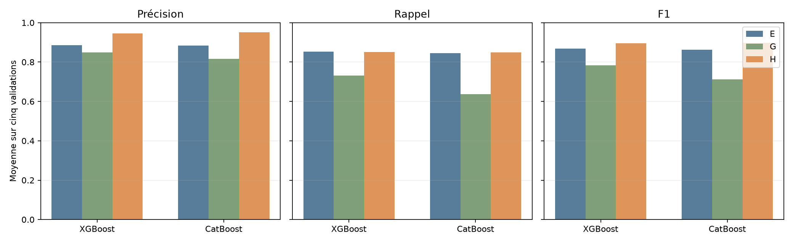
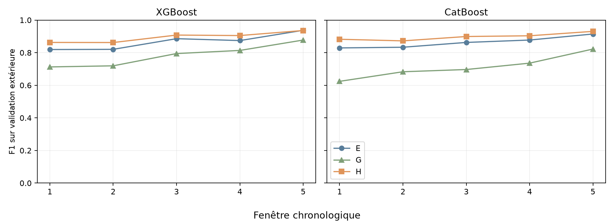
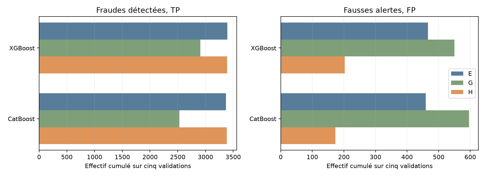

# Lot 4.4, expérience H : ratio et activité passée du destinataire

H combine les cinq entrées de D, le ratio exact de [E](ML_FEATURE_BALANCE_SHARE.md) et le compteur exact de [G](ML_FEATURE_RECIPIENT_HISTORY.md), sans autre variable. Le ratio vaut `amount / oldbalanceOrg` pour un solde strictement positif, sinon `NaN` ; il n'est pas plafonné. Le compteur brut vaut le nombre de réceptions du même `nameDest` aux steps strictement antérieurs, zéro sans historique. `nameDest` ne devient pas un prédicteur brut. Le calcul ignore labels, ordre des lignes dans un step et test 505 à 743.

Les paramètres XGBoost et CatBoost sont ceux de D, E et G. Chaque modèle apprend sur la première portion chronologique, choisit son seuil par F1 maximal sur la réserve interne, puis est évalué sur la validation extérieure. Les scores identiques sont groupés ; le seuil le plus haut départage deux maxima F1. Une précision sans alerte reste `n.d.`. E et G sont réutilisées sans réentraînement.

## Moyennes des cinq fenêtres

La comparaison principale est H moins E ; la comparaison complémentaire est H moins G. Chaque métrique est une moyenne arithmétique des cinq validations, non un ratio tiré des cases cumulées. `Δ` signifie H moins la référence nommée.

| Modèle | Variante | Précision moyenne | Rappel moyen | F1 moyen | F1 min | Écart-type F1 |
| --- | ---: | ---: | ---: | ---: | ---: | ---: |
| xgboost | E | 0.8848 | 0.8520 | 0.8674 | 0.8192 | 0.0495 |
| xgboost | G | 0.8491 | 0.7311 | 0.7835 | 0.7125 | 0.0689 |
| xgboost | H | 0.9456 | 0.8510 | 0.8948 | 0.8622 | 0.0319 |
| catboost | E | 0.8842 | 0.8450 | 0.8634 | 0.8291 | 0.0350 |
| catboost | G | 0.8162 | 0.6361 | 0.7123 | 0.6242 | 0.0733 |
| catboost | H | 0.9519 | 0.8493 | 0.8976 | 0.8724 | 0.0224 |

Axes : modèles en horizontal, moyenne des trois métriques de 0 à 1 en vertical.

Axes : fenêtres 1 à 5 en horizontal, F1 de 0 à 1 en vertical sur une échelle commune.

## Effectifs cumulés et écarts

Ces nombres additionnent les cinq validations disjointes. Une baisse de FP réduit les fausses alertes ; une hausse de TP augmente les fraudes détectées.

| Modèle | Variante ou écart | TP | FP | FN | Alertes |
| --- | ---: | ---: | ---: | ---: | ---: |
| xgboost | E | 3,395 | 466 | 594 | 3,861 |
| xgboost | G | 2,909 | 550 | 1,080 | 3,459 |
| xgboost | H | 3,388 | 203 | 601 | 3,591 |
| xgboost | H − E | -7 | -263 | +7 | -270 |
| xgboost | H − G | +479 | -347 | -479 | +132 |
| catboost | E | 3,370 | 459 | 619 | 3,829 |
| catboost | G | 2,528 | 596 | 1,461 | 3,124 |
| catboost | H | 3,385 | 173 | 604 | 3,558 |
| catboost | H − E | +15 | -286 | -15 | -271 |
| catboost | H − G | +857 | -423 | -857 | +434 |

Axes : effectifs cumulés linéaires, TP et FP dans deux panneaux distincts.

## Résultats par fenêtre

Chaque Δ de métrique compare H à E ou G sur la même validation et avec le seuil propre à chaque pipeline. Les seuils H et cases de confusion sont publiés ci-dessous.

| Modèle | Fenêtre | Seuil H | P H | R H | F1 H | ΔP/E | ΔR/E | ΔF1/E | ΔP/G | ΔR/G | ΔF1/G |
| --- | ---: | ---: | ---: | ---: | ---: | ---: | ---: | ---: | ---: | ---: | ---: |
| xgboost | 1 | 0.30538 | 0.8699 | 0.8559 | 0.8629 | 0.0769 | 0.0087 | 0.0436 | 0.1710 | 0.1292 | 0.1503 |
| xgboost | 2 | 0.637798 | 0.9579 | 0.7838 | 0.8622 | 0.1254 | -0.0249 | 0.0417 | 0.1145 | 0.1568 | 0.1428 |
| xgboost | 3 | 0.439554 | 0.9279 | 0.8889 | 0.9080 | 0.0167 | 0.0271 | 0.0222 | 0.0857 | 0.1369 | 0.1134 |
| xgboost | 4 | 0.647156 | 0.9739 | 0.8452 | 0.9050 | 0.0767 | -0.0071 | 0.0308 | 0.0830 | 0.0964 | 0.0913 |
| xgboost | 5 | 0.587022 | 0.9985 | 0.8809 | 0.9360 | 0.0087 | -0.0092 | -0.0013 | 0.0286 | 0.0798 | 0.0586 |
| catboost | 1 | 0.353136 | 0.9322 | 0.8373 | 0.8822 | 0.1283 | -0.0186 | 0.0531 | 0.2534 | 0.2596 | 0.2580 |
| catboost | 2 | 0.348922 | 0.9266 | 0.8242 | 0.8724 | 0.0725 | 0.0107 | 0.0391 | 0.0642 | 0.2589 | 0.1895 |
| catboost | 3 | 0.423375 | 0.9448 | 0.8577 | 0.8991 | 0.0473 | 0.0271 | 0.0364 | 0.2217 | 0.1856 | 0.2025 |
| catboost | 4 | 0.385226 | 0.9661 | 0.8488 | 0.9037 | 0.0672 | -0.0083 | 0.0262 | 0.0815 | 0.2190 | 0.1679 |
| catboost | 5 | 0.199813 | 0.9897 | 0.8783 | 0.9307 | 0.0232 | 0.0105 | 0.0162 | 0.0577 | 0.1427 | 0.1084 |

### Matrices de confusion et alertes

| Modèle | Fenêtre | Transactions | Fraudes | Alertes | TP | FP | FN | TN | ΔTP/E | ΔFP/E | ΔTP/G | ΔFP/G |
| --- | ---: | ---: | ---: | ---: | ---: | ---: | ---: | ---: | ---: | ---: | ---: | ---: |
| xgboost | 1 | 1,288,139 | 805 | 792 | 689 | 103 | 116 | 1,287,231 | +7 | -75 | +104 | -149 |
| xgboost | 2 | 1,160,580 | 842 | 689 | 660 | 29 | 182 | 1,159,709 | -21 | -108 | +132 | -69 |
| xgboost | 3 | 1,227,741 | 738 | 707 | 656 | 51 | 82 | 1,226,952 | +20 | -11 | +101 | -53 |
| xgboost | 4 | 822,359 | 840 | 729 | 710 | 19 | 130 | 821,500 | -6 | -63 | +81 | -58 |
| xgboost | 5 | 55,620 | 764 | 674 | 673 | 1 | 91 | 54,855 | -7 | -6 | +61 | -18 |
| catboost | 1 | 1,288,139 | 805 | 723 | 674 | 49 | 131 | 1,287,285 | -15 | -119 | +209 | -171 |
| catboost | 2 | 1,160,580 | 842 | 749 | 694 | 55 | 148 | 1,159,683 | +9 | -62 | +218 | -21 |
| catboost | 3 | 1,227,741 | 738 | 670 | 633 | 37 | 105 | 1,226,966 | +20 | -33 | +137 | -153 |
| catboost | 4 | 822,359 | 840 | 738 | 713 | 25 | 127 | 821,494 | -7 | -56 | +184 | -44 |
| catboost | 5 | 55,620 | 764 | 678 | 671 | 7 | 93 | 54,849 | +8 | -16 | +109 | -34 |

### Temps et mémoire observés

Les temps sont en secondes, les mémoires en Gio. `Historique` construit le compteur sur les steps 1 à 504 ; `Variables` construit les tableaux fit, réserve et validation, ratio compris. Le RSS après historique est un instantané. Le pic RSS est échantillonné chaque seconde et peut manquer un pic très bref.

| Modèle | Fenêtre | Lecture s | Historique s | Variables s | Ajustement s | Seuil s | Prédiction s | Total s | RSS historique Gio | Pic RSS Gio |
| --- | ---: | ---: | ---: | ---: | ---: | ---: | ---: | ---: | ---: | ---: |
| xgboost | 1 | 0.2 | 2.2 | 0.2 | 1.3 | 0.1 | 0.23 | 4.4 | 0.82 | 1.72 |
| xgboost | 2 | 0.2 | 1.9 | 0.3 | 1.9 | 0.3 | 0.20 | 5.0 | 1.14 | 1.71 |
| xgboost | 3 | 0.2 | 1.9 | 0.3 | 3.7 | 0.3 | 0.22 | 6.8 | 0.99 | 2.02 |
| xgboost | 4 | 0.2 | 2.5 | 0.4 | 5.5 | 0.3 | 0.16 | 9.4 | 0.77 | 1.94 |
| xgboost | 5 | 0.2 | 2.0 | 0.4 | 7.2 | 0.2 | 0.01 | 10.2 | 0.97 | 2.12 |
| catboost | 1 | 0.2 | 1.9 | 0.1 | 4.4 | 0.1 | 0.11 | 7.0 | 0.85 | 1.54 |
| catboost | 2 | 0.2 | 1.9 | 0.1 | 6.5 | 0.2 | 0.11 | 9.3 | 0.99 | 2.01 |
| catboost | 3 | 0.2 | 1.9 | 0.1 | 12.9 | 0.2 | 0.11 | 15.7 | 0.94 | 2.30 |
| catboost | 4 | 0.6 | 2.3 | 0.2 | 20.9 | 0.3 | 0.09 | 24.6 | 0.77 | 2.77 |
| catboost | 5 | 0.9 | 2.1 | 0.2 | 28.2 | 0.2 | 0.01 | 31.8 | 0.64 | 2.35 |

## Régularité et coût cumulé

Les cinq apprentissages se recouvrent : l'écart-type est descriptif, sans inférence statistique indépendante. Chaque processus reconstruit l'historique complet, ce qui explique son addition sur cinq exécutions. Les coûts locaux de E, G et H ne sont pas des benchmarks contrôlés de vitesse, car ils ont été exécutés séparément.

| Modèle | Variante | F1 min | Écart-type F1 | Ajustement total s | Temps total s | Pic RSS Gio |
| --- | ---: | ---: | ---: | ---: | ---: | ---: |
| xgboost | E | 0.8192 | 0.0495 | 21.5 | 26.8 | 1.75 |
| xgboost | G | 0.7125 | 0.0689 | 15.2 | 30.1 | 2.08 |
| xgboost | H | 0.8622 | 0.0319 | 19.6 | 35.9 | 2.12 |
| catboost | E | 0.8291 | 0.0350 | 65.5 | 69.4 | 2.76 |
| catboost | G | 0.6242 | 0.0733 | 65.3 | 79.2 | 2.63 |
| catboost | H | 0.8724 | 0.0224 | 73.0 | 88.4 | 2.77 |

Le temps total H de construction de l'historique est 10.5 s pour XGBoost et 10.1 s pour CatBoost. Le temps total H de construction des tableaux de variables est 1.6 s et 0.7 s, respectivement.

## Interprétation et limites

Pour xgboost, H moins E vaut +0.0274 de F1 moyen et H moins G vaut +0.1113. Ces différences décrivent les pipelines complets avec seuil réestimé, pas un effet causal isolé.
Pour catboost, H moins E vaut +0.0342 de F1 moyen et H moins G vaut +0.1853. Ces différences décrivent les pipelines complets avec seuil réestimé, pas un effet causal isolé.

Face à E, H progresse en F1 sur quatre fenêtres sur cinq pour XGBoost et sur les cinq pour CatBoost. La cinquième fenêtre XGBoost baisse légèrement de 0,0013. Le gain moyen accompagné de moins de fausses alertes soutient une complémentarité pratique du compteur et du ratio dans PaySim, sans gain universel sur chaque période. Le ratio peut amplifier une signature propre au simulateur entre montant et solde initial. L'heure est simulée et la fréquence d'un destinataire ne prouve pas une intention frauduleuse. Les validations ont été réutilisées dans plusieurs expériences, les apprentissages se recouvrent et les labels du futur test avaient été examinés lors de l'EDA. Aucun score 505 à 743 n'est utilisé ici, aucun modèle final n'est retenu et aucune généralisation réelle n'est démontrée.
