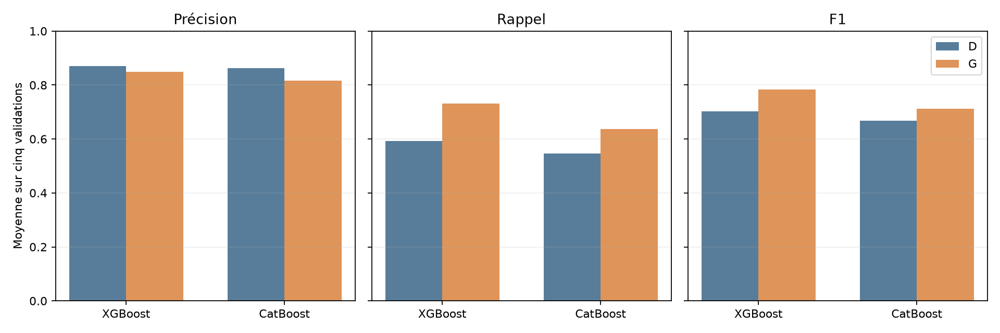
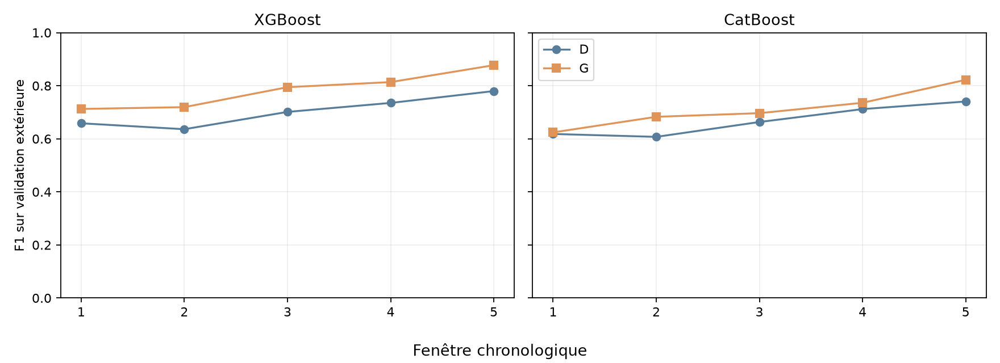
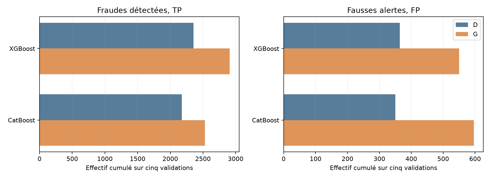

# Lot 4.4, expérience G : activité passée du destinataire

G ajoute seulement `nb_entrees_anterieures` aux entrées de [D](ML_FEATURE_BALANCE_ORG_HOUR.md) : `type`, `amount`, `oldbalanceOrg`, `hour_sin`, `hour_cos`. Le compteur est le nombre de transactions du même `nameDest` aux steps strictement inférieurs. Il reste brut en `float32`, sans transformation apprise. `nameDest` sert uniquement au calcul ; le ratio de E et le compteur émetteur F n'entrent pas dans G. D est réutilisée sans réentraînement.

Chaque modèle apprend sur la première portion, choisit son seuil par F1 maximal dans la réserve interne avec scores identiques groupés et seuil le plus haut à égalité, puis est mesuré sur la validation extérieure. Une précision sans alerte reste non définie. Les steps 505 à 743 ne sont pas lus pour les prédictions.

## Moyennes et effectifs cumulés

Chaque moyenne est arithmétique sur cinq fenêtres. Les effectifs TP, FP, FN et alertes sont additionnés sur cinq validations disjointes. `Δ` signifie G moins D.

| Modèle | P D | P G | ΔP | R D | R G | ΔR | F1 D | F1 G | ΔF1 | TP D → G | FP D → G | FN D → G | Alertes D → G |
| --- | ---: | ---: | ---: | ---: | ---: | ---: | ---: | ---: | ---: | ---: | ---: | ---: | ---: |
| xgboost | 0.8698 | 0.8491 | -0.0208 | 0.5924 | 0.7311 | 0.1387 | 0.7022 | 0.7835 | 0.0813 | 2,356 → 2,909 | 364 → 550 | 1,633 → 1,080 | 2,720 → 3,459 |
| catboost | 0.8626 | 0.8162 | -0.0465 | 0.5463 | 0.6361 | 0.0898 | 0.6683 | 0.7123 | 0.0441 | 2,176 → 2,528 | 350 → 596 | 1,813 → 1,461 | 2,526 → 3,124 |

Axes : modèles en horizontal, moyenne de précision, rappel et F1 de 0 à 1 en vertical.

Axes : fenêtres 1 à 5 en horizontal, F1 de 0 à 1 en vertical, échelle commune.

Axes : effectifs cumulés linéaires, séparés entre fraudes détectées et fausses alertes.

## Résultats par modèle et fenêtre

Le seuil, les cases de confusion, les temps et la mémoire concernent G. `n.d.` signifie précision non définie. Les Δ comparent G à D sur la même validation.

| Modèle | Fenêtre | Transactions | Fraudes | Seuil G | P G | R G | F1 G | ΔP | ΔR | ΔF1 | TP | FP | FN | TN | Alertes | ΔTP | ΔFP | Construction historique | RSS après historique | Ajustement | Seuil | Prédiction | Total | Pic RSS |
| --- | ---: | ---: | ---: | ---: | ---: | ---: | ---: | ---: | ---: | ---: | ---: | ---: | ---: | ---: | ---: | ---: | ---: | ---: | ---: | ---: | ---: | ---: | ---: | ---: |
| xgboost | 1 | 1,288,139 | 805 | 0.183916 | 0.6989 | 0.7267 | 0.7125 | -0.0873 | 0.1602 | 0.0541 | 585 | 252 | 220 | 1,287,082 | 837 | +129 | +128 | 2.3 s | 0.87 Gio | 1.0 s | 0.1 s | 0.17 s | 4.2 s | 1.97 Gio |
| xgboost | 2 | 1,160,580 | 842 | 0.33611 | 0.8435 | 0.6271 | 0.7193 | -0.0738 | 0.1401 | 0.0832 | 528 | 98 | 314 | 1,159,640 | 626 | +118 | +61 | 2.0 s | 0.81 Gio | 1.4 s | 0.3 s | 0.16 s | 4.4 s | 1.97 Gio |
| xgboost | 3 | 1,227,741 | 738 | 0.266882 | 0.8422 | 0.7520 | 0.7946 | 0.0358 | 0.1314 | 0.0932 | 555 | 104 | 183 | 1,226,899 | 659 | +97 | -6 | 1.9 s | 1.07 Gio | 2.9 s | 0.3 s | 0.18 s | 5.8 s | 1.85 Gio |
| xgboost | 4 | 822,359 | 840 | 0.303273 | 0.8909 | 0.7488 | 0.8137 | 0.0078 | 0.1190 | 0.0785 | 629 | 77 | 211 | 821,442 | 706 | +100 | +7 | 1.9 s | 1.07 Gio | 4.3 s | 0.3 s | 0.16 s | 7.3 s | 1.98 Gio |
| xgboost | 5 | 55,620 | 764 | 0.291031 | 0.9699 | 0.8010 | 0.8774 | 0.0136 | 0.1427 | 0.0976 | 612 | 19 | 152 | 54,837 | 631 | +109 | -4 | 1.9 s | 1.07 Gio | 5.6 s | 0.2 s | 0.01 s | 8.4 s | 2.08 Gio |
| catboost | 1 | 1,288,139 | 805 | 0.137981 | 0.6788 | 0.5776 | 0.6242 | -0.0877 | 0.0596 | 0.0059 | 465 | 220 | 340 | 1,287,114 | 685 | +48 | +93 | 1.9 s | 1.09 Gio | 4.3 s | 0.1 s | 0.14 s | 6.9 s | 1.91 Gio |
| catboost | 2 | 1,160,580 | 842 | 0.187133 | 0.8623 | 0.5653 | 0.6829 | 0.0170 | 0.0914 | 0.0756 | 476 | 76 | 366 | 1,159,662 | 552 | +77 | +3 | 2.0 s | 0.97 Gio | 6.6 s | 0.2 s | 0.11 s | 9.5 s | 2.63 Gio |
| catboost | 3 | 1,227,741 | 738 | 0.132302 | 0.7230 | 0.6721 | 0.6966 | -0.1384 | 0.1328 | 0.0333 | 496 | 190 | 242 | 1,226,813 | 686 | +98 | +126 | 2.0 s | 0.87 Gio | 12.3 s | 0.2 s | 0.11 s | 15.1 s | 2.31 Gio |
| catboost | 4 | 822,359 | 840 | 0.206993 | 0.8846 | 0.6298 | 0.7357 | -0.0063 | 0.0369 | 0.0238 | 529 | 69 | 311 | 821,450 | 598 | +31 | +8 | 2.0 s | 0.94 Gio | 18.2 s | 0.2 s | 0.07 s | 21.0 s | 2.51 Gio |
| catboost | 5 | 55,620 | 764 | 0.140964 | 0.9320 | 0.7356 | 0.8222 | -0.0169 | 0.1283 | 0.0816 | 562 | 41 | 202 | 54,815 | 603 | +98 | +16 | 1.9 s | 1.00 Gio | 23.8 s | 0.1 s | 0.01 s | 26.7 s | 2.61 Gio |

## Régularité et coûts

L'écart-type est descriptif : les apprentissages se recouvrent et les cinq résultats ne sont pas indépendants. L'historique complet 1 à 504 est reconstruit dans chacun des dix processus ; les temps de construction ci-dessous sont donc additionnés sur cinq exécutions par modèle. Le pic RSS est échantillonné, et le RSS après construction est un instantané.

| Modèle | F1 min D → G | Écart-type F1 D → G | Ajustement D → G | Historique G | Temps total D → G | Pic RSS D → G |
| --- | ---: | ---: | ---: | ---: | ---: | ---: |
| xgboost | 0.6362 → 0.7125 | 0.0579 → 0.0689 | 14.3 → 15.2 s | 10.0 s | 20.2 → 30.1 s | 1.53 → 2.08 Gio |
| catboost | 0.6073 → 0.6242 | 0.0578 → 0.0733 | 66.2 → 65.3 s | 9.8 s | 69.6 → 79.2 s | 2.47 → 2.63 Gio |

## Observations et limites

Le F1 moyen augmente de +0.0813 pour XGBoost et de +0.0441 pour CatBoost face à D. Les dix comparaisons par fenêtre sont positives, mais le gain CatBoost de la première fenêtre est faible. XGBoost détecte 553 fraudes supplémentaires avec 186 fausses alertes supplémentaires ; CatBoost en détecte 352 de plus avec 246 fausses alertes de plus. La précision moyenne baisse pour les deux. Le F1 minimum s'améliore, tandis que l'écart-type des cinq F1 augmente : le niveau monte, mais sa variation temporelle aussi.

La [couverture préalable](ML_RECIPIENT_HISTORY_COVERAGE.md) était de 56,5140 % sur les steps 1 à 504 ; elle ne garantissait aucun gain prédictif. Le résultat G mesure le pipeline enrichi avec son seuil réestimé : l'effet du nouveau compteur et celui du seuil ne sont pas séparés. Un destinataire fréquent n'est pas pour autant suspect ni animé d'une intention frauduleuse. Sa fréquence peut refléter le fonctionnement de PaySim, notamment des comptes commerçants. Les comptes bruts ne sont pas des prédicteurs. L'heure est simulée, les validations ont déjà guidé plusieurs analyses, les apprentissages se recouvrent et les labels du futur test avaient été examinés pendant l'EDA. Aucun modèle final n'est annoncé. Les résultats structurés conservent versions, paramètres, graines, colonnes et matrices agrégées ; les journaux et résultats intermédiaires restent hors de Git.
