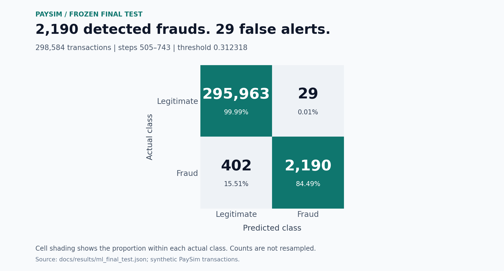

# Final evaluation of the frozen pipeline

The [freeze specification](ML_FINAL_FREEZE.md) and [manifest](results/ml_final_manifest.json) precede final scoring. CatBoost `cat_slow200` is fitted on steps 1–360; one global threshold is chosen on 361–432. Steps 433–504 informed earlier selection but do not refit the final pipeline. Steps 505–743 form one final evaluation period after freezing.

Labels do not construct model features or account histories. Test labels had already been examined during exploratory analysis, which must remain part of the experimental interpretation.

## Aggregate result

The test contains **298,584 transactions**, **2,592 frauds** (0.8681%), and **2,219 alerts** at threshold **0.312317992385**.

| Actual / decision | Legitimate | Fraud alert |
| --- | ---: | ---: |
| Legitimate | TN 295,963 | FP 29 |
| Fraud | FN 402 | TP 2,190 |

Precision is **0.9869**, recall **0.8449**, and F1 **0.9104**. Precision is TP / alerts, recall is TP / frauds, and F1 is 2TP / (2TP + FP + FN). The model score is not described as a calibrated probability.

## Comparison with development

| Evaluation | Precision | Recall | F1 | Aggregation |
| --- | ---: | ---: | ---: | --- |
| Five validation windows | 0.9581 | 0.8589 | 0.9056 | Arithmetic mean across windows |
| Final test, steps 505–743 | 0.9869 | 0.8449 | 0.9104 | One pooled period |

These aggregations have different denominators and prevalence. Development windows supported repeated model-selection decisions.

## Transaction-type diagnostics

| Type | Transactions | Frauds | Fraud rate (%) | Alerts | TP | FP | FN | Precision | Recall | F1 |
| --- | ---: | ---: | ---: | ---: | ---: | ---: | ---: | ---: | ---: | ---: |
| CASH_IN | 68121 | 0 | 0.000 | 0 | 0 | 0 | 0 | n/a | n/a | 0.0000 |
| CASH_OUT | 96019 | 1296 | 1.350 | 911 | 895 | 16 | 401 | 0.9824 | 0.6906 | 0.8111 |
| DEBIT | 2441 | 0 | 0.000 | 0 | 0 | 0 | 0 | n/a | n/a | 0.0000 |
| PAYMENT | 103976 | 0 | 0.000 | 0 | 0 | 0 | 0 | n/a | n/a | 0.0000 |
| TRANSFER | 28027 | 1296 | 4.624 | 1308 | 1295 | 13 | 1 | 0.9901 | 0.9992 | 0.9946 |

CASH_OUT accounts for 401 of 402 missed frauds. Recall is undefined without positive examples; precision is undefined without alerts. A reported zero F1 in an empty-positive group does not measure fraud-detection ability.

## Amount diagnostics

Positive amount intervals combine the 0.5-wide log10 bins used in exploratory analysis. Lower bounds are included and upper bounds excluded, except for the separate zero-amount group. Amounts use PaySim units.

| Amount | Transactions | Frauds | Fraud rate (%) | TP | FP | FN | Precision | Recall |
| --- | ---: | ---: | ---: | ---: | ---: | ---: | ---: | ---: |
| 0 | 10 | 10 | 100.000 | 0 | 0 | 10 | n/a | 0.0000 |
| (0, 100000) | 168887 | 528 | 0.313 | 363 | 9 | 165 | 0.9758 | 0.6875 |
| [100000, 10^5.5) | 92550 | 566 | 0.612 | 402 | 11 | 164 | 0.9734 | 0.7102 |
| [10^5.5, 1000000) | 31411 | 650 | 2.069 | 587 | 9 | 63 | 0.9849 | 0.9031 |
| [1000000, 10^6.5) | 4625 | 489 | 10.573 | 489 | 0 | 0 | 1.0000 | 1.0000 |
| [10^6.5, +inf) | 1101 | 349 | 31.698 | 349 | 0 | 0 | 1.0000 | 1.0000 |

All ten zero-amount transactions are fraudulent and missed. Perfect detection in the largest amount bins describes this simulator sample; it does not establish a transferable real-world rule.

## Time-period diagnostics

| Steps | Transactions | Frauds | Fraud rate (%) | Alerts | TP | FP | FN | Precision | Recall | F1 |
| --- | ---: | ---: | ---: | ---: | ---: | ---: | ---: | ---: | ---: | ---: |
| 505–672 | 232135 | 1792 | 0.772 | 1539 | 1514 | 25 | 278 | 0.9838 | 0.8449 | 0.9090 |
| 673–720 | 66177 | 528 | 0.798 | 457 | 453 | 4 | 75 | 0.9912 | 0.8580 | 0.9198 |
| 721–743 | 272 | 272 | 100.000 | 223 | 223 | 0 | 49 | 1.0000 | 0.8199 | 0.9010 |

The final period has no legitimate transactions. It cannot independently support a false-positive rate or ROC-AUC, but remains part of the aggregate test.

## Verification and interpretation

The source CSV hash and reloaded pipeline hash matched the pre-test manifest. At the 504/505 boundary, unseen recipients receive zero history. Each step is predicted before its counters are updated. Subgroup totals reconcile to all 298,584 transactions and 2,592 frauds.

An initial attempt stopped during a boundary check before test prediction. The check's dictionary access was corrected to return zero for unseen recipients, matching the existing feature construction. The model, threshold, and artifact hash did not change. The subsequent attempt produced the recorded complete test evaluation.

PaySim is synthetic, simulated hour is conventional, and balance/history availability in real operations is not established. The result is a simulator evaluation, not evidence of guaranteed real-world performance.

[Structured results](results/ml_final_test.json) · [Model manifest](results/ml_final_manifest.json)
