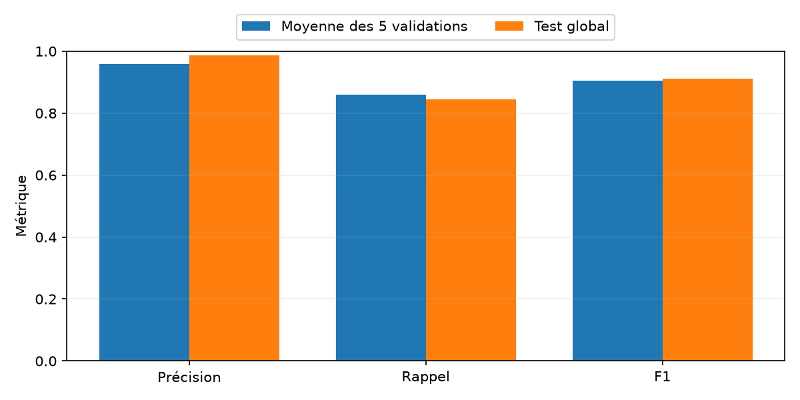
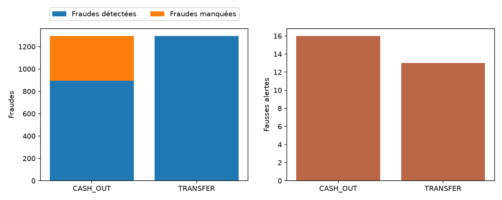
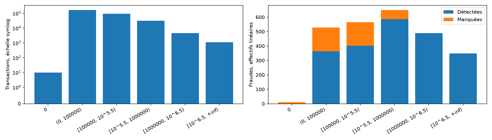
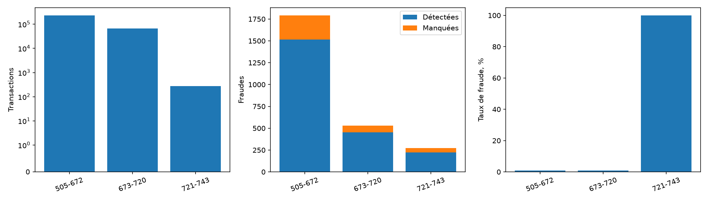

# Lot 4.5 : évaluation finale du pipeline gelé

La [décision](ML_FINAL_FREEZE.md) et le [manifeste](results/ml_final_manifest.json) ont été publiés avant le score. Le modèle CatBoost `cat_slow200` apprend sur 1–360 et le seuil est fixé sur 361–432. La période 433–504 a participé à la sélection antérieure, sans réajustement. Le test 505–743 est évalué en un ensemble unique, une fois après gel. Les labels ne construisent ni variables ni historiques.

## Résultat global

**298 584 transactions**, **2 592 fraudes**, taux de fraude **0.8681 %**. Seuil fixé **0.312317992385**. **2 219 alertes**, précision **0.9869**, rappel **0.8449**, F1 **0.9104**.

Matrice de confusion, lignes = label réel, colonnes = décision :

| Réel / décision | Normale | Alerte fraude |
| --- | ---: | ---: |
| Normale | TN 295 963 | FP 29 |
| Fraude | FN 402 | TP 2 190 |

Le taux de fraude est `fraudes / transactions`. La précision est `TP / alertes`, le rappel est `TP / fraudes` et F1 est `2TP / (2TP + FP + FN)`. Le score brut n'est pas présenté comme une probabilité calibrée.

## Comparaison descriptive avec la validation

| Ensemble | Précision | Rappel | F1 | Nature |
| --- | ---: | ---: | ---: | --- |
| Cinq validations | 0.9581 | 0.8589 | 0.9056 | Moyenne arithmétique des cinq fenêtres |
| Test 505–743 | 0.9869 | 0.8449 | 0.9104 | Métriques globales sur une seule période |

Ces deux lignes n'ont pas le même dénominateur ni les mêmes prévalences. Les validations ont guidé plusieurs choix ; le test avait été vu en EDA par l'analyste, même si ses scores n'ont pas servi aux choix.

## Diagnostics préannoncés par type

| Type | Transactions | Fraudes | Taux fraude % | Alertes | TP | FP | FN | Précision | Rappel | F1 |
| --- | ---: | ---: | ---: | ---: | ---: | ---: | ---: | ---: | ---: | ---: |
| CASH_IN | 68121 | 0 | 0.000 | 0 | 0 | 0 | 0 | n.d. | n.d. | 0.0000 |
| CASH_OUT | 96019 | 1296 | 1.350 | 911 | 895 | 16 | 401 | 0.9824 | 0.6906 | 0.8111 |
| DEBIT | 2441 | 0 | 0.000 | 0 | 0 | 0 | 0 | n.d. | n.d. | 0.0000 |
| PAYMENT | 103976 | 0 | 0.000 | 0 | 0 | 0 | 0 | n.d. | n.d. | 0.0000 |
| TRANSFER | 28027 | 1296 | 4.624 | 1308 | 1295 | 13 | 1 | 0.9901 | 0.9992 | 0.9946 |

Les fraudes test sont dans CASH_OUT et TRANSFER. Le rappel diffère fortement entre ces types. Pour un type sans fraude, le rappel est non défini ; une précision sans alerte est aussi non définie. Le F1 nul indiqué par la fonction pour ces groupes sans positif ne mesure pas une capacité à détecter des fraudes.

## Diagnostics préannoncés par montant

Les bornes positives sont des unions des tranches de largeur 0,5 de `log10(amount)` employées dans l'EDA. Le zéro est isolé. `10^5,5 ≈ 316 227,77` et `10^6,5 ≈ 3 162 277,66` unités PaySim. Chaque borne inférieure positive est incluse ; la borne supérieure est exclue.

| Montant PaySim | Transactions | Fraudes | Taux fraude % | TP | FP | FN | Précision | Rappel |
| --- | ---: | ---: | ---: | ---: | ---: | ---: | ---: | ---: |
| 0 | 10 | 10 | 100.000 | 0 | 0 | 10 | n.d. | 0.0000 |
| (0, 100000) | 168887 | 528 | 0.313 | 363 | 9 | 165 | 0.9758 | 0.6875 |
| [100000, 10^5.5) | 92550 | 566 | 0.612 | 402 | 11 | 164 | 0.9734 | 0.7102 |
| [10^5.5, 1000000) | 31411 | 650 | 2.069 | 587 | 9 | 63 | 0.9849 | 0.9031 |
| [1000000, 10^6.5) | 4625 | 489 | 10.573 | 489 | 0 | 0 | 1.0000 | 1.0000 |
| [10^6.5, +inf) | 1101 | 349 | 31.698 | 349 | 0 | 0 | 1.0000 | 1.0000 |

L'axe des volumes utilise `symlog` pour rendre visibles 10 montants nuls face aux grandes tranches ; l'axe des fraudes est linéaire. Les 10 montants nuls sont tous frauduleux et tous manqués dans ce test. Les performances parfaites des deux plus grandes tranches décrivent une signature du simulateur, pas une règle transférable au réel.

## Diagnostics préannoncés par période

| Steps | Transactions | Fraudes | Taux fraude % | Alertes | TP | FP | FN | Précision | Rappel | F1 |
| --- | ---: | ---: | ---: | ---: | ---: | ---: | ---: | ---: | ---: | ---: |
| 505-672 | 232135 | 1792 | 0.772 | 1539 | 1514 | 25 | 278 | 0.9838 | 0.8449 | 0.9090 |
| 673-720 | 66177 | 528 | 0.798 | 457 | 453 | 4 | 75 | 0.9912 | 0.8580 | 0.9198 |
| 721-743 | 272 | 272 | 100.000 | 223 | 223 | 0 | 49 | 1.0000 | 0.8199 | 0.9010 |

Le volume est en échelle `symlog`, les fraudes et le taux en axes linéaires distincts. Les steps 721–743 comptent 272 transactions, toutes frauduleuses : 223 alertées et 49 manquées. Il n'y a aucune transaction normale dans cette tranche ; taux de faux positifs, ROC-AUC et séparation des deux classes n'y sont pas définissables. Elle reste incluse dans le test global.

## Vérifications et limites

L'empreinte du CSV et celle du pipeline rechargé correspondent au manifeste antérieur au test. À la frontière 504/505, un destinataire inédit reçoit zéro ; chaque step est prédit avant mise à jour de son historique. Les matrices de confusion et les regroupements retrouvent les 298 584 lignes et 2 592 fraudes. Les prédictions individuelles et labels restent uniquement dans `data/ml_final_catboost/`, ignoré par Git.

La première tentative s'est arrêtée avant tout score test : un contrôle utilisait un accès direct au dictionnaire pour un destinataire inédit. La trace locale est conservée. La correction a remplacé cet accès par zéro, déjà utilisé par la construction effective du compteur ; le modèle, son empreinte et son seuil sont restés identiques. La seconde tentative a produit cette unique évaluation complète.

PaySim est synthétique ; le rapport montant/solde est une signature forte de ce simulateur. L'heure est conventionnelle, la disponibilité des soldes et historiques en situation réelle n'est pas établie, et les validations ont été réutilisées. L'EDA avait exposé les labels du test. Ces limites empêchent d'annoncer une performance garantie sur des transactions réelles. Aucun réglage n'a été lancé après le score.
