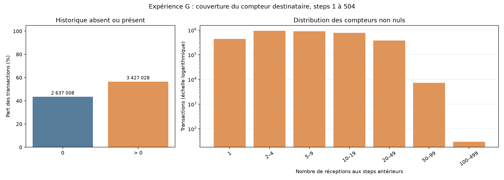

# Lot 4.4, expérience G : couverture avant entraînement

**Statut : contrôle de couverture terminé, aucun modèle G entraîné.** G ajouterait à D une seule variable : le nombre de transactions antérieures où le compte actuel apparaît comme `nameDest`. Le ratio de E et l'historique émetteur de F ne sont pas ajoutés. F reste mis de côté ; sa faible couverture ne démontre pas une absence d'utilité.

## Méthode et périmètre

L'analyse projette le CSV sur `step` et `nameDest`, puis filtre les steps 1 à 504. Elle ne lit aucun label. Le SHA-256 contrôle l'intégrité du fichier complet, sans exploiter les transactions des steps 505 à 743 pour les agrégats. Les lignes sont regroupées par destinataire et par step, en conservant leur multiplicité. Le compteur au step `t` additionne seulement les réceptions de ce destinataire aux steps strictement inférieurs à `t`. Toutes les transactions d'un même step partagent donc l'historique disponible avant ce step. L'ordre physique des lignes et les occurrences où le même compte est `nameOrig` ne comptent pas.

Le regroupement par compte et step rend explicite la règle temporelle. Un parcours step par step avec des compteurs mis à jour après chaque step serait une alternative moins gourmande en mémoire, mais devrait produire exactement la même variable. Aucun identifiant de compte n'est conservé dans les résultats publiés.

## Couverture et distribution globale

Sur **6 064 036** transactions des steps 1 à 504, **3 427 028** ont un historique destinataire non nul, soit **56,5140 %**. Les **2 637 008** autres ont zéro. Le compteur moyen, zéros inclus, vaut **5,0273** et le maximum observé est **112**.

| Réceptions aux steps antérieurs | Transactions |
| --- | ---: |
| 0 | 2 637 008 |
| 1 | 434 877 |
| 2 à 4 | 929 973 |
| 5 à 9 | 898 395 |
| 10 à 19 | 778 890 |
| 20 à 49 | 377 510 |
| 50 à 99 | 7 353 |
| 100 à 499 | 30 |
| 500 ou plus | 0 |



À gauche, l'axe vertical est la part de toutes les transactions, en pourcentage ; les effectifs bruts sont écrits au-dessus des barres zéro et non-zéro. À droite, l'axe horizontal regroupe **seulement les compteurs positifs** par tranches et l'axe vertical donne leur nombre de transactions sur une **échelle logarithmique**. Cette échelle montre à la fois les tranches proches du million et celle de 30 lignes ; une distance verticale égale représente un rapport, pas une différence fixe. Le zéro est traité séparément car il ne peut pas être placé sur cet axe logarithmique. Les tranches 500 ou plus, vides, restent dans le tableau et n'apparaissent pas comme barres.

## Trois portions de chaque fenêtre

Chaque cellule indique `transactions avec compteur > 0 / toutes les transactions de la portion`, puis le pourcentage. Les apprentissages croissants se recouvrent ; les cinq validations extérieures sont disjointes. La dernière validation est beaucoup plus petite.

| Fenêtre | Apprentissage | Réserve de seuil | Validation extérieure |
| --- | ---: | ---: | ---: |
| 1 | 556 672 / 1 030 563, 54,016 % | 271 195 / 479 034, 56,613 % | 736 208 / 1 288 139, 57,153 % |
| 2 | 827 867 / 1 509 597, 54,840 % | 736 208 / 1 288 139, 57,153 % | 657 610 / 1 160 580, 56,662 % |
| 3 | 1 564 075 / 2 797 736, 55,905 % | 657 610 / 1 160 580, 56,662 % | 704 381 / 1 227 741, 57,372 % |
| 4 | 2 221 685 / 3 958 316, 56,127 % | 704 381 / 1 227 741, 57,372 % | 470 688 / 822 359, 57,236 % |
| 5 | 2 926 066 / 5 186 057, 56,422 % | 470 688 / 822 359, 57,236 % | 30 274 / 55 620, 54,430 % |

La distribution détaillée de chaque portion, y compris les zéros et la valeur maximale, figure dans les [résultats structurés](results/ml_recipient_history_coverage.json). Les cinq validations ont une couverture comprise entre **54,430 % et 57,372 %**. Cela rend possible une comparaison G contre D sur une grande part des transactions. La couverture seule ne mesure toutefois ni association avec la fraude, ni gain prédictif. Un destinataire très fréquent peut refléter un rôle propre à PaySim, notamment un commerçant, sans être une règle de fraude. Un compteur zéro signifie seulement aucune réception antérieure observée depuis le début du fichier.

## Vérifications et reproductibilité

L'empreinte SHA-256 vérifiée est `16910f90577b0d981bf8ff289714510bb89bc71bff7d3f220f024e287e4eea6b`. Les 504 steps, les 6 064 036 transactions, les effectifs des trois portions de chaque fenêtre et les sommes des tranches sont contrôlés. Les tests synthétiques couvrent compte nouveau et déjà observé, doublons, même step, futur, permutation des lignes, séparation `nameOrig`/`nameDest` et rejet des labels. La dernière réexécution a pris **2,27 s** sur macOS Apple Silicon avec Python 3.11.15 et Polars 1.44.2 ; la mémoire résidente relevée après regroupement est **1,50 Gio**, ce qui n'est pas un pic continu. La commande `uv run --locked`, Linux et Windows n'ont pas été testés pour ce contrôle.

Depuis la racine du dépôt avec le CSV audité, le parcours générique est :

```sh
uv run --locked python -m unittest tests.test_ml_recipient_history -v
uv run --locked python scripts/inspect_ml_recipient_history.py
```

Aucun entraînement F ou G, seuil ou test final n'est effectué. La décision sur G attend la discussion des constats.
