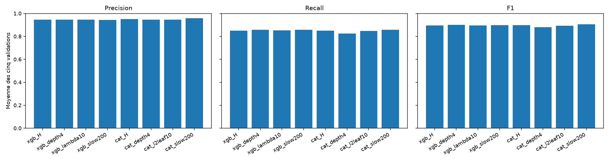
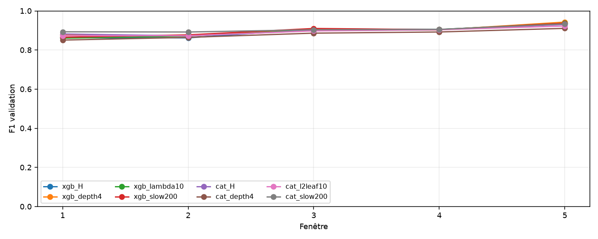
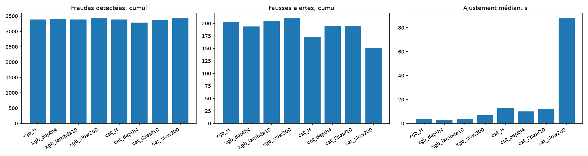

# Lot 4.4 : sélection proposée après réglages limités de H

Les huit configurations comprennent H pour chaque famille et les six variantes figées avant les scores. Les 30 nouveaux ajustements ont terminé leurs cinq fenêtres. Les moyennes ci-dessous sont arithmétiques ; TP et FP sont des effectifs cumulés sur les validations disjointes. Les apprentissages se recouvrent.

| Configuration | P moyen | R moyen | F1 moyen | F1 min | Écart-type F1 | TP | FP | Ajust. médian s | Taille médiane Mio |
| --- | ---: | ---: | ---: | ---: | ---: | ---: | ---: | ---: | ---: |
| xgb_H | 0.9456 | 0.8510 | 0.8948 | 0.8622 | 0.0319 | 3388 | 203 | 3.69 | 0.161 |
| xgb_depth4 | 0.9469 | 0.8583 | 0.9000 | 0.8731 | 0.0280 | 3418 | 194 | 3.01 | 0.122 |
| xgb_lambda10 | 0.9452 | 0.8514 | 0.8953 | 0.8605 | 0.0302 | 3392 | 205 | 3.78 | 0.140 |
| xgb_slow200 | 0.9439 | 0.8587 | 0.8988 | 0.8654 | 0.0281 | 3421 | 210 | 6.77 | 0.317 |
| cat_H | 0.9519 | 0.8493 | 0.8976 | 0.8724 | 0.0224 | 3385 | 173 | 12.89 | 0.114 |
| cat_depth4 | 0.9454 | 0.8253 | 0.8810 | 0.8509 | 0.0235 | 3290 | 195 | 10.12 | 0.040 |
| cat_l2leaf10 | 0.9468 | 0.8473 | 0.8941 | 0.8732 | 0.0212 | 3378 | 195 | 12.48 | 0.114 |
| cat_slow200 | 0.9581 | 0.8589 | 0.9056 | 0.8921 | 0.0166 | 3423 | 151 | 87.74 | 0.255 |

Les détails par fenêtre, seuil, apprentissage, mémoire et temps sont dans les [rapports XGBoost](ML_TUNE_H_XGBOOST.md) et [CatBoost](ML_TUNE_H_CATBOOST.md).

## Application de la règle préannoncée

La configuration proposée est `cat_slow200`. La sélection part du meilleur F1 moyen non arrondi, inclut les candidats à moins de 0,005, puis départage par F1 minimum et les critères suivants seulement si nécessaire. La trace exacte est dans les [résultats structurés](results/ml_tune_h_selection.json).

- `f1_mean_within_0.005` : cat_slow200.
- `f1_min_within_0.005` : cat_slow200.

## Compromis de la proposition

Face à CatBoost H, `cat_slow200` change le F1 moyen de +0.0080, les fraudes détectées de +38 et les fausses alertes de -22. Face au candidat provisoire XGBoost profondeur 4, les écarts sont +0.0056 de F1 moyen, +5 fraudes détectées et -43 fausses alertes. Le F1 minimum est 0.8921 contre 0.8731.

L'ajustement médian prend 87.74 s contre 3.01 s pour XGBoost profondeur 4, soit 29.2 fois plus dans ces exécutions locales. Les tailles médianes sont 0.255 et 0.122 Mio. La règle préannoncée ne fait intervenir le coût que si le F1 moyen et la régularité ne départagent pas les candidats. Elle propose donc la configuration ci-dessus, avec ce coût comme compromis explicite à discuter, sans la figer comme modèle final.

| Fenêtre | F1 XGBoost profondeur 4 | F1 proposition | Écart | TP écart | FP écart |
| ---: | ---: | ---: | ---: | ---: | ---: |
| 1 | 0.8764 | 0.8932 | +0.0168 | +9 | -18 |
| 2 | 0.8731 | 0.8921 | +0.0190 | +29 | +3 |
| 3 | 0.9048 | 0.9039 | -0.0010 | -12 | -13 |
| 4 | 0.9027 | 0.9056 | +0.0029 | -9 | -16 |
| 5 | 0.9428 | 0.9333 | -0.0095 | -12 | +1 |

Cette proposition attend la discussion avec l'utilisateur. Les seuils ont été réestimés sur chaque réserve interne ; les différences entre pipelines ne sont pas un effet causal isolé d'un paramètre. La signature PaySim montant/solde, l'heure simulée, les validations réutilisées et les labels du futur test vus pendant l'EDA limitent la portée des résultats. Aucun score du test 505 à 743 n'a été calculé. Aucun modèle de déploiement n'est produit.
