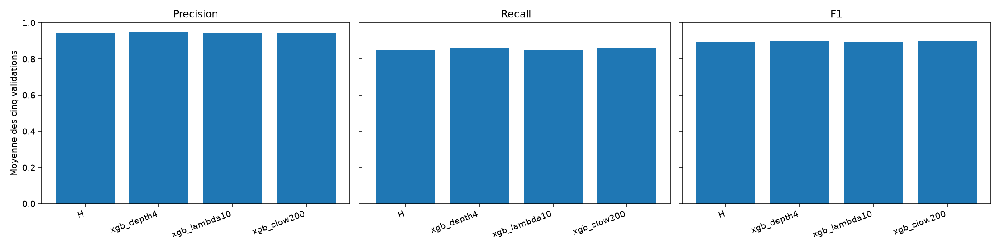
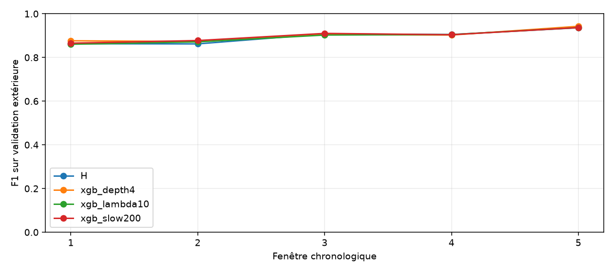
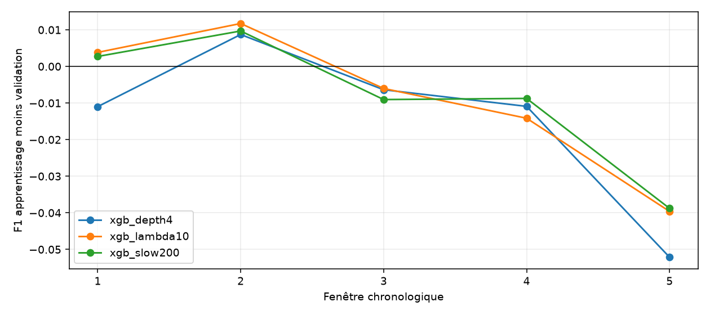
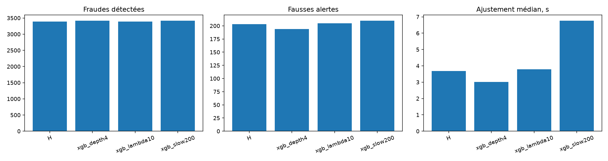

# Lot 4.4 : réglages XGBoost avec les variables de H

Les configurations des deux familles ont été figées dans [le protocole](ML_PROTOCOL.md) avant les nouveaux scores. Seules les quinze exécutions XGBoost ont commencé. CatBoost attend la discussion. H est réutilisée sans réentraînement. Les métriques d'apprentissage de H n'avaient pas été enregistrées ; son écart apprentissage/validation est donc non disponible.

## Moyennes des cinq validations

Les moyennes sont arithmétiques et distinctes des effectifs cumulés. Les cinq fenêtres se recouvrent par l'apprentissage et ne forment pas cinq expériences indépendantes.

| Configuration | Précision | Rappel | F1 | F1 min | Écart-type F1 |
| --- | ---: | ---: | ---: | ---: | ---: |
| H | 0.9456 | 0.8510 | 0.8948 | 0.8622 | 0.0319 |
| xgb_depth4 | 0.9469 | 0.8583 | 0.9000 | 0.8731 | 0.0280 |
| xgb_lambda10 | 0.9452 | 0.8514 | 0.8953 | 0.8605 | 0.0302 |
| xgb_slow200 | 0.9439 | 0.8587 | 0.8988 | 0.8654 | 0.0281 |

## Fenêtres, seuils et apprentissage

Chaque seuil maximise F1 sur la réserve interne seulement. Les prévalences sont `fraudes / transactions`. Les métriques d'apprentissage emploient ce même seuil, choisi après l'ajustement.

| Config | Fen. | Seuil | P val | R val | F1 val | P app. | R app. | F1 app. | Prév. app. % | Prév. val % |
| --- | ---: | ---: | ---: | ---: | ---: | ---: | ---: | ---: | ---: | ---: |
| xgb_depth4 | 1 | 0.376377 | 0.9092 | 0.8460 | 0.8764 | 0.8984 | 0.8348 | 0.8655 | 0.086 | 0.062 |
| xgb_depth4 | 2 | 0.528298 | 0.9536 | 0.8052 | 0.8731 | 0.9403 | 0.8303 | 0.8819 | 0.108 | 0.073 |
| xgb_depth4 | 3 | 0.401575 | 0.9213 | 0.8889 | 0.9048 | 0.9356 | 0.8642 | 0.8985 | 0.087 | 0.060 |
| xgb_depth4 | 4 | 0.480804 | 0.9548 | 0.8560 | 0.9027 | 0.9463 | 0.8432 | 0.8918 | 0.083 | 0.102 |
| xgb_depth4 | 5 | 0.332229 | 0.9956 | 0.8953 | 0.9428 | 0.9203 | 0.8628 | 0.8907 | 0.077 | 1.374 |
| xgb_lambda10 | 1 | 0.287370 | 0.8665 | 0.8547 | 0.8605 | 0.8658 | 0.8629 | 0.8644 | 0.086 | 0.062 |
| xgb_lambda10 | 2 | 0.539029 | 0.9445 | 0.8088 | 0.8714 | 0.9362 | 0.8358 | 0.8831 | 0.108 | 0.073 |
| xgb_lambda10 | 3 | 0.539366 | 0.9412 | 0.8672 | 0.9027 | 0.9521 | 0.8474 | 0.8967 | 0.087 | 0.060 |
| xgb_lambda10 | 4 | 0.645145 | 0.9766 | 0.8429 | 0.9048 | 0.9631 | 0.8283 | 0.8906 | 0.083 | 0.102 |
| xgb_lambda10 | 5 | 0.485951 | 0.9970 | 0.8835 | 0.9368 | 0.9530 | 0.8476 | 0.8972 | 0.077 | 1.374 |
| xgb_slow200 | 1 | 0.306744 | 0.8764 | 0.8547 | 0.8654 | 0.8746 | 0.8618 | 0.8681 | 0.086 | 0.062 |
| xgb_slow200 | 2 | 0.541714 | 0.9477 | 0.8171 | 0.8776 | 0.9385 | 0.8413 | 0.8872 | 0.108 | 0.073 |
| xgb_slow200 | 3 | 0.451436 | 0.9356 | 0.8862 | 0.9102 | 0.9434 | 0.8625 | 0.9012 | 0.087 | 0.060 |
| xgb_slow200 | 4 | 0.550394 | 0.9611 | 0.8536 | 0.9042 | 0.9576 | 0.8408 | 0.8954 | 0.083 | 0.102 |
| xgb_slow200 | 5 | 0.583405 | 0.9985 | 0.8822 | 0.9368 | 0.9614 | 0.8424 | 0.8980 | 0.077 | 1.374 |

### Écarts à H sur les mêmes fenêtres

Un écart positif de F1 ou de TP et un écart négatif de FP n'ont pas la même signification. Les seuils diffèrent entre H et chaque variante.

| Config | Fen. | ΔP | ΔR | ΔF1 | ΔTP | ΔFP | F1 H |
| --- | ---: | ---: | ---: | ---: | ---: | ---: | ---: |
| xgb_depth4 | 1 | 0.0393 | -0.0099 | 0.0136 | -8 | -35 | 0.8629 |
| xgb_depth4 | 2 | -0.0043 | 0.0214 | 0.0110 | 18 | 4 | 0.8622 |
| xgb_depth4 | 3 | -0.0065 | 0.0000 | -0.0031 | 0 | 5 | 0.9080 |
| xgb_depth4 | 4 | -0.0191 | 0.0107 | -0.0023 | 9 | 15 | 0.9050 |
| xgb_depth4 | 5 | -0.0029 | 0.0144 | 0.0068 | 11 | 2 | 0.9360 |
| xgb_lambda10 | 1 | -0.0035 | -0.0012 | -0.0023 | -1 | 3 | 0.8629 |
| xgb_lambda10 | 2 | -0.0134 | 0.0249 | 0.0092 | 21 | 11 | 0.8622 |
| xgb_lambda10 | 3 | 0.0133 | -0.0217 | -0.0053 | -16 | -11 | 0.9080 |
| xgb_lambda10 | 4 | 0.0026 | -0.0024 | -0.0002 | -2 | -2 | 0.9050 |
| xgb_lambda10 | 5 | -0.0015 | 0.0026 | 0.0008 | 2 | 1 | 0.9360 |
| xgb_slow200 | 1 | 0.0065 | -0.0012 | 0.0025 | -1 | -6 | 0.8629 |
| xgb_slow200 | 2 | -0.0103 | 0.0333 | 0.0154 | 28 | 9 | 0.8622 |
| xgb_slow200 | 3 | 0.0078 | -0.0027 | 0.0023 | -2 | -6 | 0.9080 |
| xgb_slow200 | 4 | -0.0128 | 0.0083 | -0.0009 | 7 | 10 | 0.9050 |
| xgb_slow200 | 5 | 0.0000 | 0.0013 | 0.0007 | 1 | 0 | 0.9360 |

Un écart peut aussi provenir du changement de prévalence et de période ; il ne prouve pas seul un surapprentissage.

## Alertes et coûts

| Config | Fen. | Alertes | TP | FP | FN | TN | Fit s | Préd. val s | Total s | Pic Gio | Taille Mio |
| --- | ---: | ---: | ---: | ---: | ---: | ---: | ---: | ---: | ---: | ---: | ---: |
| xgb_depth4 | 1 | 749 | 681 | 68 | 124 | 1287266 | 1.12 | 0.17 | 5.04 | 1.42 | 0.12 |
| xgb_depth4 | 2 | 711 | 678 | 33 | 164 | 1159705 | 1.55 | 0.15 | 4.66 | 1.97 | 0.12 |
| xgb_depth4 | 3 | 712 | 656 | 56 | 82 | 1226947 | 3.01 | 0.16 | 6.35 | 2.36 | 0.12 |
| xgb_depth4 | 4 | 753 | 719 | 34 | 121 | 821485 | 4.02 | 0.11 | 7.56 | 2.35 | 0.12 |
| xgb_depth4 | 5 | 687 | 684 | 3 | 80 | 54853 | 5.52 | 0.01 | 9.16 | 2.83 | 0.13 |
| xgb_lambda10 | 1 | 794 | 688 | 106 | 117 | 1287228 | 1.16 | 0.23 | 4.10 | 1.99 | 0.14 |
| xgb_lambda10 | 2 | 721 | 681 | 40 | 161 | 1159698 | 1.76 | 0.20 | 5.15 | 1.78 | 0.14 |
| xgb_lambda10 | 3 | 680 | 640 | 40 | 98 | 1226963 | 3.78 | 0.25 | 8.23 | 1.98 | 0.14 |
| xgb_lambda10 | 4 | 725 | 708 | 17 | 132 | 821502 | 4.76 | 0.14 | 8.98 | 2.46 | 0.15 |
| xgb_lambda10 | 5 | 677 | 675 | 2 | 89 | 54854 | 6.33 | 0.01 | 10.39 | 2.14 | 0.16 |
| xgb_slow200 | 1 | 785 | 688 | 97 | 117 | 1287237 | 2.36 | 0.46 | 5.98 | 2.45 | 0.29 |
| xgb_slow200 | 2 | 726 | 688 | 38 | 154 | 1159700 | 3.70 | 0.42 | 7.86 | 1.67 | 0.30 |
| xgb_slow200 | 3 | 699 | 654 | 45 | 84 | 1226958 | 6.77 | 0.48 | 11.85 | 1.90 | 0.32 |
| xgb_slow200 | 4 | 746 | 717 | 29 | 123 | 821490 | 9.30 | 0.32 | 14.76 | 2.63 | 0.32 |
| xgb_slow200 | 5 | 675 | 674 | 1 | 90 | 54855 | 12.22 | 0.02 | 18.17 | 1.96 | 0.33 |

Les cumuls de la référence H et des variantes sont :

| Config | TP | FP | FN | Alertes | Fit médian s | Taille médiane Mio |
| --- | ---: | ---: | ---: | ---: | ---: | ---: |
| H | 3388 | 203 | 601 | 3591 | 3.69 | 0.16 |
| xgb_depth4 | 3418 | 194 | 571 | 3612 | 3.01 | 0.12 |
| xgb_lambda10 | 3392 | 205 | 597 | 3597 | 3.78 | 0.14 |
| xgb_slow200 | 3421 | 210 | 568 | 3631 | 6.77 | 0.32 |

## Lecture provisoire

Parmi les quatre configurations XGBoost, `xgb_depth4` a le F1 moyen le plus élevé (0,9000 contre 0,8948 pour H), le meilleur minimum (0,8731 contre 0,8622), 30 TP de plus et 9 FP de moins. Le F1 baisse toutefois légèrement face à H dans les fenêtres 3 et 4. `xgb_lambda10` varie peu en moyenne et baisse dans trois fenêtres. `xgb_slow200` se rapproche de `depth4`, mais son ajustement médian est plus long et son modèle médian plus gros. Avec la règle préannoncée et les seules configurations XGBoost, `xgb_depth4` est le candidat provisoire : plusieurs moyennes sont à moins de 0,005 du meilleur, puis son F1 minimum est le plus haut. La sélection globale attend les variantes CatBoost et la discussion avec l'utilisateur.

## Limites et suite

La règle de sélection complète attend CatBoost. Les seuils sont réestimés par configuration. Les mesures de coût proviennent d'exécutions séparées et ne constituent pas un benchmark contrôlé de vitesse. Le pic RSS est échantillonné et peut manquer un pic bref. Ratio montant/solde et heure peuvent refléter des signatures du simulateur. Les validations ont déjà guidé plusieurs choix ; les labels du test ont été examinés en EDA, sans score du test 505 à 743 ici. Aucune généralisation réelle ni modèle final ne sont annoncés.

Réexécution locale : `python scripts/run_ml_tune_h_xgboost_all.py`, puis `python scripts/report_ml_tune_h_xgboost.py`, avec les prérequis du README. Aucun fichier de transaction ni prédiction individuelle n'est publié.
